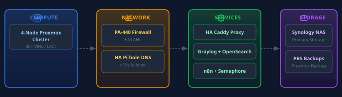

## Welcome

I'm Mario, a Network Security Engineer at Palo Alto Networks. At work, I manage one of our largest SASE deployments, with 100K+ users across 34 regions. At home, I run 50+ services on a 4-node Proxmox cluster. This is where I write about securing it, watching for failures, and using AI to automate parts of the work.

I use [Claude Code](https://claude.ai/code) to help build the site and work on diagrams, banners, and some of the writing. Part of the experiment is seeing where AI actually helps with technical documentation. [Resume →](https://mareox.github.io/resume)

---

## What's Running

---

## Featured Content

### [Wazuh XDR Implementation]()
I set up Wazuh for open-source threat detection and response, then sent its alerts to Graylog.

### [4-Layer Agentic Architecture]()
How I split AI-assisted automation into Justfile recipes, commands, skills, and agents. Each layer has one job.

### [PAN-OS Certificate Automation]()
How I automated certificate management for the firewall and reverse proxy.

---

## Explore by Interest

**[I want to understand how something works →]()**
Reference notes on security, networking, infrastructure, automation, observability, and AI tooling.

**[I want to follow a step-by-step guide →]()**
Detailed tutorials with prerequisites, verification steps, and troubleshooting tips.

**[I want to read lessons learned →]()**
What I built, what broke, and what I learned fixing it.
