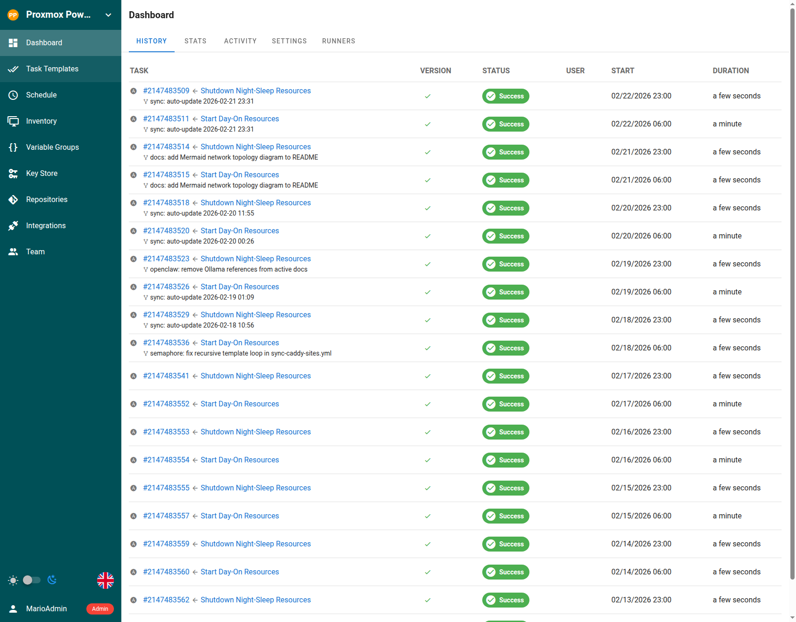

## What Changed

I didn't need every VM running overnight. I added two Ansible playbooks in Semaphore to shut down nonessential VMs and LXC containers gracefully, then start them again in the morning. That cuts power use and wear on the hardware.

## Details

Semaphore runs `night-sleep.yml` and `day-on.yml` on a cron schedule. Both use a central Proxmox API host for cluster-wide operations.

The scheduler has its own time zone. It ignores the container's `TZ` setting, so I set `SEMAPHORE_SCHEDULE_TIMEZONE=America/Los_Angeles`. Without it, the jobs run in UTC.

## Result

Nonessential services sleep from 11 PM to 7 AM Pacific. DNS, the reverse proxy, and backups keep running.

*The Semaphore dashboard shows several weeks of successful shutdown and startup runs.*
