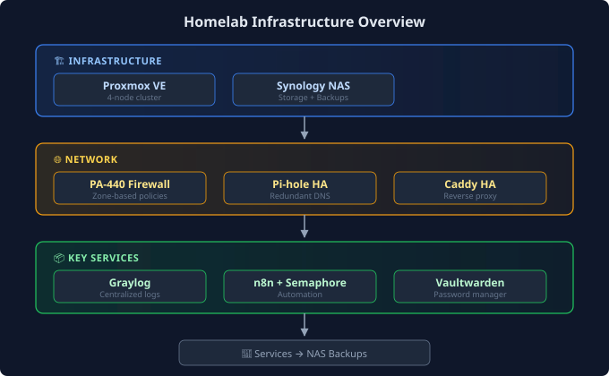

## The Beginning

I put Pi-hole on a Raspberry Pi three years ago because I was tired of ads on my smart TV.

Today, the lab runs a 4-node Proxmox cluster with 50+ containers, enterprise-grade networking, centralized logging, and more automation than I probably need. I figured it was time to write some of it down.

## Why Document This?

I've learned more from random blog posts than from official documentation. The morning after a 2 AM troubleshooting session, someone writes down what worked. Those posts have saved me countless hours. I'd like to return the favor.

I've also lost count of how many times I've had to relearn something because I didn't write it down. This journal is insurance against future amnesia.

## What's Running

## What to Expect

This journal has four sections:

| Section | Content |
|---------|---------|
| **[Wiki]()** | Reference notes on what things do and how they work |
| **[Tutorials]()** | Step-by-step guides |
| **[Journal]()** | Short entries on what I changed and when |
| **[Posts]()** | Longer write-ups, lessons learned, and postmortems |

## Security Note

I use placeholders for IP addresses, domains, and credentials in examples. Use your own values when following a guide.

## Let's Go

Thanks for stopping by. I hope a post saves you a few hours or gives you something to try in your own lab.

---

*First post done. Now to write the interesting stuff.*
