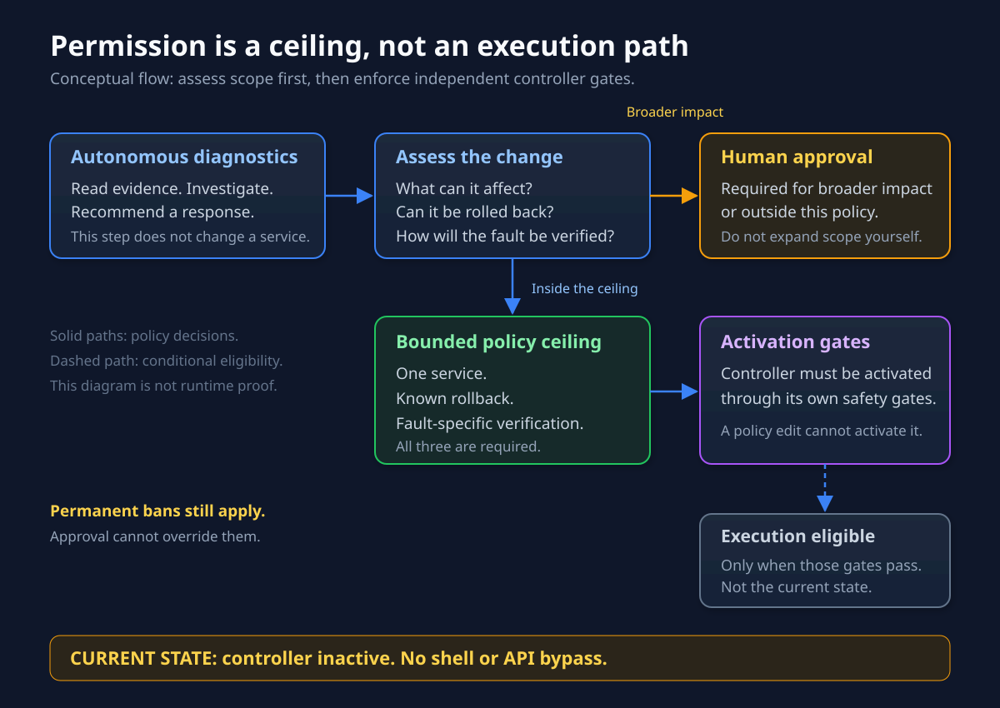
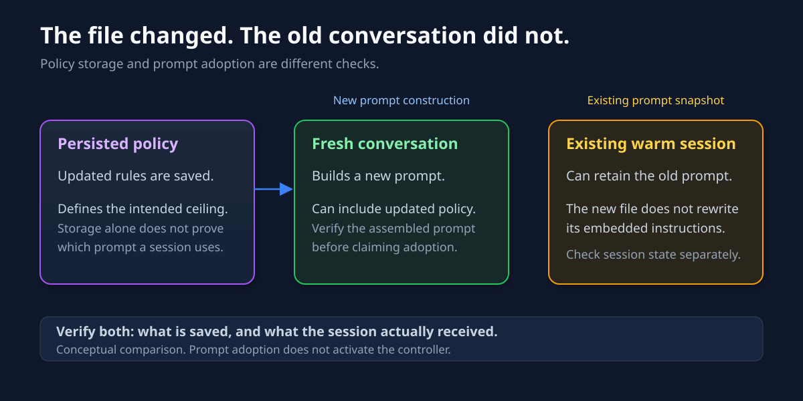
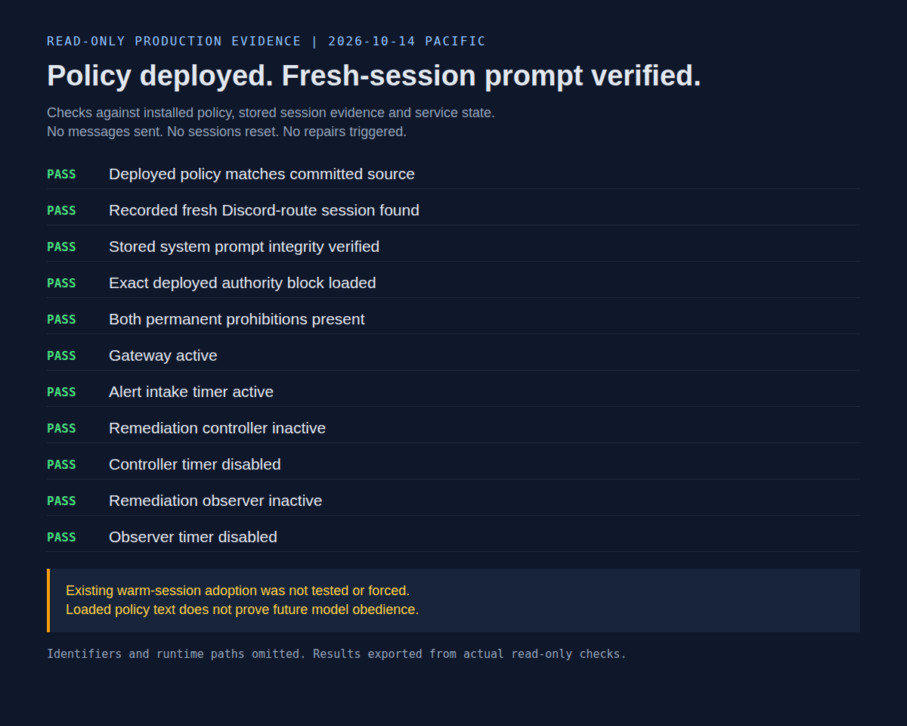

Changing my AI admin's rules should have been straightforward: save the policy, deploy it, restart the gateway. Then I traced how an existing conversation restores its instructions: it can reuse its stored prompt instead of loading the new policy file. Apparently Gilfoyle had a way to keep outdated management instructions. Very on brand.

When I [introduced Gilfoyle in April](), he was an observer. He watched services, investigated alerts, and told me what broke. By October, his policy carried an Admin label. The interesting work became deciding exactly what that label allowed, then checking which conversations actually loaded those rules.

## The badge was too vague

“Admin” describes access. It does not tell an assistant whether restarting a service is acceptable while somebody else is working on it, whether a rollback is feasible, or whether the apparently local problem affects shared storage.

I kept Gilfoyle as the independent production incident owner and narrowed the unattended repair ceiling: **one identified service, a known feasible rollback, and verification tied to the original fault**. Broader changes need fresh approval where the policy permits them. That includes hosts, networking, high availability, storage, multi-service changes, irreversible actions, uncertain impact, and work that could interrupt another active session. Permanent deletion bans still apply, even with approval.

I chose that boundary because asking for every diagnostic wastes time, while treating technical access as blanket permission creates problems faster than monitoring can find them.

There is another limit beneath the policy. The deterministic remediation controller is the sole executor and action-ledger writer for eligible autonomy runbooks. Registry membership alone does not establish eligibility. **It remains inactive.** Installing the narrower policy did not activate repairs, change credentials, or enable schedules. An inactive controller means investigate, report, and recommend. It does not mean improvise the same action through a shell or API.

These instructions define behavior. They are not a claim of operating-system isolation or proof that every possible action is technically blocked.

## Two failed fixes still means two

An incident also needs continuity. If Gilfoyle investigates a fault and hands evidence to another assistant, the same incident must retain its attempted actions, results, rollback evidence, and attempt count.

The second failed fix freezes that incident and brings me back in. Switching assistants does not buy another two attempts. Otherwise, delegation becomes a loyalty program for repeated mistakes.

Missing or conflicting history means diagnosis only. This is an operating rule carried through the incident record, not a new atomic coordination system across machines.

## The file changed. The conversation did not.

On October 14, I deployed the committed policy with a retained preimage and restarted the gateway. That proved the file was installed and the process was running. It did not prove what every conversation would use.

The runtime restores an existing conversation's stored system prompt when its runtime identity still matches. Changing the policy file alone does not invalidate that identity. **A warm conversation can therefore keep the earlier policy**, even after a gateway restart. A new session, identity change, capability rebuild, or compression can refresh it.

I checked a fresh turn through the real Discord route. Its persisted system prompt contained the exact deployed authority block and permanent hard rules. That was evidence of adoption by that session. I did not reset existing conversations or claim they had all adopted the change.

The screenshot checks stored evidence without sending another message or triggering a repair. Matching text proves the policy was loaded; it does not prove the model will obey it in every future situation.

## What I would check next time

There are three separate questions: did the configuration reach disk, did the running process see it, and did the session actually load it?

I used to treat those as one deployment check. They are separate acceptance gates, and a green answer to the first two can hide an old prompt behind the third.

The useful upgrade here is a clearer contract and a more honest verification step. Keep diagnostics useful, make repair authority specific, preserve failed attempts across handoffs, and verify the rules at the point where decisions happen.

Gilfoyle still gets to be paranoid. Now the paperwork is more precise.

For the earlier incident story, see [how a certificate flap became a VPN automation project]().

For the complete system around those guardrails, see [How Gilfoyle Works](): alert intake, investigations, tools, context, memory, and scheduling.
