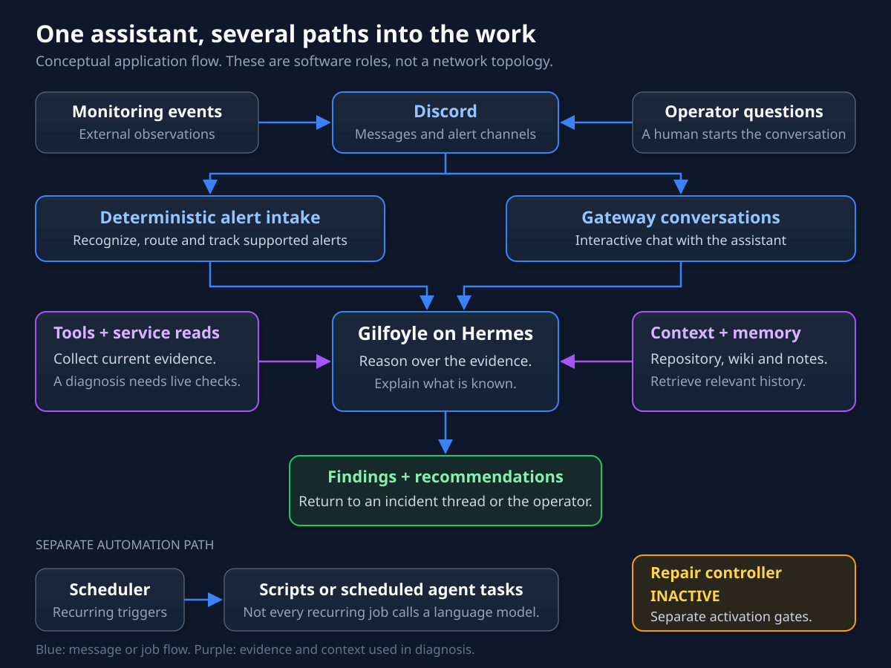
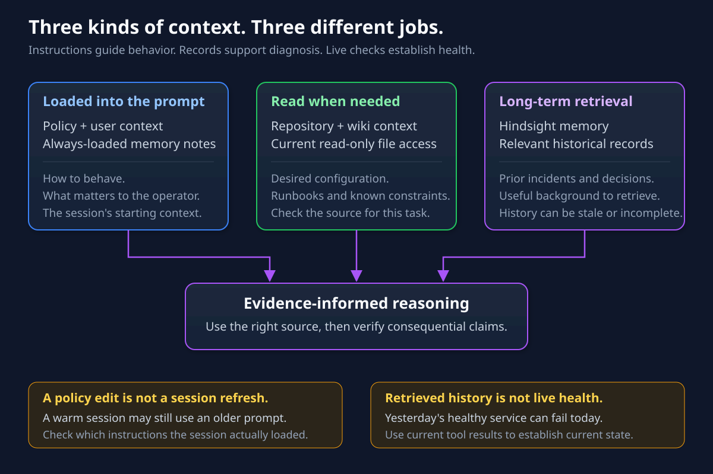
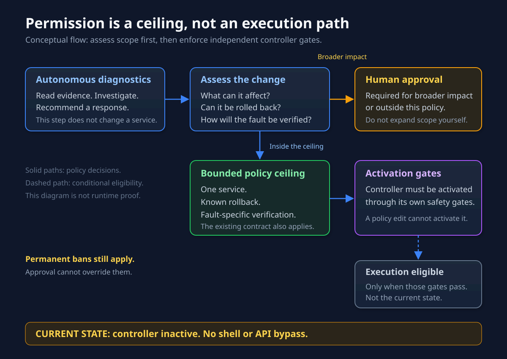
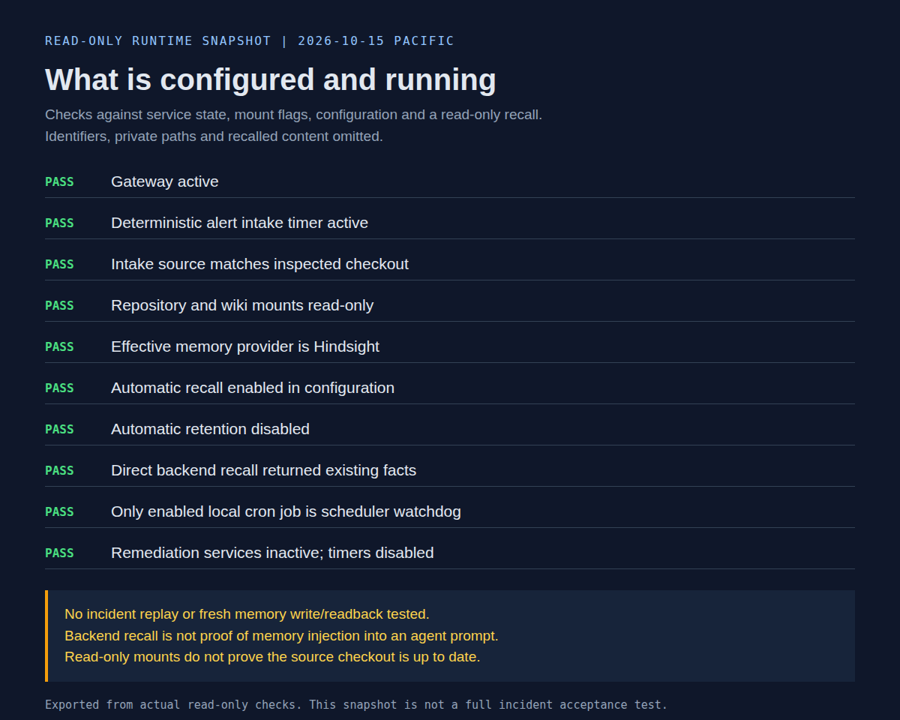

An infrastructure alert lands in Discord. Turning it into a useful response takes more than adding an LLM: something has to decide whether the message belongs in the queue, collect evidence, preserve the incident context, and know when to stop.

That is the machinery around Gilfoyle. [The original introduction]() covered the April rollout. This is the current system, checked on October 15: how a signal reaches him, how he investigates, and which parts run without asking a model anything.

## One profile, several supporting systems

Hermes Agent supplies the gateway, conversation state, and tool loop. Gilfoyle's profile supplies the operating instructions, personality, and skills for infrastructure work.

Monitoring systems produce alerts. Discord carries the messages and responses. Tools supply observations. Repository files describe intended configuration. Memory supplies earlier decisions. A job scheduler runs recurring work. Each has a different job, and the connections matter more than the model's name.

The usual result is an evidence-backed finding or recommendation anchored to the source incident. Repair execution has its own boundary, described below.

## Two ways into the investigation

**The gateway handles conversations.** Its channel, user, mention, and thread rules decide which messages enter the conversational path. A follow-up in an existing joined thread can continue without another mention. That does not mean every automation message is guaranteed a useful response.

**A separate deterministic poller covers supported automation alerts.** It runs every minute, outside Hermes cron, and excludes the gateway's free-response channels to reduce duplicate handling. This path checks known bot and webhook producers, ignores Gilfoyle's own output and human chatter, and applies keyword-based severity rules. Warning and critical candidates can reach the model; informational noise does not automatically buy an investigation.

Those producer checks belong to the poller. The gateway has separate admission rules, so an allowlist on one path is not a security guarantee for every Discord message.

The poller carries the source-message reference into the request and asks Gilfoyle to follow the alert-correlation skill. That skill calls for lighter investigation of warnings and deeper correlation of critical findings. Related failures can be grouped instead of producing a separate diagnosis for every symptom.

Here, the division is useful: deterministic code handles selection and bookkeeping; the model interprets evidence.

## The model asks; tools bring back observations

Hermes runs the conversation and tool loop: the model requests a tool call, the tool returns a result, and the model uses that result to continue investigating or answer.

Gilfoyle's infrastructure skill uses the **homelab-mcp CLI** through the terminal tool. Despite the name, the current path is a CLI, rather than the retired REST layer described in early material. It exposes structured queries for metrics, logs, inventory, backup state, and job results. [The integration article]() covers that shared interface.

There is also a small registered-probe path. The skill directs registered services through their known probe. For unregistered services, it directs investigation back to repository and wiki evidence; inventing a probe URL is prohibited. Coverage is limited. A passing HTTP status proves the endpoint answered as expected; it does not establish that storage is mounted or the service's real task succeeded.

These skills guide the model. They are not a universal router that forces every possible terminal command through a narrow API. Broader terminal access still needs the operating policy and approval controls.

## Three kinds of context

| Source | What it contributes |
|---|---|
| Policy and compact notes | Operating rules, recurring user context, and compact memory supplied to the conversation |
| Repository and wiki files | Configuration, runbooks, service history, and other files read through read-only SSHFS mounts |
| Hindsight | Longer-lived facts retrieved from the shared memory service, with explicit retention |

The current profile enables automatic Hindsight recall and disables automatic retention. Saving durable facts is an explicit operation. Credentials read for operational work must stay out of reports and memory.

Two limits matter. A read-only mount protects those files from edits through that mount; it does not sandbox the entire agent. It also serves what the source checkout contains, which may lag upstream until that checkout is updated.

Memory has a similar boundary. A remembered decision gives context for a check. Today's service state still comes from today's observations. And changing a policy file does not necessarily rebuild an existing conversation's stored prompt, as [the authority chapter explains]().

## The scheduler is a separate part of the system

Production patrols, reports, and audits belong to the Ansible job scheduler. Some jobs are deterministic scripts; others invoke the agent. A schedule is therefore not synonymous with an LLM conversation.

Gilfoyle's Hermes cron keeps the documented watchdog that watches the scheduler itself. The alert poller's minute timer is separate again. This avoids asking the scheduler to be the only mechanism that notices its own failure.

For poller-triggered investigations, the wrapper delivers the final response as a reply to the original alert. It tracks processed messages and channel cursors, batches candidates, and retries failed batches. Repeated triage failure ends in a manual-review request. Those delivery retries are separate from repair attempts.

## Investigation stops short of automatic repair

Gilfoyle remains the production incident owner. His policy requires the same incident, attempted actions, outcomes, rollback evidence, and repair-attempt count to survive assistant handoffs. A second failed fix freezes that incident and brings me back in. Switching assistants does not reset the count.

The unattended repair ceiling is one identified service, a known feasible rollback, and fault-specific verification, within the existing operating contract. Broader or uncertain impact needs fresh approval where the policy permits it. Permanent bans remain absolute.

The deterministic controller is the sole executor and action-ledger writer for eligible autonomy runbooks. **It is currently inactive, with its timer disabled.** A policy ceiling is not an activated repair system. Assistant-initiated unattended work stays at diagnosis, reporting, and recommendations, with no substitute shell or API repair path. Separately approved maintenance jobs keep their own contracts.

## What the runtime check actually proves

The read-only inspection confirmed the gateway and intake timer were active, repository context mounts were read-only, Hindsight was configured, and remediation remained inactive. A direct backend recall retrieved existing facts. That did not test native agent prompt injection or storing and recalling a fresh memory.

No new alert was injected and no end-to-end incident replay was run for this article. An active timer also does not prove every scheduled job completed successfully.

The transferable design is the separation of responsibilities: code handles intake and delivery state, tools supply observations, the model interprets them, and repair authority stays explicit. Each connection needs its own evidence. A convincing paragraph from the bot is only one part of that evidence.
