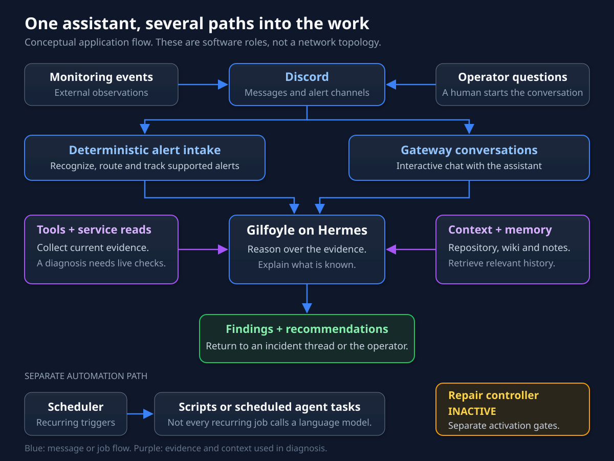
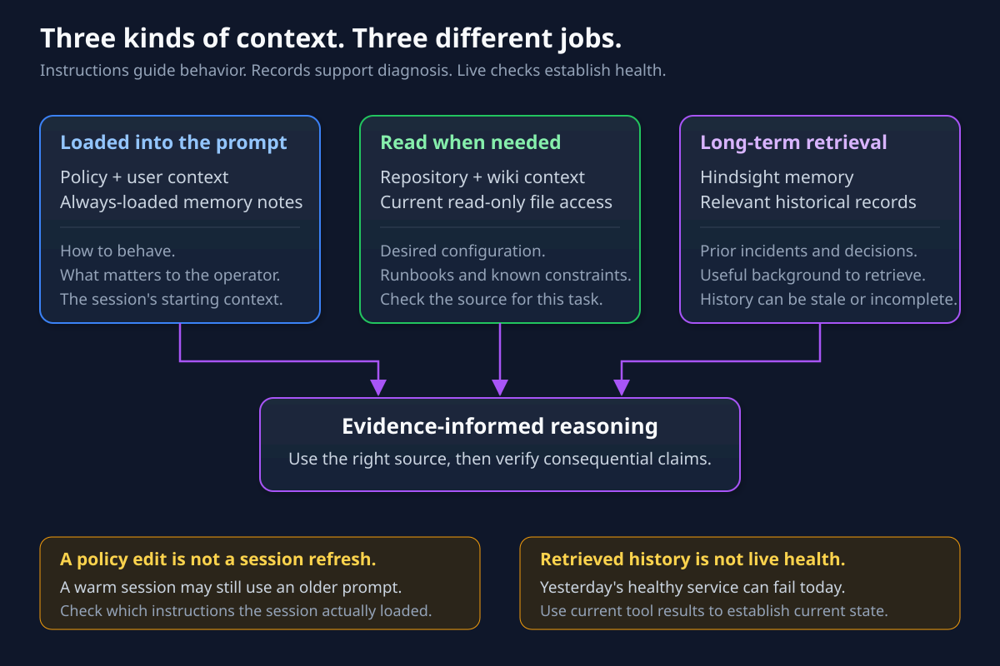
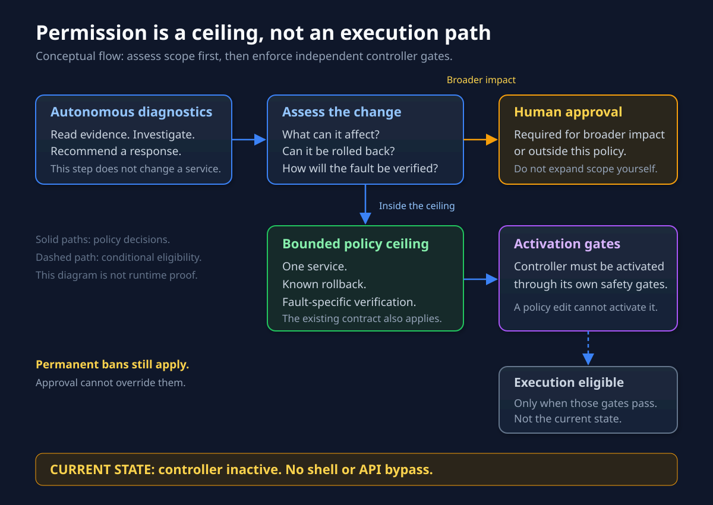
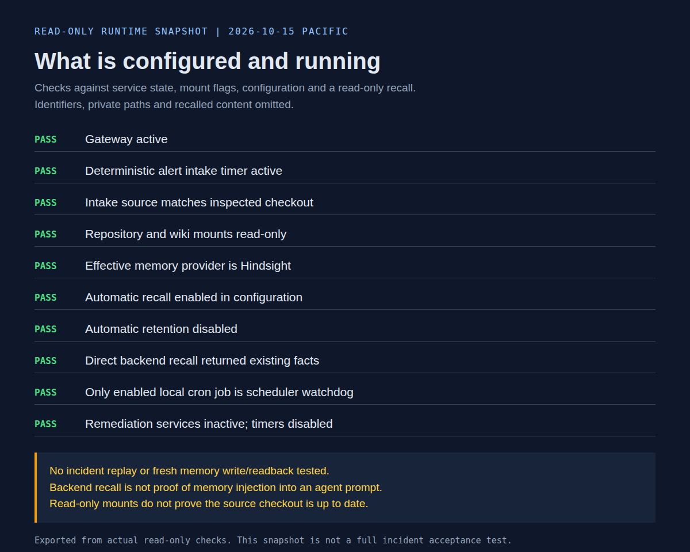

An infrastructure alert lands in Discord. Before Gilfoyle can diagnose anything, code has to decide whether the alert belongs in the queue. The investigation then needs evidence, a record of what's already happened, and a rule for when to stop.

[The original introduction]() covered the April rollout. On October 15, I checked how a signal reaches Gilfoyle, how he investigates it, and which parts run without a model.

## One profile, several supporting systems

Hermes Agent supplies the gateway, conversation state, and tool loop. Gilfoyle's profile supplies the operating instructions, personality, and skills for infrastructure work.

Monitoring systems produce alerts, and Discord carries the messages and replies. Tools return observations from the lab. The repository holds the intended configuration, memory recalls earlier decisions, and the scheduler runs recurring jobs.

Gilfoyle usually replies with a finding or recommendation backed by evidence from the incident. A separate policy governs repairs.

## Two ways into the investigation

**The gateway handles conversations.** Its channel, user, mention, and thread rules decide which messages enter the conversational path. A follow-up in an existing joined thread can continue without another mention. That does not mean every automation message is guaranteed a useful response.

**A separate deterministic poller covers supported automation alerts.** It runs every minute outside Hermes cron and skips the gateway's free-response channels to reduce duplicate handling. It checks known bot and webhook producers, ignores Gilfoyle's own output and human chatter, and uses keywords to assign severity. Warning and critical candidates can reach the model. Informational alerts don't automatically reach the model.

Those producer checks belong to the poller. The gateway has separate admission rules, so an allowlist on one path is not a security guarantee for every Discord message.

The poller carries the source-message reference into the request and asks Gilfoyle to follow the alert-correlation skill. That skill calls for lighter investigation of warnings and deeper correlation of critical findings. Related failures can be grouped instead of producing a separate diagnosis for every symptom.

## The model asks; tools bring back observations

Hermes runs the conversation and tool loop. The model requests a tool call, reads the result, and decides whether to keep investigating or answer.

Gilfoyle's infrastructure skill calls the **homelab-mcp CLI** through the terminal tool. Earlier versions used a REST layer. The CLI exposes structured queries for metrics, logs, inventory, backup state, and job results. [The integration article]() covers that shared interface.

The skill uses known probes for registered services and sends Gilfoyle back to the repository and wiki for anything else. He cannot make up a probe URL. Even for those services, a passing HTTP status tells me that the endpoint answered as expected. I still need evidence that storage is mounted or the service's real task ran.

The skills guide the model's choice of tools. The operating policy and approval controls govern broader terminal access, which can reach beyond the CLI.

## Three kinds of context

| Source | What it contributes |
|---|---|
| Policy and compact notes | Operating rules, recurring user context, and compact memory supplied to the conversation |
| Repository and wiki files | Configuration, runbooks, service history, and other files read through read-only SSHFS mounts |
| Hindsight | Longer-lived facts retrieved from the shared memory service, with explicit retention |

The current profile enables automatic Hindsight recall and disables automatic retention. Saving durable facts is an explicit operation. Credentials read for operational work must stay out of reports and memory.

The read-only mount prevents edits through that mount. The rest of the agent has its own access rules. Gilfoyle also reads whatever the source checkout contains, so he may see an older version until someone updates it.

Memory has a similar boundary. A remembered decision gives context for a check. Today's service state still comes from today's observations. And changing a policy file does not necessarily rebuild an existing conversation's stored prompt, as [the authority chapter explains]().

## The scheduler is a separate part of the system

The Ansible job scheduler handles production patrols, reports, and audits. Some jobs run scripts. Others invoke the agent.

Hermes cron still runs the documented watchdog that checks the scheduler. The alert poller uses its own minute timer. If the scheduler goes down, another process can notice.

For poller-triggered investigations, the wrapper delivers the final response as a reply to the original alert. It tracks processed messages and channel cursors, batches candidates, and retries failed batches. Repeated triage failure ends in a manual-review request. Those delivery retries are separate from repair attempts.

## Investigation stops short of automatic repair

Gilfoyle remains the production incident owner. His policy requires the same incident, attempted actions, outcomes, rollback evidence, and repair-attempt count to survive assistant handoffs. A second failed fix freezes that incident and brings me back in. Switching assistants does not reset the count.

The unattended repair ceiling is one identified service, a known feasible rollback, and fault-specific verification, within the existing operating contract. Broader or uncertain impact needs fresh approval where the policy permits it. Permanent bans remain absolute.

The deterministic controller is the sole executor and action-ledger writer for eligible autonomy runbooks. **The controller is inactive and its timer is disabled.** For unattended work, Gilfoyle can diagnose, report, and recommend. He cannot use a shell or API as a substitute repair path. Separately approved maintenance jobs keep their own contracts.

## What the runtime check actually proves

In the read-only inspection, I found an active gateway and intake timer, read-only repository mounts, a configured Hindsight backend, and an inactive remediation controller. I retrieved existing facts directly from the backend. I did not test native agent prompt injection or the round trip of saving and recalling a fresh memory.

I did not inject a new alert or replay an incident end to end. The timer was active when I checked. Individual job results would need a separate check.

To verify a diagnosis, I need to trace the path from the source alert through intake and tool results to the reply. A convincing paragraph from the bot is evidence of what it reported. The checks at each handoff tell me whether I can trust it.
