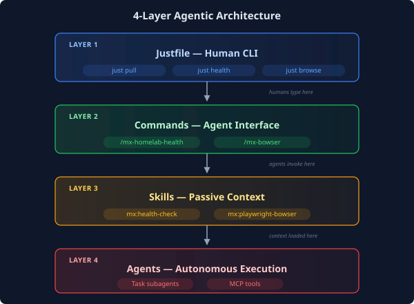

## The Problem

After months of building Claude Code agents, skills, commands, hooks, and MCP servers, I kept hitting a basic problem: I couldn't tell where to start. Pulling all repos meant finding a shell script. Checking infrastructure health meant asking Claude and hoping it picked the right command. A browser task meant deciding between the MCP plugin and a script.

## The Inspiration

IndyDevDan's [Bowser framework](https://github.com/ATheorel/bowser) gave me a way to organize the tools. Each layer has one job, and you can start at whichever layer fits the task. Bowser uses that pattern for browser automation. I used it for the rest of my workspace.

## The Architecture



### Layer 1: Justfile (Human CLI)

[Just](https://github.com/casey/just) is a command runner that feels like `make` without the build system. A single `justfile` at the workspace root wraps my shell scripts and adds a few utilities:

```bash
just pull        # Start of session - pull all repos
just end         # End of session - audit + commit + push
just status      # Show repos with uncommitted changes
just health      # List infrastructure health check stories
just browse      # List browser automation stories
```

I could start using one command list without migrating the scripts. `just pull` still calls `./start-pull-all-repos.sh`.

### Layer 2: Commands (Agent Interface)

Commands are Markdown files with YAML frontmatter. They give Claude an ordered set of steps for a task:

- `/mx-homelab-health pihole-ha`: Parse a YAML health check story, SSH into servers, run checks, report pass/fail
- `/mx-bowser homelab-services`: Parse a browser story YAML, write Playwright scripts, execute, report results

The commands also tell the agent how to report results.

### Layer 3: Skills (Passive Context)

Claude loads skills when it detects a relevant task. These two tell it which tools and patterns are available:

- `mx:health-check` triggers on "homelab health", "service status". Tells Claude about the YAML story system.
- `mx:playwright-bowser` triggers on "browse website", "take screenshot". Tells Claude to prefer CLI over MCP.

### Layer 4: Agents (Autonomous Execution)

Claude executes the work through specialized subagents spawned by its Task tool, MCP server tools, or direct Bash commands. I already had all three. The upper layers give me clearer ways to reach them.

## YAML-Driven Stories

I use YAML stories for infrastructure checks and browser tests. The file lists the checks, and the orchestrator runs them.

### Infrastructure Health Checks

```yaml
name: pihole-ha
description: Pi-hole HA cluster health
severity: critical

targets:
  - host: <DNS-PRIMARY-IP>
    role: dns1
  - host: <DNS-SECONDARY-IP>
    role: dns2

checks:
  - name: FTL service running
    type: ssh_command
    command: "systemctl is-active pihole-FTL"
    expect: "active"
```

Four stories cover the critical infrastructure: Pi-hole HA, Caddy HA, Proxmox cluster, and Docker service stacks. Each story defines targets (hosts) and checks (commands with expected output).

<!-- SCREENSHOT: Terminal output of `just health pihole-ha` showing pass/fail results -->

### Browser Automation Stories

```yaml
name: homelab-services
description: Verify homelab web UIs are accessible

stories:
  - name: "n8n web UI loads"
    steps:
      - action: navigate
        url: "http://<DOCKER-HOST>:5678"
      - action: assert_title
        text: "n8n"
      - action: screenshot
        path: /tmp/pw-n8n.png
```

For browser work, the orchestrator reads the YAML, generates and runs a Playwright script, and reports results.

<!-- SCREENSHOT: Browser automation output showing Playwright test results with pass/fail per story step -->

## CLI-First Browser Automation

Bowser drew my attention to the token cost of MCP schemas. Every `browser_navigate`, `browser_click`, and `browser_snapshot` call brings the full tool schema into the conversation context.

For a sequence of browser steps, I can write a Playwright script to `/tmp/pw-task.mjs` and run it with `node`. The same engine runs in one Bash call instead of 5 to 10 MCP calls, which saves tokens.

```javascript
import { createRequire } from 'module';
const require = createRequire('<PLAYWRIGHT-INSTALL-PATH>');
const { chromium } = require('playwright');

const browser = await chromium.launch({ headless: true });
const page = await browser.newPage();
try {
  await page.goto('https://example.com');
  console.log(await page.title());
  await page.screenshot({ path: '/tmp/pw-result.png' });
} finally {
  await browser.close();
}
```

On WSL2, `npm install -g` needs root permissions. I keep Playwright in a local project directory and resolve it through Node's module system with `createRequire`.

I still use MCP when I need to inspect the DOM interactively or debug one step at a time.

## What I Learned

### Layers compose better than monoliths

Keeping the layers separate lets me add a health check or browser test with a YAML file. I can leave the skill code alone.

### Declarative beats imperative for story-driven automation

I can review a proposed check as a YAML diff, commit it with the rest of the project, and combine it with existing checks.

### Token efficiency matters in agentic workflows

For repetitive browser tasks such as navigating, clicking, filling, and asserting, I script the sequence and pay the tool-call overhead once.

### Wrap, don't replace

The justfile gave me a common entry point right away. I could keep calling the old scripts, so there was nothing to migrate.

## What's Next

The YAML story pattern could extend to:
- **Deployment validation stories**: verify a service is healthy after deploy
- **Security audit stories**: check SSL certs, open ports, firewall rules
- **Backup verification stories**: confirm backup freshness and restorability

Each would follow the same pattern: YAML definition, command orchestrator, skill for context, justfile recipe for humans.
