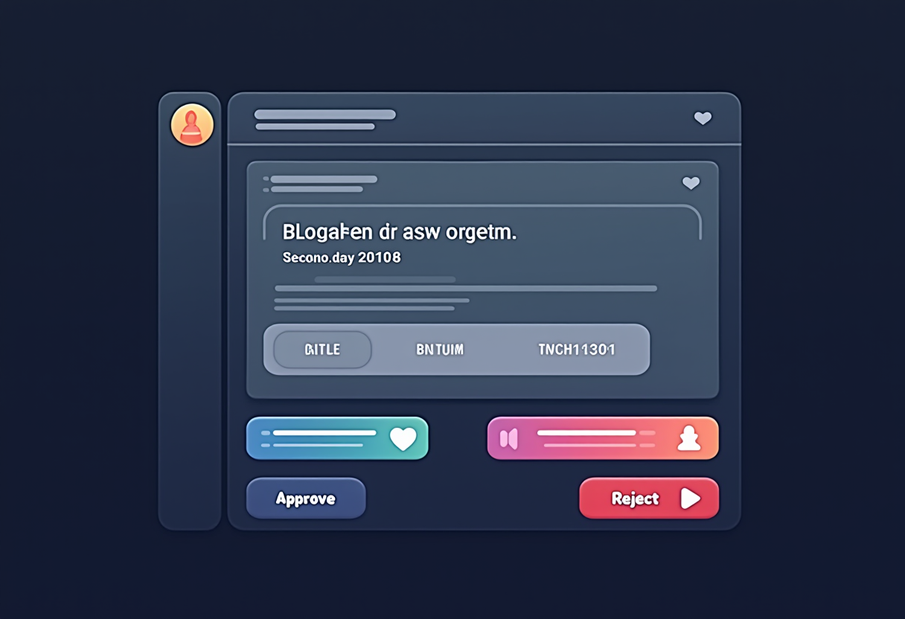

## The Challenge

Every time I fix something gnarly in the lab, I think, "I should write this up." A few weeks later I open a blank file and realize I've forgotten the exact error and the command that fixed it.

That kept happening after projects like deploying Wazuh XDR or migrating from Watchtower to WUD. By the time the services were up, I had no appetite for reconstructing the work, scrubbing private details, and formatting a post. The journal got maybe one post every few months. I needed to get a draft down while I still remembered the work.

## The Solution

I put the publishing steps behind one command. Here's how the pipeline worked when I built it:

1. The Claude Code skill (`/journal`) reads recent Git commits and asks a few questions before drafting.
2. A sanitizer replaces internal IPs, hostnames, and domains with placeholders.
3. Gemini CLI generates a cover.
4. I review the draft in Discord, where I can approve or reject it.
5. Approval opens a GitHub PR. Once it merges to main, Hugo builds the site and GitHub Pages deploys it.

My part takes about 5 minutes, mostly spent reading the draft.

## Architecture Overview

The draft and cover go to Discord before the bot opens a PR.

```text
┌─────────────────────────────────────────────────────────────┐
│                  Automated Blog Pipeline                     │
├─────────────────────────────────────────────────────────────┤
│                                                             │
│  ┌──────────────┐       ┌──────────────┐                   │
│  │ Git Commits  │──────▶│  /journal    │                   │
│  │  + Context   │       │    Skill     │                   │
│  └──────────────┘       └──────┬───────┘                   │
│                                │                            │
│                                ▼                            │
│                         ┌──────────────┐                    │
│                         │ Draft Post + │                    │
│                         │ Sanitization │                    │
│                         └──────┬───────┘                    │
│                                │                            │
│                                ▼                            │
│                         ┌──────────────┐                    │
│                         │ Cover Image  │                    │
│                         │  Generation  │                    │
│                         └──────┬───────┘                    │
│                                │                            │
│                                ▼                            │
│                         ┌──────────────┐                    │
│                         │   Discord    │                    │
│                         │    Review    │                    │
│                         └──────┬───────┘                    │
│                                │                            │
│                    ┌───────────┴───────────┐               │
│                    ▼                       ▼               │
│             ┌──────────┐           ┌──────────┐            │
│             │  Reject  │           │ Approve  │            │
│             │  (done)  │           │          │            │
│             └──────────┘           └────┬─────┘            │
│                                         │                  │
│                                         ▼                  │
│                                  ┌──────────────┐          │
│                                  │  GitHub PR   │          │
│                                  └──────┬───────┘          │
│                                         │                  │
│                                         ▼                  │
│                                  ┌──────────────┐          │
│                                  │ Hugo Build + │          │
│                                  │ GitHub Pages │          │
│                                  └──────────────┘          │
│                                                             │
└─────────────────────────────────────────────────────────────┘
```


## Component Deep-Dive

### The /journal Skill

I kept the Claude Code skill in my homelab-infra repository. When I run `/journal`, it scans recent Git commits in the current repo, then asks what I'm writing: a quick note, a tutorial, a lesson learned, or an architecture overview. It asks 2 to 3 questions to fill in what the commits miss, then uses the matching template to draft Markdown with Hugo frontmatter.

At the time, the skill knew about the PaperMod theme, the two taxonomies, and the site's directory layout. It generated a `YYYY-MM-DD-slug.md` file for the right folder. Tags described the type of post and topics described the technology.

I used these templates as a starting point:

| Type | When | Structure | Length |
|------|------|-----------|--------|
| **Quick Note** | Small fix, discovery | Problem → Solution → Key Takeaway | 300-500 words |
| **Tutorial** | Step-by-step guide | Overview → Prerequisites → Steps → Validation | 1000-1500 words |
| **Lesson Learned** | Something broke | Challenge → What Happened → Root Cause → Takeaways | 800-1200 words |
| **Architecture** | System design | Why → Components → Integration → Lessons | 1500-2500 words |

The templates supply headings, frontmatter, and placeholders for commands or configuration snippets. I start with something I can edit.

### Content Sanitization

I wanted to speak freely about the lab during the interview without publishing its addresses or names. The first draft went through these pattern replacements:

**IP Address Sanitization:**
```text
192.0.2.10  → <N8N_IP>
192.0.2.11  → <DISCORD_BOT_IP>
192.0.2.12 → <DNS_PRIMARY_IP>
192.0.2.13 → <DNS_SECONDARY_IP>
192.168.*.* (all others) → <YOUR_IP>
```

**Hostname Sanitization:**
```text
resolver-a → DNS-Primary
resolver-b → DNS-Secondary
pve-mini2 → Proxmox-Node-A
caddy1 → Proxy-Primary
graylog → Graylog-Server
```

**Domain Sanitization:**
```text
lab.example → <YOUR_DOMAIN>.local
*.lab.example.com → <SERVICE>.<YOUR_DOMAIN>
example.com → <YOUR_DOMAIN>
```

**Credential Detection:**
Flags and removes:
- API keys (pattern: `[A-Za-z0-9_-]{32,}`)
- Bearer tokens
- SSH private key snippets
- Webhook URLs (keeps structure, removes actual webhook ID)

The rules live in the `/journal` skill configuration and run before I review the draft. The Wazuh XDR draft repeated server IPs dozens of times. The sanitizer replaced those with role-based examples, so I could keep the explanation without exposing the lab's addresses.

### Cover Image Generation

A post without a cover looked unfinished in RSS and had nothing to show in a social preview. I didn't want to make a new Canva layout for every post, so this version of the pipeline generated a cover with Gemini CLI and the nanobanana extension:

```bash
# Generate image based on post content
gemini --yolo -p "/generate 'Cybersecurity monitoring dashboard with holographic displays, dark blue and purple neon aesthetic, futuristic homelab server rack in background, high-tech security visualization'"

# Images auto-save to configured directory
# Output: static/images/posts/2026/automated-blog-pipeline.png
```

The `--yolo` flag runs in headless mode (no interactive prompts), making it scriptable. The nanobanana extension handles the actual image generation via Google's Imagen API.

**Prompt Engineering Tips:**

I used a few prompt templates to give the covers a consistent look:

- **Security posts**: "Cybersecurity [concept], holographic displays, dark blue and purple neon aesthetic, server rack background, technical visualization"
- **Infrastructure posts**: "Modern data center, [specific technology], clean minimalist design, blue and white color scheme, isometric view"
- **Tutorial posts**: "Technical diagram showing [concept], clean lines, modern UI elements, professional documentation style"

The skill chooses a prompt from the topic tags. A Wazuh post gets a security prompt. A Docker migration gets an infrastructure prompt.

Images are saved to `static/images/posts/YYYY/` with the same slug as the post filename, then referenced in the frontmatter:

```yaml
cover: "images/posts/2026/automated-blog-pipeline.png"
```

### Discord Review Workflow

I wanted a chance to catch mistakes before anything went to GitHub. The `/journal` skill sends the draft to a private Discord channel. The preview shows the title, excerpt, word count, and tags, with Approve and Reject buttons.

The Discord bot (`<DISCORD_BOT_IP>`) handles the interaction:

```text
📝 New Blog Post Draft

Title: Building an Automated Blog Pipeline
Type: lesson-learned
Topics: automation, n8n, discord, hugo
Word Count: 1,847

[Approve ✅]  [Reject ❌]
```

Approve creates a branch in the homelab-journal repo, commits the Markdown and cover, opens a PR named after the post, and replies with the link. Reject archives the draft and confirms that in Discord. It makes no GitHub changes.

I check for private details the sanitizer missed, tone, gaps in the explanation, and typos. I make the publication decision there, while the work is still fresh.

### Hugo + GitHub Pages

Merging the PR to main triggered this GitHub Actions workflow:

```yaml
name: Deploy Hugo Site

on:
  push:
    branches: [main]

jobs:
  build-deploy:
    runs-on: ubuntu-latest
    steps:
      - uses: actions/checkout@v4
        with:
          submodules: true
          fetch-depth: 0

      - name: Setup Hugo
        uses: peaceiris/actions-hugo@v2
        with:
          hugo-version: 'latest'
          extended: true

      - name: Build
        run: hugo --minify

      - name: Deploy
        uses: peaceiris/actions-gh-pages@v3
        with:
          github_token: ${{ secrets.GITHUB_TOKEN }}
          publish_dir: ./public
```

The build took about 30 seconds. Hugo rendered the Markdown with PaperMod, generated feeds and tag and topic pages, and wrote everything to `public/`. The deploy action pushed that directory to `gh-pages`, which GitHub Pages served at `https://<YOUR_USER>.github.io/<YOUR_REPO>`.

The site setup at the time included:

- **Dual Taxonomy**: Tags (content type: tutorial, lesson-learned, lab-note) and Topics (technology: docker, security, automation)
- **Content Types**: Posts (chronological blog), Tutorials (standalone how-tos), Wiki (evergreen reference), Journal (quick notes)
- **Search**: Client-side search via Fuse.js
- **Social**: OpenGraph and Twitter Card meta tags for proper link previews
- **Analytics**: Minimal privacy-respecting analytics (Plausible)

Posts show up in multiple places:
- Chronological feed at `/posts/`
- Topic pages at `/topics/docker/`, `/topics/security/`, etc.
- Tag pages at `/tags/tutorial/`, `/tags/lesson-learned/`, etc.
- RSS feed at `/index.xml`

## Content Types and When to Use Them

Each post type gives the skill a different set of questions and a draft outline.

### Quick Note
**When**: Small fix, interesting discovery, single command that solved a problem

**Questions Asked**:
- What was the issue or discovery?
- What's the one-line solution or key insight?

**Output Structure**:
```text
## The Issue
[1-2 sentences]

## The Fix
[Command or config snippet]

## Why This Works
[1 paragraph explanation]
```

**Target Length**: 300-500 words

**Example**: "TIL: Docker restart doesn't pick up new environment variables. You need `docker compose down && docker compose up -d` to reload .env files."

### Tutorial
**When**: Step-by-step guide, reproducible procedure, how-to content

**Questions Asked**:
- What is the end goal of this tutorial?
- What prerequisites or existing setup is required?
- Are there any common gotchas or pitfalls?

**Output Structure**:
```text
## What You'll Build
[Overview and goals]

## Prerequisites
[Required knowledge, existing systems, tools]

## Step 1: [Action]
[Detailed steps with commands]

## Step 2: [Action]
[More steps]

## Validation
[How to verify it worked]

## Troubleshooting
[Common issues]
```

**Target Length**: 1000-1500 words

**Example**: "Deploying High-Availability Pi-hole with Keepalived"

### Lesson Learned
**When**: Something broke, post-mortem, "here's what I learned from this mistake"

**Questions Asked**:
- What broke or went wrong?
- What was the root cause?
- What's the takeaway for next time?

**Output Structure**:
```text
## The Problem
[What happened]

## What I Tried
[Initial troubleshooting attempts]

## The Root Cause
[What actually caused it]

## The Fix
[How it was resolved]

## Key Takeaways
[Lessons learned, preventive measures]
```

**Target Length**: 800-1200 words

**Example**: "Why Watchtower's Opt-Out Model Is Dangerous for Production Services"

### Architecture
**When**: System design, how components integrate, infrastructure overview

**Questions Asked**:
- What problem does this architecture solve?
- What are the key components?
- How do they integrate/communicate?
- What were the design tradeoffs?

**Output Structure**:
```text
## Why This Architecture
[Problem statement, requirements]

## Components
[Description of each component]

## Integration
[How they communicate, data flow]

## Lessons Learned
[What worked, what didn't, what you'd change]
```


**Target Length**: 1500-2500 words

**Example**: "Building a Homelab XDR: Wazuh, Graylog, and Monitoring AI Agents"

## Workflow in Action

Here's what the workflow looked like after I moved my Docker stacks from Watchtower to WUD. The services were running and I'd finished testing them.




**Step 1: Invoke the skill**
```bash
/journal
```

**Step 2: Answer questions**
```text
> What type of post is this?
lesson-learned

> What was the problem with the previous approach?
Watchtower's opt-out model meant I had to remember to exclude containers.
Forgetting meant surprise updates to production services.

> What solution did you implement?
Migrated to WUD (What's Up Docker) with opt-in monitoring and notification-only
updates. I control when updates happen.

> What's the key takeaway?
For production services, notification-only beats auto-update. Opt-in beats opt-out.
```

**Step 3: AI generates draft** (takes ~15 seconds)

The skill scans the Git commits, reads the docker-compose.yml changes that remove Watchtower and add WUD, and drafts a 900-word post with frontmatter and code examples. It runs the sanitizer and generates a cover. The illustrative commit scan found 8 changed files across caddy/, semaphore/, netbox/, and other directories, back when I used NetBox for IPAM.

**Step 4: Review in Discord**

I read the Discord preview and check the word count, topics, and any details the sanitizer might have missed.

**Step 5: Approve**

Click "Approve ✅". Within seconds:
- Bot creates branch `post/watchtower-to-wud-migration`
- Commits the markdown and cover image
- Opens PR at `https://github.com/<YOUR_USER>/<YOUR_REPO>/pull/42`
- Replies in Discord with PR link

**Step 6: Merge and publish**

I review the PR in GitHub (mostly checking the cover image looks good in the preview), merge to main, and GitHub Actions deploys the site. The post is live at `https://<YOUR_USER>.github.io/<YOUR_REPO>/posts/2026/watchtower-to-wud-migration/` within 30 seconds.

That took 5 minutes of review and no time writing from scratch. Before this workflow, I'd stare at the cursor for 10 minutes, write 200 words, and get distracted. Three days later I'd reopen the draft, forget where I was going with it, and abandon it.

## Lessons Learned

### 1. AI-Generated Drafts Need Review But Save 80% of Writing Time

The `/journal` skill gets the structure and most technical details from the commits and my answers. It still slips into formal language, repeats itself, and misses nuance when I give it thin answers. I estimate it did about 80% of the work. I spent the other 20% on review, judgment, and the parts that needed to sound like me.

### 2. Sanitization Must Be Automated

A manual find-and-replace pass kept missing addresses in code comments, hostnames in config, domains in URLs, and server names in prose. Moving the patterns into the skill configuration gave me one place to update the rules for future posts.

I use role-based placeholders such as `<DNS_PRIMARY_IP>`. A realistic sample like `192.0.2.100` can look like a value the reader should copy.

### 3. Discord Review Prevents Accidental Publication of Sensitive Info

The Discord review caught things the sanitizer missed:

- A webhook URL that the sanitization regex didn't match
- A screenshot I forgot to blur that showed internal hostnames in the terminal
- A configuration snippet with an API key in a comment
- Narrative text that mentioned a specific vendor product version (which could aid attackers)

I already spend time in Discord, so I review a draft when it appears there. When I left it to PR review, I tended to put it off.

### 4. Cover Images Dramatically Improve Engagement

In Plausible, which I used for cookie-free analytics, I saw these differences on posts with covers:

- **3x higher click-through** from social media (Twitter, Reddit, Discord)
- **2x longer average time on page** (readers who arrive via image preview tend to read more)
- **Better RSS engagement** (readers are more likely to click through from their feed reader)

At the time, even a generic dashboard cover gave a Wazuh post some visual context and made it show up with a preview image. The Gemini covers were quick to make, which was what I needed from this version of the workflow.

### 5. Templates Ensure Consistent Structure

The templates help me remember what the reader needs. A tutorial needs prerequisites, steps, and a way to check the result. A write-up about a failure needs the root cause. An architecture post needs to show how the pieces connect. I move sections around during review when the draft calls for it.

### 6. Code Fences Need Language Hints

Hugo's syntax highlighting only works if you specify the language in the code fence:

```yaml
# This gets syntax highlighting
wud:
  image: fmartinou/whats-up-docker:latest
```

```text
# This doesn't (bare backticks — no language hint)
wud:
  image: fmartinou/whats-up-docker:latest
```

The `/journal` skill knows to use `\`\`\`bash`, `\`\`\`yaml`, `\`\`\`python`, `\`\`\`text` as appropriate. This was a learned behavior—early generated posts had bare code fences that looked terrible when rendered.

For ASCII art diagrams (like the architecture diagram at the top of this post), use `\`\`\`text` not `\`\`\`mermaid`. Mermaid is great for flowcharts but terrible for box-and-line diagrams. Plain text gives you full control.

## What's Next

Here were the changes I wanted to try next.

### Automatic Trigger on Git Push

Right now, I manually run `/journal` when I want to create a post. The next step is adding an n8n workflow that automatically detects significant git pushes (multiple commits, specific patterns like "deploy" or "migrate" in commit messages) and offers to generate a draft.

The workflow would:
1. Monitor GitHub webhook for pushes to homelab-infra
2. Analyze commit messages and diff stats
3. If significant work detected, send Discord notification: "Looks like you just deployed WUD. Generate a blog post? [Yes] [No]"
4. If Yes, trigger the `/journal` skill workflow automatically


### SEO Scoring Before Publication

Hugo supports OpenGraph and meta descriptions, but I'm not optimizing for search. Adding automated SEO scoring during the review phase would help:

- Check that title is under 60 characters (for Google SERP display)
- Verify meta description exists and is 150-160 characters
- Confirm header hierarchy (H1 → H2 → H3, no skipping levels)
- Check for alt text on all images
- Verify internal links to related posts

This could be a simple checklist in the Discord review embed, generated by analyzing the markdown.

### Automatic Cross-Linking Between Related Posts

Posts often reference concepts explained in detail in other posts. Right now, I manually add links during review. This could be automated:

1. Extract topics/tags from the draft
2. Query existing posts for matching topics
3. Suggest relevant links with anchor text
4. Insert links automatically or present as review suggestions

For example, a post about Graylog could automatically link to the Wazuh XDR post when mentioning "security monitoring," or to the Docker Compose patterns post when showing a compose file.

### RSS Feed Optimization

The default Hugo RSS feed is functional but basic. I want to enhance it:

- Full content in feed (not just summaries)
- Inline images (currently external links break in some readers)
- Proper `<category>` tags for filtering
- Custom `<author>` fields
- Better `<description>` text using the post excerpt

This makes the blog more accessible to readers who prefer RSS over visiting the site.

## Key Takeaway

I went from documenting maybe 10% of my lab work to closer to 80%. Starting with a draft made it easier to write up failed experiments and small fixes, while I still remembered the details. The part I kept for myself was deciding what was worth publishing and making sure it was accurate.

The blank page was my bottleneck. If yours is editing, formatting, or publishing, start there.
