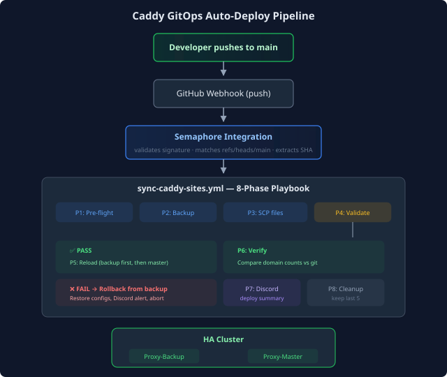
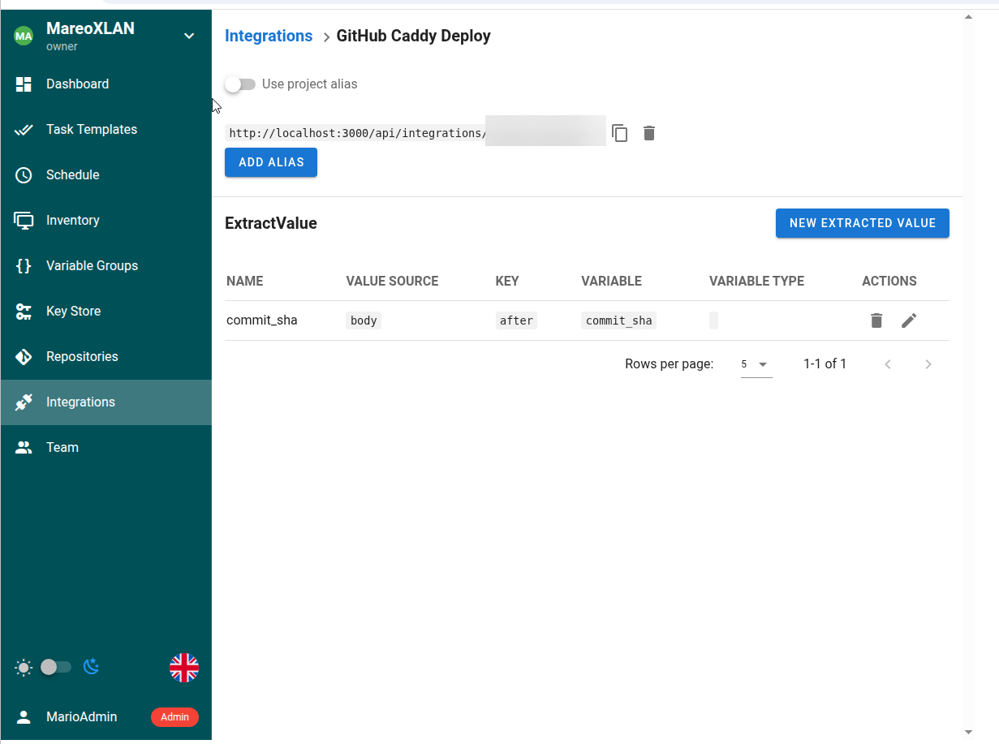

## The Problem

All traffic into my homelab goes through two Caddy reverse proxies behind a keepalived VIP. That gives me failover, provided the two nodes are running the same config.

The deployment process was manual: edit the Caddy site config in git, SCP it to both nodes, validate, reload. The "both nodes" part is where things break down. It's easy to deploy to Reverse-Proxy-1, test it, see it working, and then forget Reverse-Proxy-2 exists. Until keepalived fails over and suddenly half your sites return 502s because the backup node has last week's config.

After each outage, I copied the config to the missed node and reminded myself to deploy to both next time. Then it happened again.

## The Goal

I wanted a push to GitHub to deploy the checked-in config to both nodes. That would take the manual copies and my memory out of the loop.

## The Architecture

Every run copies all config files from Git to both nodes, even if I only changed one file.

That sends about 50 KB of config per deploy. I'll take the extra traffic over another piece of code that has to work out which files changed.

## How Semaphore Integrations Work

I used Semaphore's built-in webhook integration so I could skip a separate CI/CD webhook handler. The project integration does four things:

1. For GitHub, verify `X-Hub-Signature-256` with a shared secret.
2. Match `refs/heads/main` so only pushes to the main branch trigger a deploy.
3. Read `after` from GitHub's push payload and pass it to the playbook as `commit_sha`.
4. Run the same template I'd launch manually.

The webhook URL is something like `https://sema.<YOUR_DOMAIN>/api/webhooks/<alias>`, where the alias is auto-generated. Since Semaphore is already behind Caddy and accessible externally through a Cloudflare tunnel, the webhook endpoint is reachable from GitHub without any additional port forwarding.

<!-- SCREENSHOT: Discord notification showing a successful deploy with commit SHA, file count, and node status -->

## The Safety Net

A bad config push should leave both proxies serving traffic. The playbook checks the files, backs up the current config, and reloads the nodes in order.

**Truncation guard.** Before a deploy, the playbook checks that every site file is at least 100 bytes. I've accidentally truncated a file before. An empty or nearly empty file would wipe all the domain configs.

**Pre-deploy backup.** Each run saves a timestamped copy of the current config on each node so it has something to restore.

**Validation.** The playbook runs `caddy validate` on both nodes after copying the files and before reloading. If either check fails, it restores the backup, sends a Discord alert, and skips the reload.

<!-- SCREENSHOT: Terminal output of `caddy validate` passing on both nodes, or Semaphore task log showing the validation step -->

**Reload order.** The backup reloads first. If it fails, the primary still serves the previous config. The primary reloads only after the backup succeeds.

**Drift check.** After a deploy, the playbook compares the number of domain entries on each node with the count in Git. It flags a mismatch, which can indicate a direct edit on a node.

**Dry run.** Set `dry_run=true` to check the rest of the deployment without reloading Caddy or interrupting traffic.

## What I'd Do Differently

If I were starting over, I'd consider using Ansible's native `synchronize` module (rsync wrapper) instead of individual SCP commands per file. The current approach works fine for 6 files, but wouldn't scale well if the config structure grew significantly.

I'd also consider a path filter. Today, any push to main triggers a deploy, even if it only touches `proxmox/` or `pihole/`. Semaphore can look for `caddy/` in a list of changed files, but pulling that list from the GitHub push would require another request to the commits API. A deploy takes about 30 seconds, so I can live with the extra runs.

<!-- SCREENSHOT: Semaphore task history showing successful automated deploys triggered by GitHub webhooks -->

## The Result

Every push to main now deploys the same config to both nodes. Discord tells me what went out and whether it worked. If validation fails, the rollback takes about 30 seconds.

Semaphore runs the deploy, GitHub sends the webhook, and Discord delivers the result. I already had all three running.
