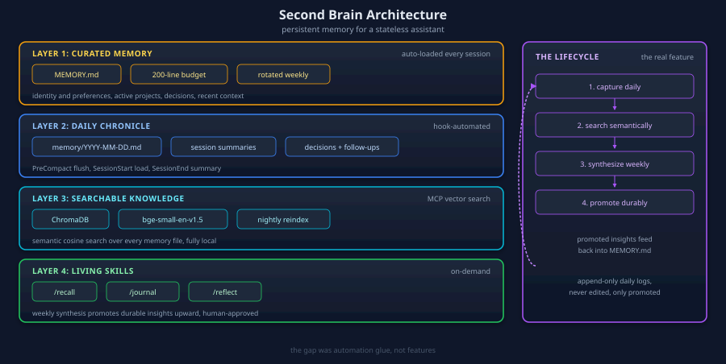

## The Goal

I wanted Claude Code to pick up where I left off. It needed to carry useful context between sessions, record what I learned that day, and find older notes even when I couldn't remember the exact words.

I borrowed the memory workflow from [Hermes](https://hermes.ai/) and adapted it to the tools Claude Code already had.

## Hermes's Approach (The Model)

These are the pieces of Hermes's personalization system I looked at:

| Feature | How It Works |
|---------|-------------|
| **Two-layer memory** | `MEMORY.md` (curated long-term) + `memory/YYYY-MM-DD.md` (daily logs) |
| **Auto memory flush** | Before context compaction, agent writes insights to disk |
| **Hybrid search** | Vector embeddings + keyword search over all memory files |
| **Skills system** | Markdown files as on-demand knowledge that grow over time |
| **Centralized preferences** | Single file for personal prefs |
| **External integrations** | Obsidian vault, health data, communication channels |

## Gap Analysis: Claude Code vs Hermes

I estimated Claude Code already had about 70% of the pieces. Most of my work would be wiring them together.

| Hermes Feature | Claude Code Status | Gap |
|------------------|-------------------|-----|
| Curated MEMORY.md | Exists (first 200 lines auto-loaded) | LOW - needs restructuring |
| Daily logs | **Missing entirely** | HIGH |
| Pre-compaction flush | Hook system exists, not configured | HIGH |
| Vector/semantic search | No MCP server for this | HIGH |
| Centralized preferences | Split across 3+ config files | MEDIUM |
| Skills that learn | Skills exist but static | MEDIUM |
| Notepad wisdom | Infrastructure exists, unused | LOW |

## Architecture

```text
LAYER 1: CURATED MEMORY (auto-loaded every session)
└── ~/.claude/MEMORY.md (first 200 lines)
    ├── Identity & Preferences
    ├── Active Projects
    ├── Patterns & Decisions
    └── Recent Context (rotated weekly)

LAYER 2: DAILY CHRONICLE (hook-automated)
└── ~/.claude/memory/YYYY-MM-DD.md
    ├── Session summaries
    ├── Decisions made
    ├── Problems encountered
    └── Follow-ups needed
    Hooks: PreCompact → flush, SessionStop → summarize

LAYER 3: SEARCHABLE KNOWLEDGE (MCP server)
└── ChromaDB + bge-small-en-v1.5
    ├── Indexes all memory/*.md files
    ├── Semantic vector search (cosine similarity)
    └── Nightly re-index via cron

LAYER 4: LIVING SKILLS (on-demand)
└── /recall, /journal, /reflect skills
    ├── Search memory corpus
    ├── Create structured daily entries
    └── Weekly synthesis + promotion to MEMORY.md
```



## Implementation Plan

### Phase 1: Quick Wins (1-2 hours)

- [x] Restructure MEMORY.md into a 200-line template for identity, active projects, preferences, architectural decisions, patterns learned, and recent context.
- [x] Put communication preferences, technical choices, and work habits in PREFERENCES.md.
- [x] Create the daily log directory `~/.claude/memory/` with `.template.md`.
- [x] Set up the PreCompact hook so `memory-flush.sh` writes context to the daily log before compaction.
- [x] Set up the SessionStart hook so `session-start-memory.sh` loads today's log and yesterday's follow-ups.
- [x] Set up the SessionEnd hook so `session-summary.sh` records where the session ended.
- [x] Add the hooks to `settings.local.json`.
- [x] Activate the OMC notepad and add a reminder to call `addLearning()` and `addDecision()` during planning.

### Phase 2: Enhanced Memory (3-4 hours)

- [x] Use `weekly-reflect.sh` to review the last 7 days and flag notes worth keeping. Cron runs it Sundays at 9 p.m.
- [x] Use `memory-cleanup.sh` to archive logs older than 30 days as .gz files. Cron runs it monthly.
- [x] Add `/recall` to search daily logs, weekly summaries, and project memories.
- [x] Add `/journal` to write a structured daily entry and classify it by type.
- [x] Add `/reflect` to review the week and promote notes to MEMORY.md while keeping it under 200 lines.
- [x] Schedule weekly reflection, monthly cleanup, and nightly reindexing in cron.

### Phase 3: Vector Search Brain (4-6 hours)

- [x] Build a Python MCP server for ChromaDB that uses bge-small-en-v1.5 embeddings for semantic search.
- [x] Register the MCP server at the workspace level in `~/GIT/.mcp.json`.
- [x] Schedule a nightly reindex at 11 p.m. Pacific.
- [ ] Consider adding the Obsidian vault path to the indexer for personal notes.

## Approach Comparison

| Dimension | Pure Native | Plugin-Enhanced | **Full Hybrid (Chosen)** |
|-----------|-------------|-----------------|--------------------------|
| Complexity | Low | Medium | Medium-High |
| Token cost/session | Low | Medium | Low-Medium (on-demand) |
| Search quality | grep only | Varies | **Keyword + semantic** |
| Privacy | 100% local | Some phone home | **100% local** |
| Scales to 1000+ logs | No | Depends | **Yes** |
| Offline capable | Yes | Maybe not | **Yes** |

## Why Full Hybrid?

1. I could start with hooks and Markdown. The first phase carries context into the next session without adding a service.
2. A weekly review surfaces old notes worth keeping before they get buried.
3. At one log a day, I'd have 90 or more after three months. Semantic search helps when I remember the idea but forget how I wrote it down.

I skipped Claude-Mem and Supermemory because they'd overlap with my oh-my-claudecode orchestration. Some plugins also require a cloud API.

## Key Design Decisions

- I chose ChromaDB for its HNSW index, PersistentClient for on-disk storage, and cosine distance support. It had about 25K GitHub stars, and Claude-Mem used it. sqlite-vec was lighter, with fewer tools and a smaller community.
- bge-small-en-v1.5 (2023) had a 62% MTEB score against 28% for all-MiniLM-L6-v2 (2019), at the same 384 dimensions. That let me swap models without changing the vector size.
- Claude Code loads the first 200 lines of MEMORY.md. I treat those lines as a budget.
- Daily logs are append-only. I leave past entries in place and promote useful insights.
- The weekly reflection script proposes candidates. I decide what gets promoted.

## Lessons Learned

- Daily capture, semantic search, and weekly review solve different problems. A useful note still needs a way to get into long-term memory.
- The 200-line MEMORY.md budget forces me to choose what belongs in every session.
- PreCompact, SessionStart, and SessionEnd are the hook events I use. The correct event is `SessionEnd`. There is no `SessionStop`.
- Keeping ChromaDB and bge-small-en-v1.5 local keeps the search private and lets it run offline.
