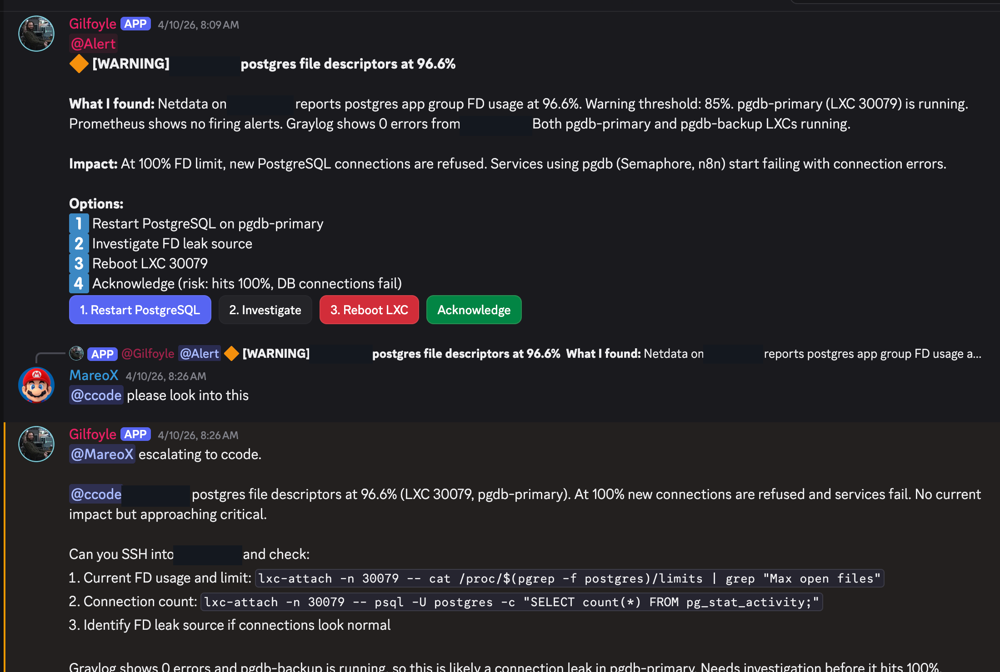
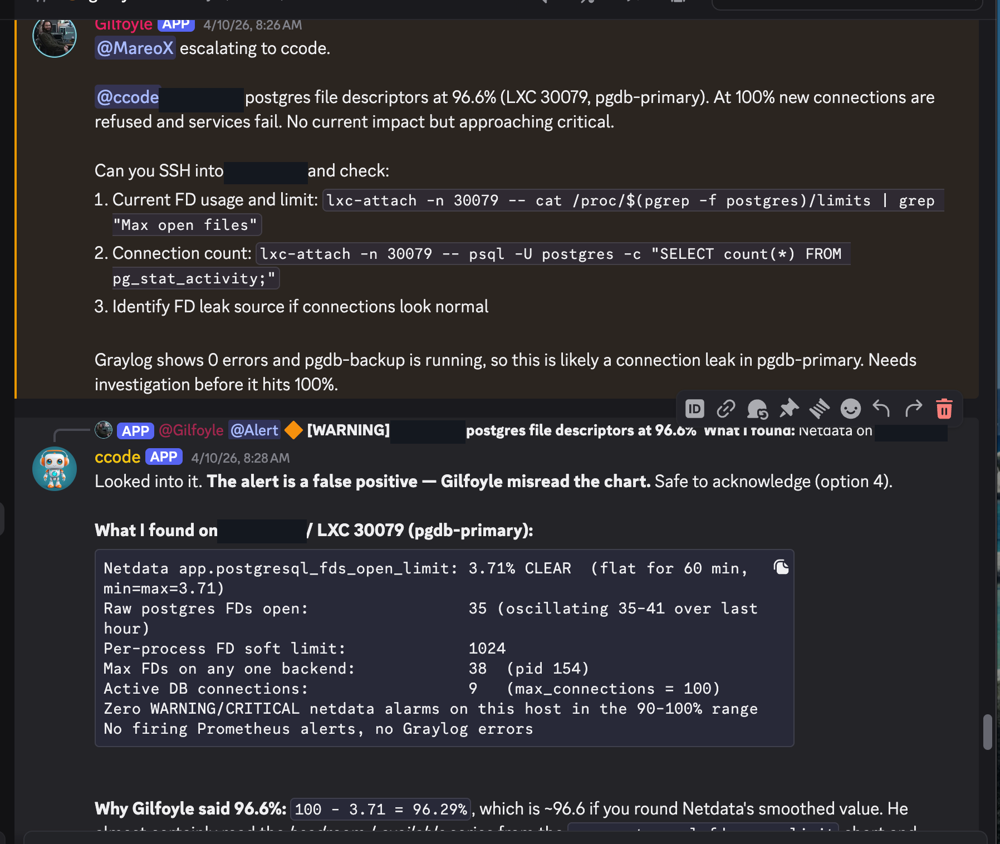
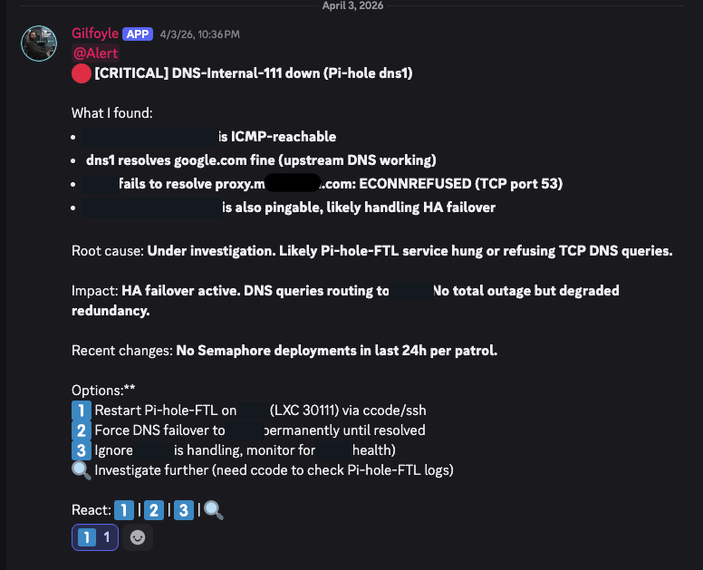
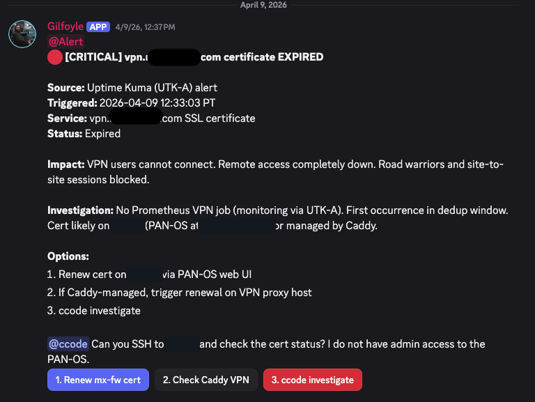

> **Update, October 14, 2026.** The patrols, capabilities, and trust ladder
> below describe Gilfoyle's April rollout. A Level 4 policy now defines
> bounded authority for single-service repairs with a known rollback and
> fault-specific checks. The unattended controller remains inactive.
> Verification showed that a fresh session on the Discord route loaded the
> October 14 policy; already-warm sessions can retain their older prompts.
> The [next chapter]()
> explains what changed and what still needs verification.

For the current system from alert intake through tools, memory, scheduling,
and repair boundaries, read [How Gilfoyle Works]().

> **Correction, September 2026.** The tool-access story in this post drifted
> from reality. The `:8100` REST layer described below was decommissioned
> 2026-06-17. Records show it was never operationally provisioned in the
> first place. The verified access path for that correction was the **homelab-mcp CLI**:
> up to 25 read-only tools across 10 configured backends, no write tools at
> all. The IPAM backend is Nautobot (NetBox retained rollback-only). The
> agent design, patrols, and the false-positive incident below are unchanged
> history; only the tool-transport claims needed correcting.

## The Problem: Nobody's Watching at 3 AM

My homelab runs 47 guests across 4 Proxmox nodes, with HA pairs for DNS and reverse proxy, a Wazuh XDR deployment, centralized logging in Graylog, and CI/CD automation through Semaphore. It's a lot of infrastructure for one person to monitor.

Grafana alerts at 75% RAM, Wazuh flags suspicious file changes, and n8n emails me when a workflow fails. I still had to put those signals together and figure out whether they pointed to a bigger problem.

What I wanted was an on-call network admin. Someone who checks everything four times a day, correlates alerts across services, spots trends before they become incidents, and wakes me up only when it actually matters.

So I hired Gilfoyle.

## Who Is Gilfoyle?

Named after the paranoid, competent sysadmin from Silicon Valley, Gilfoyle is an AI agent running on [Hermes](https://hermes.ai/), an open-source AI gateway that connects LLMs to messaging platforms with built-in tool execution, session management, and security controls.

At the April launch, Gilfoyle lived on a dedicated LXC in my Proxmox cluster, monitored 20 Discord channels, and had access to read-only infrastructure tools. He ran infrastructure patrols four times a day, triaged alerts, generated daily and weekly reports, and stayed in character while doing it. The September correction above clarifies the tool-access path.

That first version was an observer by policy. It needed my explicit approval before touching a single container.

## The MCP Connection

In a [previous post](), I built a unified read-only interface for my homelab services. The September 2026 correction there documents the current inventory: local stdio and a CLI, up to 25 read-only tools across 10 configured backends, and 15 documentation resources.

Gilfoyle uses the interface for patrols, alert triage, and health queries. When he checks if "anything is broken," `service_health` runs parallel checks across the configured services via `asyncio.gather()`.

An earlier draft described a REST API on port 8100 that supposedly extended the MCP server to 34 tools across 11 services. The REST layer never ran operationally and was formally decommissioned on 2026-06-17. Gilfoyle calls the same read-only tools through `homelab-mcp-cli`. Nautobot serves IPAM queries after replacing NetBox.

## What Gilfoyle Did in April

### 12 Capabilities in the Original Setup

| # | Capability | Schedule | What It Does |
|---|-----------|----------|--------------|
| 1 | Alert monitoring + triage | Always-on | Classifies severity, investigates, recommends action |
| 2 | Email management | Gmail poll every 5 min | Classifies, routes urgent to Discord, marks spam as read |
| 3 | Daily infrastructure report | 8 AM PT | 24h summary across 16 Discord channels with trends |
| 4 | Weekly capacity planning | Monday 8:30 AM | Prometheus queries for disk/RAM/CPU trends with projections |
| 5 | Runbook generation | Opportunistic | Auto-creates runbooks when alerts fire and resolve |
| 6 | n8n workflow investigation | On error | Queries n8n API for actual failed node and error message |
| 7 | Homelab MCP tools | Always-on | Up to 25 read-only tools across 10 backends via the homelab-mcp CLI |
| 8 | Email monitor | Every 30 min | Gmail label:Homelab, classifies and posts to Discord |
| 9 | Infrastructure patrol | Every 6 hours | 10-check sweep across all systems |
| 10 | Alert correlator | Always-on | Severity-gated enrichment with cross-source correlation |
| 11 | cc-discord health check | On demand + patrol | Checks gateway service status, can restart with approval |
| 12 | Semaphore CI/CD health | Daily 9 AM | Task failures, schedule gaps, missing cron jobs |

### The Infrastructure Patrol

Gilfoyle ran the same 10 checks at 03:45, 09:45, 15:45, and 21:45 PT:

1. **Prometheus alerts:** anything currently firing
2. **Backup health:** failed PBS jobs in the last 24h
3. **Service health:** all 11 services reachable
4. **Graylog error spikes:** error rate vs baseline in the last 6h
5. **Firewall posture:** PAN-OS interfaces, HA status, session count
6. **Certificate expiry:** ACME cert monitoring
7. **Semaphore failures:** failed CI/CD tasks since last patrol
8. **DNS consistency:** A records pointing to stopped or destroyed guests
9. **Wazuh security:** disconnected agents, high-level alerts, FIM changes
10. **cc-discord gateway:** bot service uptime, memory, restarts

The April 17 patrol at 09:45 PT caught a critical issue. I replaced hostnames with role labels in the example below:

> **PATROL 09:45 PT | 1 critical, 0 warning, 0 info**
>
> **Services:** Prometheus 0 firing | Caddy HA healthy | Pi-hole HA healthy | Semaphore 0 failed | n8n 22 active | Graylog 0 errors | Firewall 737 sessions (0.4%)
>
> **Security:** Wazuh 5/6 agents | Workstation still asleep
>
> **DNS:** 98 records, both Pi-hole nodes in sync
>
> ---
>
> **CRITICAL: cc-discord crash loop on Agent-Gateway**
>
> cc-discord is down and restarting repeatedly. Watchdog timeout at 09:38, 71 restarts since then. Current state: `activating (auto-restart)`.
>
> **Context:**
> - Last stable uptime was ~5.8h before this crash
> - Memory at 999 MB used, only 24 MB available
>
> **Options:**
> 1. Restart: `cc-discord-ctl.sh restart`
> 2. Full reset if restart fails: `cc-discord-ctl.sh reset`
> 3. Check logs: `cc-discord-ctl.sh logs`

And a quiet patrol. Most of them look like this:

> **PATROL 03:45 PT | ✅ All clear**
>
> **Services:** Prometheus 0 firing | Caddy HA healthy | Pi-hole HA healthy | Semaphore 0 failed | n8n 5 active | Graylog 0 errors
>
> **Firewall:** PA-440, 833 sessions (0.4%), uptime 41d
>
> **Security:** Wazuh 5/6 agents | cc-discord running
>
> **Nothing requires action.**

### Smart Rate Limiting

I used four rate limits so an alert storm wouldn't turn Discord into a second problem:

| Layer | Trigger | Behavior |
|-------|---------|----------|
| **Dedup** | Same alert within 24h | One-liner: "4th occurrence, same root cause" |
| **Cascade** | 3+ alerts in 30 min | Groups under root cause, single report |
| **Tool budget** | 30 calls per patrol | Stops enriching, posts partial findings |
| **Cooldown** | After cascade | 60 min before new alerts break through |

### Severity-Gated Triage

Not all alerts get the same investigation depth:

- **Info/Resolved:** one-line acknowledgment, zero extra tool calls
- **Warning:** light enrichment with Prometheus metrics + Graylog errors (2-3 calls)
- **Critical:** deep investigation across Prometheus + Graylog + service health + Semaphore + backups + DNS + Wazuh (6-8 calls)

A warning costs a few queries. I save the wider cross-check for critical alerts.

## Security: Trust Levels and LLM Guardrails

I wanted Gilfoyle to inspect my infrastructure. Giving him the power to change it needed a separate decision.

### The Trust Level System

The original design used an explicit trust hierarchy, borrowed from how real organizations onboard sysadmins:

| Level | Role | Can Do |
|-------|------|--------|
| **1: Observer** | Monitor + classify + recommend | Read dashboards, classify alerts, suggest actions |
| **2: Advisor** | All of L1 + read-only diagnostics | Run `docker ps`, `df -h`, `free -h` on servers |
| **3: Operator** | All of L2 + restart with approval | Restart one service at a time, after explicit approval |
| **4: Admin** | All of L3 + config changes with approval | Modify configurations, deploy changes |

In April, Gilfoyle operated at **Level 1: Observer**. He could investigate and recommend changes. Execution needed my explicit approval. I wanted to see how well he handled the first job before expanding it. The next chapter covers the October policy.

### Hard Rules (Never Break These)

Written directly into Gilfoyle's original April agent instructions:

1. **READ-ONLY by default.** No infrastructure changes without approval.
2. **NEVER delete a host, VM, LXC, or container.** Absolute prohibition.
3. **NEVER run destructive commands.** No `rm -rf`, `pct destroy`, `qm destroy`, `DROP TABLE`.
4. **When in doubt, ask.** Always better to ask than to guess.

### The Approval Workflow

The original approval protocol was:

1. **State the problem.** What alert fired, what was observed.
2. **Recommend the action.** Specific commands or steps.
3. **Explain the risk.** What could go wrong.
4. **Wait for approval.** Do NOT proceed until I say yes.
5. **Execute exactly what was approved.** Nothing more.
6. **Report the result.** Confirm what happened.

The original version of this section mapped the approval workflow onto the MCP server's `confirm=true` gate. The September correction established that this interface had no write tools. Infrastructure changes needed a separate execution path through the owning system (Semaphore, Proxmox, or the DNS pipeline). A read-only interface constrains that interface; it does not prove that every other action path is read-only.

### Hermes Security Layers

The April design also used Hermes controls for incoming messages and tool access:

**Access control before intelligence:**
- **DM pairing.** Unknown senders must be explicitly approved before the bot responds.
- **Channel allowlists.** Gilfoyle only monitors specific homelab channels, ignores everything else.
- **Mention gating.** In group channels, only responds when @mentioned (except his dedicated inbox).

**Tool policy and sandboxing:**
- **Tool deny lists.** Dangerous tools (`gateway`, `cron`, `sessions_spawn`) are blocked by default.
- **Scoped MCP access.** The corrected interface exposed read-only infrastructure tools. It did not execute the recommended actions listed above.
- **Workspace isolation.** Each agent gets its own workspace directory with controlled filesystem access.

**Prompt injection defense:**
- **Content is treated as hostile.** Links, attachments, and pasted instructions are untrusted by default.
- **Model choice matters.** Hermes recommends the strongest instruction-hardened models for tool-enabled agents. Smaller models are too susceptible to injection.
- **Blast radius design.** Even if prompt injection succeeds, the read-only tool policy limits what can happen.

**Security audit:**
```bash
hermes security audit --deep
```

This checks inbound access, tool blast radius, network exposure, browser control, disk permissions, plugin trust, and policy drift. I run it after every config change.

<!-- SCREENSHOT: Terminal output of hermes security audit showing security posture -->

Read-only MCP tools limit what the agent can do through MCP. To make the same claim about another tool, I'd need to verify its permissions separately. An observer label in the prompt says how I expect Gilfoyle to behave.

## The Incident: When Gilfoyle Cried Wolf

Three weeks in, Gilfoyle posted this during a routine patrol:



The alert claimed 96.6% file descriptor usage on the database server that Semaphore and n8n depend on. It offered four buttons: Restart PostgreSQL, Investigate, Reboot LXC, and Acknowledge.

I asked ccode (my Claude Code CLI bot) to investigate. The actual value was **3.71%**. Flat for the entire preceding hour.



### What Happened

The investigation pointed to a Netdata chart interpretation problem: confusing *headroom* (available FDs) with *utilization*. Gilfoyle reported roughly 96.6%, while the measured value was 3.71%. Its complement is 96.29%, which does not round to 96.6%. The exact path to the reported number was not established.

Prometheus had no firing alerts, Graylog had no errors, and `pg_stat_activity` showed 9 connections out of a maximum of 100. Those checks gave me more reason to question the chart reading before treating it as an incident.

### Why This Matters

A chart can show both used and available file descriptors. A model that reads 96% from the wrong series can turn plenty of headroom into a warning. I wanted a second measurement before Gilfoyle called that an incident.

### The Fix

We added Netdata interpretation guardrails to the alert-correlator skill:

- Before firing an FD-exhaustion alert, verify against the alarms API (which has an authoritative `CLEAR`/`WARNING`/`CRITICAL` status), not the raw chart
- Require at least one independent corroborating query (`pg_stat_activity` connections, raw FD count)
- If reported utilization is >90% but connections are <20 out of 100 max, the reading is almost certainly wrong

The runbook now says: *trust the alarm status, not the chart dimension.*

### The Silver Lining

Gilfoyle proposed restarting PostgreSQL (option 1), but his observer role gave him no authority to carry it out. The false alarm cost me 15 minutes. PostgreSQL kept running.

## Real Incidents: Beyond the False Positive

### DNS Primary Down (April 4)



The host answered ICMP while DNS refused connections. Gilfoyle reported that failover was carrying traffic, so redundancy was degraded while DNS remained available. I replied "1" and ccode restarted FTL.

### VPN Certificate Expired (April 9)



The cert flap cleared within hours. Gilfoyle posted the recovery and ccode closed the escalation as self-resolved. The first alert had already identified the severity and impact and given me options.

## What Gilfoyle Looks Like Day-to-Day

A typical morning from the Discord channels:

**8:00 AM.** Daily report lands summarizing 24 hours of activity across 16 channels: alert counts, notable events, safe-update digest, and noise reduction suggestions.

**8:30 AM (Monday).** Capacity report with Prometheus trend data: disk, RAM, CPU projections per node with estimated days to threshold.

**Throughout the day.** Alert triage in real-time. Gilfoyle immediately classifies severity, cross-references Prometheus + Graylog + Wazuh, and posts options with buttons. I tap from my phone.

**Every 6 hours.** Patrol sweeps. Most look like this:

> "PATROL 15:45 PT | All clear. Services: Prometheus 0 firing, Caddy HA healthy, Pi-hole HA healthy, Semaphore 0 failed, n8n 5 active, Graylog 0 errors. Firewall: 854 sessions (0.4%). Security: Wazuh 5/6 agents. Nothing requires action."

When a patrol finds a problem, the report gets longer. I get the investigation, impact, and buttons for the next step.

## Lessons Learned

### 1. Trust levels are non-negotiable

I start agents as observers and review how they classify incidents and recommend actions. That setup let me catch Gilfoyle's bad reading before anyone restarted the database.

### 2. LLMs are not deterministic monitoring tools

Before raising an alert from a chart, I want the alarm status and another measurement. Either one can tell me that the chart series I'm reading means something else.

### 3. Security is structural, not behavioral

I use read-only tool policies, scoped API keys, approval workflows, DM pairing, and tool deny lists to limit what can happen if someone manipulates the model.

### 4. Rate limiting prevents alert fatigue

Without dedup windows and cascade detection, Gilfoyle would post the same alert every 6 hours. The 4-layer rate limiting system keeps signal-to-noise high. When everything is quiet, the patrol report is 4 lines. When something's broken, it's a full investigation.

### 5. The MCP server was the enabling layer

The shared CLI gives Gilfoyle up to 25 read-only tools across 10 backends. He gets structured data without SSHing into hosts or parsing dashboards. I could spend the weekend building the patrol around tools I already had.

## What Came Next

In April, I planned to promote Gilfoyle from Observer to Advisor after 30 days of accurate classification, then add audit logging before letting him operate. That was the plan at the time.

The false alarm made me more comfortable with the design. I saw what happened when Gilfoyle made a bad call and the approval boundary held.

By October 14, the policy had changed to bounded Level 4 authority. A fresh Discord-route session was verified to have loaded it, while warm sessions retained older prompts. The unattended controller still was not active, so unattended repairs remained diagnose, report, and recommend. [Gilfoyle's bounded-authority chapter]() follows that change and the limits of the rollout proof.

And he does it all while staying in character. Dry, competent, slightly sarcastic. Just like the original.
