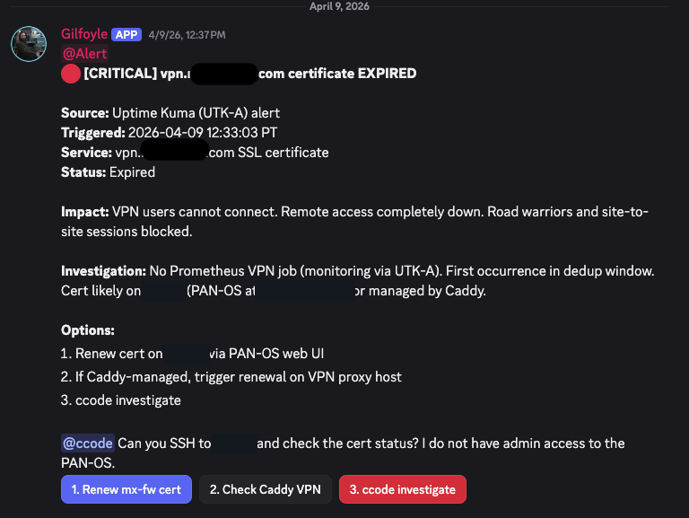

> **Update, October 14, 2026.** This is the April certificate incident and
> the automation design that followed it. The monitoring schedules below
> describe that original setup, not a fresh verification of today's jobs.
> Gilfoyle now has a Level 4 policy for bounded repairs, but the unattended
> controller remains inactive. A fresh Discord-route session loaded the new
> policy; warm sessions retained older prompts. The
> [next chapter]()
> explains the rollout. It does not make certificate renewal an AI task.

## The Wake-Up Call

On April 9, Gilfoyle (my AI network admin) posted this at midnight:



The cert flap cleared within hours. Gilfoyle posted the recovery, ccode closed the escalation, and the incident had no lasting impact.

I got lucky. If the cert had stayed expired while I was away or handling an incident, I could have lost access to my own infrastructure.

## The Problem I Was Actually Solving

I had two clients renewing the same wildcard certificate and no way to see whether the jobs had worked:

→ **Caddy** already auto-renews `*.<YOUR_DOMAIN>` via Let's Encrypt (Cloudflare DNS-01 challenge)
→ **PAN-OS** needs that same wildcard cert for the GlobalProtect VPN portal
→ A **dedicated certificate LXC** was running acme.sh separately, doing the exact same job Caddy already does
→ No monitoring on any of it, until Gilfoyle started watching

## The Architecture: Two Layers of Cert Automation

### Layer 1: Consolidate Certificate Renewal

I retired the dedicated certificate LXC and reused the certificate Caddy already renews.

Caddy already auto-renews `*.<YOUR_DOMAIN>` and stores the cert/key on an NFS share (HA NFS pair). Proxmox mounts that share. A Semaphore Ansible playbook runs weekly, compares the Caddy cert fingerprint against what's on the firewall, and only deploys when they differ.

```yaml
# Simplified: the playbook compares SHA-256 fingerprints
- name: Get live cert fingerprint from firewall
  shell: |
    echo | openssl s_client -connect vpn.<YOUR_DOMAIN>:443 2>/dev/null \
    | openssl x509 -fingerprint -sha256 -noout

- name: Get Caddy cert fingerprint from NFS
  shell: |
    openssl x509 -in /mnt/nfs-caddy-data/certificates/acme/cert.pem \
    -fingerprint -sha256 -noout

- name: Deploy only if fingerprints differ
  when: live_fingerprint != caddy_fingerprint
```

### Layer 2: The AI Monitoring Loop

In April, my [AI sysadmin]() used the [MCP server]() during patrols every 6 hours:

- **Firewall posture** via `fw_status()`, including interface health, HA state, session count
- **Certificate expiry**, caught by email-monitor (the firewall sends alerts when certs approach expiry)
- **Semaphore failures**, flagging if the weekly cert deploy playbook failed

When Gilfoyle sees a cert-related alert, the alert-correlator kicks in:

1. Classify severity (Warning: expiring soon. Critical: expired.)
2. Cross-reference: Is Semaphore's cert deploy schedule running? When did it last succeed?
3. Check: Is the firewall serving the right cert? (via the MCP's `fw_status` tool)
4. Report with options and wait for approval

The renewal stays with Caddy and Semaphore. Gilfoyle reports failures for me to investigate.

## PAN-OS XML API: What Nobody Tells You

I hit a few cases where the API gave me less information than I needed:

**Private key import requires `passphrase=none`** even for an unencrypted PEM key. Without it, the API accepts the import but the key is unusable. I only saw the error when I tried to use the certificate.

**The API imports only the leaf certificate.** If the PEM includes an intermediate CA, extract and import it separately:

```bash
# Extract intermediate from Caddy's combined PEM
awk '/BEGIN CERTIFICATE/{n++} n==2' cert.pem > intermediate-ca.pem
```

**No `show certificate` in the XML API.** I expected to verify imports by querying cert details. `<show><certificate>` returns "unexpected command." Instead, poll the live endpoint with `openssl s_client` and compare fingerprints.

**Partial commits scope by admin user.** Using a dedicated `certbot` admin user with only certificate management permissions means cert deploys never interfere with other admin sessions.

## What the Full Picture Looks Like

```
Caddy (auto-renews wildcard cert via Let's Encrypt)
  └── NFS share (HA pair)
       └── Semaphore (weekly Ansible playbook)
            ├── Compare SHA-256 fingerprints
            ├── Deploy to PAN-OS via XML API (if changed)
            ├── Import intermediate CA separately
            └── Discord notification

Gilfoyle (24/7 AI monitoring)
  └── Infrastructure patrol (every 6h)
       ├── Check firewall posture via fw_status()
       ├── Monitor Semaphore cert deploy success/failure
       ├── Email-monitor catches cert expiry alerts
       └── Alert-correlator triages with cross-source data
```

<!-- SCREENSHOT: Semaphore showing the cert deploy and root store update templates -->

## Why I Used AI For This

Here's who did what during the incident and the build:

1. Gilfoyle's monitoring caught the expired cert.
2. Claude Code (ccode) connected to the firewall over SSH, checked the cert, and confirmed the flap.
3. I designed the Ansible playbooks, Semaphore schedules, and NFS consolidation.
4. Claude Code helped write the playbook, work through the XML API quirks, and test the deployment.
5. Gilfoyle checked that the automation kept running during the April patrols.

## Lessons Learned

### 1. Catching a fire isn't preventing one

The alert gave me a reason to find the duplicated renewal jobs. The fix was to remove the duplicate and check that the remaining job could deploy the cert.

### 2. Consolidate before you automate

I could have automated the dedicated certificate LXC's acme.sh setup. Reusing Caddy's cert let me retire the LXC and avoid writing that second workflow.

### 3. The AI monitoring loop closes the gap

In the April design, the aim was to hear about a failure at the next six-hour patrol, before a cert expired. A missed check could still delay the alert.

### 4. PAN-OS XML API demands patience

I expected to lose a weekend to the key import, missing intermediate CA, and unavailable show commands. Claude Code helped me try calls, read the errors, and adjust. I got through it in an afternoon.

### 5. Document the gotchas for your future AI

I put the PAN-OS API quirks in the project's CLAUDE.md so the next person or agent who touches this workflow can start with the calls that worked.
