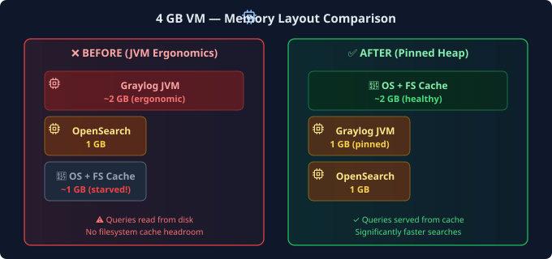

## The Problem

My Graylog VM had 4 GB of RAM. Graylog and OpenSearch were using enough of it to squeeze the filesystem cache.

## What I Tried

First, I checked memory usage on the Graylog VM:

```bash
ssh -i ~/.ssh/<YOUR_KEY> <USER>@<GRAYLOG_IP>
free -h
docker stats --no-stream
```

The Graylog container was using more memory than I'd expected. I'd capped OpenSearch's heap at 1 GB and left Graylog on the JVM's default "ergonomic" settings.

## The Solution

I pinned Graylog's JVM heap explicitly in the Docker Compose environment:

```yaml
services:
  graylog:
    environment:
      # Pin JVM heap to 1g (prevents ergonomic over-allocation)
      GRAYLOG_SERVER_JAVA_OPTS: "-Xms1g -Xmx1g -XX:NewRatio=1 -server -XX:+UseG1GC"
```

The key flags:
- `-Xms1g -Xmx1g`: Fixed heap size (no dynamic growth)
- `-XX:NewRatio=1`: Equal old/young generation split (good for Graylog's allocation patterns)
- `-XX:+UseG1GC`: G1 garbage collector (better for larger heaps)

After redeploying:

```bash
cd /opt/graylog
docker compose down && docker compose up -d
```

After redeploying, memory usage settled and the OS got about 1 GB back.

## Root Cause

With no explicit heap size, the JVM chooses a maximum based on the memory it sees. A typical default is 25%, or about 1 GB on this VM. It can also use memory outside the heap for:

- Metaspace (class metadata)
- Code cache (JIT compilation)
- Native memory (direct buffers, threads)

A JVM with a 1 GB heap can still use 1.5 to 2 GB in total.

OpenSearch stores the logs, and it leans on the filesystem cache for queries. Linux can cache frequently used index files when it has free RAM. If the JVM uses that memory, queries need more disk reads.

### Memory Layout Comparison



Leaving about 2 GB for the filesystem cache made queries faster.

## Key Takeaways

1. **Set the heap explicitly.** On a small VM, I want to choose how much room the JVM leaves for everything else.

2. Run `docker stats` and `free -h` after deploying a Java service to see what it actually uses.

3. Check the sizing guides for [Graylog](https://go2docs.graylog.org/current/setting_up_graylog/server_configuration.html) and [OpenSearch](https://opensearch.org/docs/latest/install-and-configure/install-opensearch/index/). The general rule I used was half the available RAM for OpenSearch, capped at 32 GB because of pointer compression.

4. Leave room for the filesystem cache. A 4 GB log server can beat an 8 GB one if the larger JVM uses the memory OpenSearch needs for caching.

## Verification

After the change, I confirmed the improvement:

```bash
# Check container memory usage
docker stats --no-stream graylog opensearch

# Check system memory (look for buff/cache)
free -h

# Test query performance in Graylog UI
# Search → Last 24 hours → "source:*" → Note response time
```

Look for 1 to 2 GB under `buff/cache` in the `free -h` output. That's the room the OS can use to cache OpenSearch index files.
