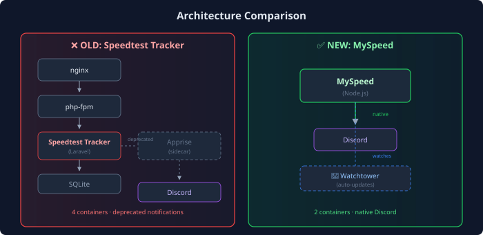
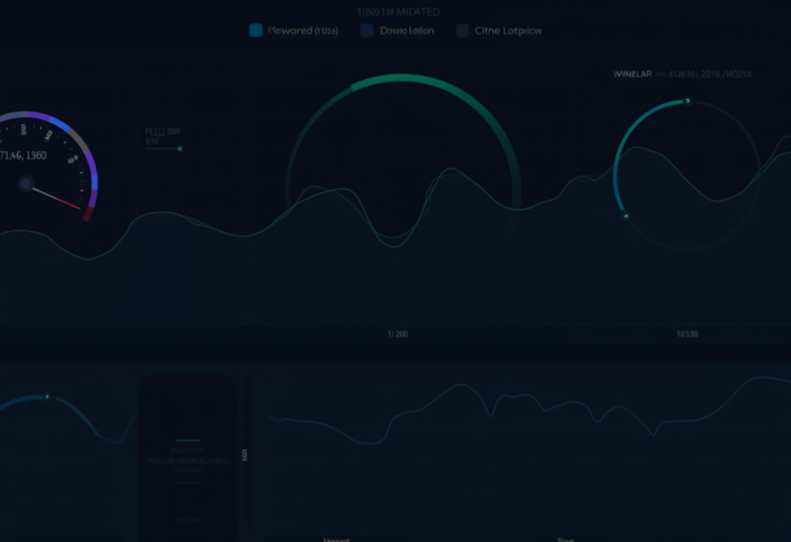

## Overview

Speedtest Tracker was deprecating native Discord notifications. I could keep it and add an Apprise sidecar, or switch to MySpeed and send the alerts from the app itself. I chose MySpeed.

## Why Migrate?

| Factor | Speedtest Tracker | MySpeed |
|--------|-------------------|---------|
| Stack | Laravel/PHP | Node.js |
| Discord | Deprecated (needs Apprise) | Native support |
| Complexity | nginx + php-fpm + SQLite | Single Docker container |
| Updates | Manual | WUD opt-in monitoring |

### Architecture Comparison



## Prerequisites

- Existing LXC or VM with network connectivity
- Docker and docker-compose installed
- Reverse proxy configuration (Caddy/nginx)
- DNS records configured

## Migration Steps

### Step 1: Backup Existing Data

I saved my test history before removing Speedtest Tracker:

```bash
# SSH to the server
ssh -i ~/.ssh/<YOUR_KEY> <USER>@<SPEED_MONITOR_IP>

# Create backup directory
sudo mkdir -p /opt/speedtest-tracker-backup

# Backup the SQLite database
sudo cp /opt/speedtest-tracker/database/database.sqlite \
  /opt/speedtest-tracker-backup/speedtest-final-backup.sqlite
```

### Step 2: Stop Old Services

```bash
# Stop and disable the old PHP services
sudo systemctl stop nginx php*-fpm
sudo systemctl disable nginx php*-fpm

# Remove old installation (optional, after verifying backup)
sudo rm -rf /opt/speedtest-tracker
```

### Step 3: Install Docker (if not present)

```bash
sudo apt-get update
sudo apt-get install -y docker.io docker-compose
sudo systemctl enable docker
sudo systemctl start docker
```

### Step 4: Deploy MySpeed

Create the deployment directory and compose file:

```bash
sudo mkdir -p /opt/myspeed
sudo tee /opt/myspeed/docker-compose.yml << 'EOF'
version: '3.8'

services:
  myspeed:
    image: germannewsmaker/myspeed:latest
    container_name: myspeed
    restart: unless-stopped
    ports:
      - '5216:5216'
    volumes:
      - myspeed-data:/myspeed/data
    environment:
      - TZ=<YOUR_TIMEZONE>

  wud:
    image: getwud/wud:latest
    container_name: wud
    restart: unless-stopped
    volumes:
      - /var/run/docker.sock:/var/run/docker.sock
    environment:
      - WUD_WATCHER_LOCAL_WATCHBYDEFAULT=false
      - TZ=<YOUR_TIMEZONE>
    labels:
      - wud.watch=true

volumes:
  myspeed-data:
EOF
```

Start the containers:

```bash
cd /opt/myspeed
sudo docker compose up -d
```

### Step 5: Update Reverse Proxy

For Caddy, update your site configuration:

```caddyfile
myspeed.<YOUR_DOMAIN> {
    reverse_proxy http://<SPEED_MONITOR_IP>:5216 {
        health_uri /
        health_interval 30s
        health_timeout 5s
    }
    header {
        Strict-Transport-Security "max-age=31536000; includeSubDomains; preload"
    }
}
```

Validate and reload:

```bash
docker exec caddy caddy validate --config /etc/caddy/Caddyfile
docker compose restart caddy
```

### Step 6: Update DNS

Add an A record pointing your hostname to the server IP:

```text
<YOUR_HOSTNAME>.local  →  <SPEED_MONITOR_IP>
```



## Verification

```bash
# Check container is running
sudo docker ps | grep myspeed

# Test HTTP response
curl -s -o /dev/null -w '%{http_code}' http://localhost:5216
# Expected: 200

# Test DNS resolution
dig @<DNS_SERVER_IP> myspeed.<YOUR_DOMAIN> +short
```

## Configuring Discord Notifications

Once the dashboard was up, I set up the Discord alerts that prompted the move:

1. Access the MySpeed web UI
2. Navigate to **Settings** → **Notifications**
3. Add your Discord webhook URL
4. Configure triggers (test failures, speed drops, etc.)
5. Send a test notification to verify

## What I Learned

1. MySpeed's built-in Discord support saved me from running another service for notifications.
2. Both apps ran in containers, so I could replace the service without rebuilding the host.
3. Export the old results before the swap. An archive is useful even if the new tool can't import it.
4. If you run an HA proxy, update both nodes before you call the migration done.

## Troubleshooting

### Container won't start
Check logs: `sudo docker logs myspeed --tail 50`

### Can't access web UI
Verify the port isn't blocked and container is healthy:
```bash
sudo docker ps
curl http://localhost:5216
```

### Discord notifications not working
- Verify webhook URL is correct
- Check MySpeed logs for API errors
- Test webhook directly with curl

## Resources

- [MySpeed GitHub](https://github.com/gnmyt/MySpeed)
- [Speedtest Tracker Archive](https://github.com/alexjustesen/speedtest-tracker) (for reference)
