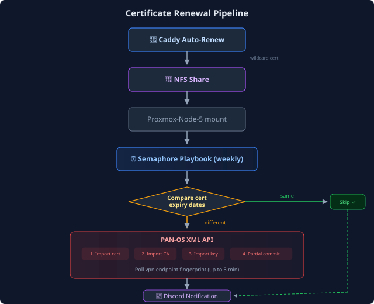

## The Problem

My PAN-OS firewall (GlobalProtect VPN portal at vpn.example.com) needs a valid TLS certificate. I had a dedicated LXC running acme.sh with a Cloudflare DNS-01 challenge to issue a wildcard cert, then a PAN-OS deploy hook to push it to the firewall via the XML API. It worked, but it was a single-purpose VM doing the same job my Caddy reverse proxy already does -- Caddy auto-renews `*.example.com` via the same Cloudflare DNS-01 mechanism.

I had two ACME clients and two renewal schedules to maintain for the same certificate.

## The Approach

I changed the deploy job to use Caddy's wildcard cert:

1. Caddy already auto-renews `*.example.com` and stores the cert/key on an NFS share (served by a highly available NFS pair)
2. A Proxmox node already mounts that NFS share at `/mnt/nfs-caddy-data/`
3. A weekly Semaphore Ansible playbook compares the Caddy cert expiry with the one on the firewall and deploys it only when they differ.

This eliminates the certificate-renewal LXC entirely -- no more dedicated cert management VM.

## Architecture



## Key Discoveries

### PAN-OS XML API Quirks

Three of the import and verification calls took longer to debug than I expected:

**Private key import requires `passphrase=none`** even for an unencrypted PEM key. Without it, the API accepts the import but the key is unusable. The error only shows up when you try to use the certificate.

**Import the intermediate separately.** If a PEM contains both the server cert and the intermediate, PAN-OS imports only the leaf. GlobalProtect needs both for the full chain.

**No `show certificate` in the XML API**: I expected to verify the import by querying the cert details via API, but `<show><certificate>` returns "unexpected command". Instead, I poll the live endpoint (`vpn.example.com:443`) with `openssl s_client` and compare SHA-256 fingerprints.

**Partial commits are scoped by admin user**: Using `<commit><partial><admin><member>certbot</member></admin></partial></commit>` ensures the cert deploy doesn't interfere with other admin sessions. The certbot user only has certificate management permissions.

### Semaphore Environment Variables Are Ansible Extra Vars

Semaphore sends the "Environment" JSON field to Ansible as `--extra-vars`. It doesn't set OS environment variables, so `lookup('env', 'PANOS_PASS')` comes back empty in Semaphore. I used a lookup that works with either source:

```yaml
panos_pass: "{{ PANOS_PASS | default(lookup('env', 'PANOS_PASS')) }}"
```

### Let's Encrypt Chain Structure

Caddy's PEM file contains two certificates: the server cert (`*.example.com`) and the intermediate (`Let's Encrypt E7`). I extract the intermediate with `awk`:

```bash
awk '/BEGIN CERTIFICATE/{n++} n==2' cert.pem > intermediate-ca.pem
```

Then import it to PAN-OS as a separate certificate named `LetsEncrypt-E7`.

## Active Verification Instead of Static Waits

I started with `pause: seconds: 30` after the firewall commit. That left me guessing whether GlobalProtect had reloaded. I switched to checking the fingerprint it actually serves:

```yaml
- name: Wait for GlobalProtect to serve new cert
  shell: >
    echo | openssl s_client -connect vpn.example.com:443
    -servername vpn.example.com 2>/dev/null |
    openssl x509 -noout -fingerprint -sha256
  register: validation_fingerprint
  until: caddy_fingerprint in (validation_fingerprint.stdout | default(''))
  retries: 12
  delay: 15
  when: cert_needs_update | bool
```

The playbook polls every 15 seconds for up to 3 minutes. It fails if the new fingerprint never appears.

## Results

**Before**: the old certificate-renewal LXC -- dedicated VM, separate ACME renewal, no monitoring, no alerting on failure.

**After**: Semaphore template in my lab project -- weekly cron (Sunday 5 AM), reuses existing Caddy cert from NFS, Discord notifications on success/failure, full post-deploy verification (fingerprint + expiry + chain depth).

**Resources saved**: One LXC (2 vCPU, 512 MB RAM) decommissioned. Zero additional infrastructure added.

## What's Next

- Wait for 1-2 successful Sunday cron cycles to confirm reliability
- Decommission the old certificate-renewal LXC following the standard lifecycle offboarding process
- The playbook will still import a new Let's Encrypt intermediate under `LetsEncrypt-E7` when the chain rotates. Deriving the name from the CN would keep the label accurate.
