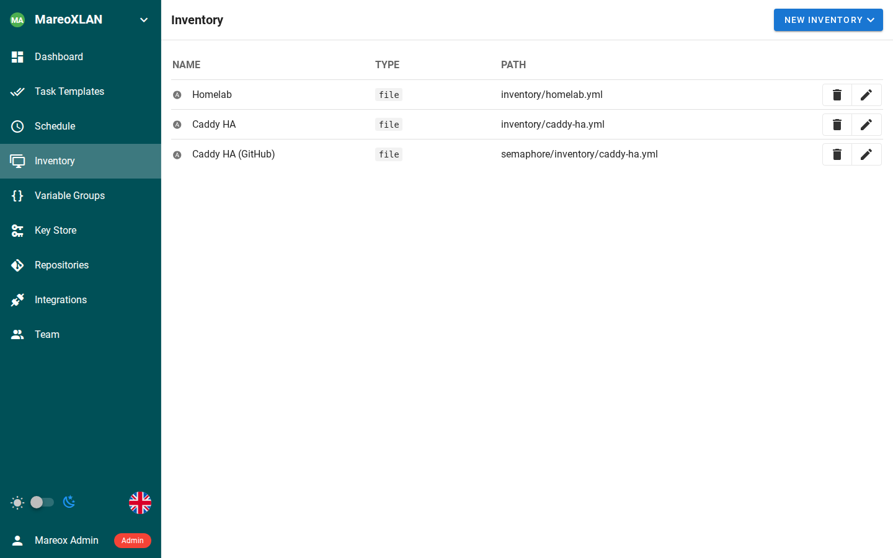
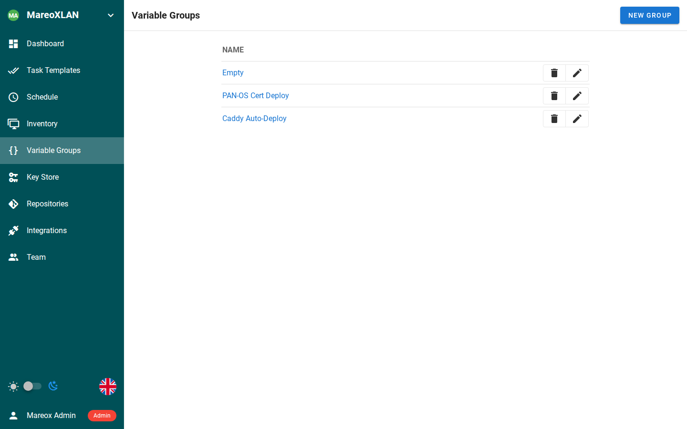
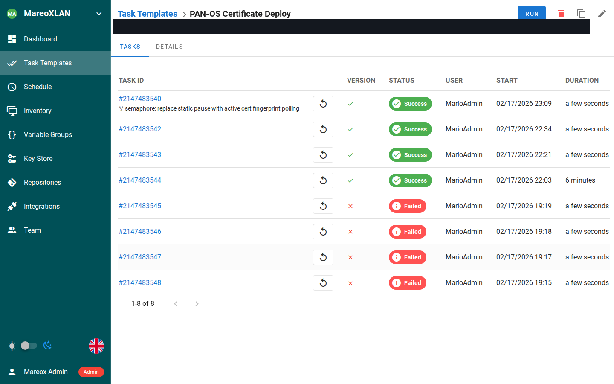
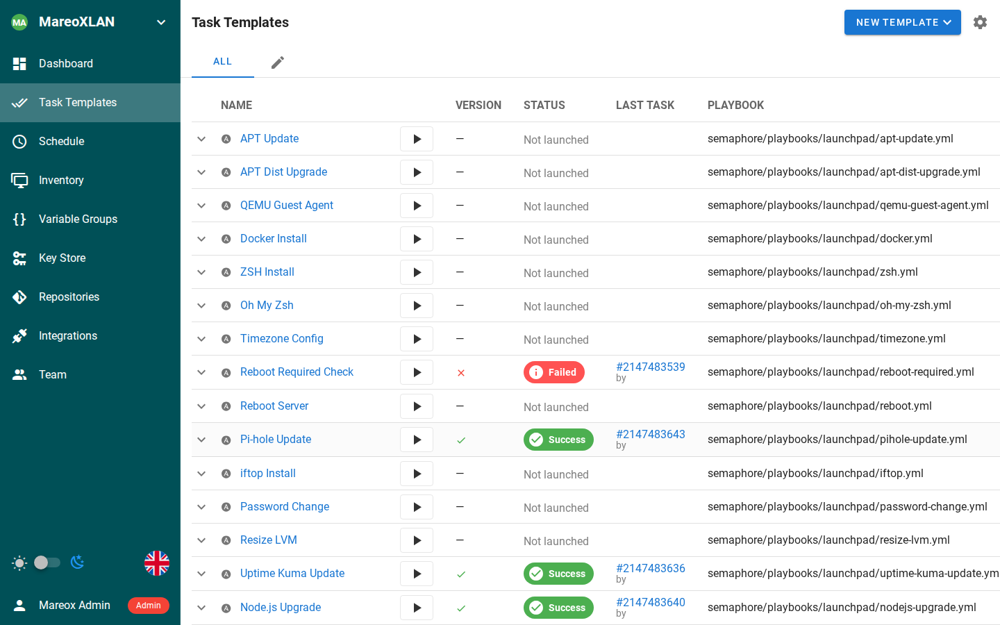

## Overview

If you're running SSL decryption on a Palo Alto firewall, you've probably hit this: a user reports they can't access a website, and it turns out the site's CA certificate isn't in your firewall's trusted root store. PAN-OS only updates its built-in root store on major software releases, which means between upgrades your firewall's trust anchors slowly go stale.

Palo Alto Networks' [pan-chainguard](https://github.com/PaloAltoNetworks/pan-chainguard) pulls root and intermediate CA certificates from the Common CA Database (CCADB), which Mozilla, Apple, Chrome, and Microsoft use. It imports the certificates into the firewall's device certificate store through the XML API.

I reused the layout of my weekly Semaphore job for deploying wildcard TLS certificates. The root store job sends a different set of certificates through the same API.

## The Problem

PAN-OS maintains a "Default Trusted CA" store that ships with each major release. Between releases, new Certificate Authorities get added to browser trust stores (Mozilla NSS, Apple, Chrome Root Program, Microsoft) but your firewall doesn't know about them. When the firewall performs SSL decryption and encounters a certificate chain signed by a CA it doesn't trust, users see TLS errors.

Before automating this, I'd have had to download each new CA certificate and import it through the web UI.

## The Solution

### Architecture

```text
pan-chainguard-content          Python Host            PAN-OS Firewall
  (GitHub Action)              (utility LXC)            (XML API)
       │                            │                       │
       │   Download archive         │                       │
       ├───────────────────────────►│                       │
       │                            │     guard.py          │
       │                            ├──────────────────────►│
       │                            │                       │
       │                            │   Import + commit     │
       │                            │                       ├──► Trusted CA Store
       │                            │                       │       Updated
       │                            │                       │
       │                            │                       ├──► Discord
       │                            │                       │    Notification
```

The `pan-chainguard-content` repository runs a GitHub Action daily that builds a certificate archive (`certificates-new.tgz`) from all four major vendor root programs. My Semaphore playbook downloads this archive monthly and uses `guard.py` to import everything to the firewall.

### How It Works

I kept the five phases from the existing cert deploy playbook:

**Phase 1: Preflight.** Install `pan-chainguard` with pip, download the latest release archive, and check it.

**Phase 2: Baseline.** Generate a PAN-OS API key and record the current device certificate count.

**Phase 3: Import.** Create a temporary `.panrc` for `guard.py`, use `guard.py` to import the roots and intermediates, and clean up `.panrc`.

**Phase 4: Verify.** Wait for the commit to settle, query the certificate count again, and compare it with the baseline.

**Phase 5: Report.** Send a Discord notification. Green means certificates were added, gray means the store was current, and red with an @mention means the job failed.

### Key Design Decisions

**Reuse existing API credentials.** I already had a `certbot` admin account on the firewall with import/commit permissions for the TLS cert automation. Rather than creating a separate service account, I reused it — both automations push certificates through the same API, and partial commits are scoped per admin session so they don't interfere with each other.

**Use the prebuilt archive.** pan-chainguard lets you select vendor root programs. I wanted all four, so I use the archive from pan-chainguard-content.

**Run monthly.** Root CA changes are infrequent. I can run the job from the Semaphore UI if I need one sooner.

**Keep the credentials file temporary.** `guard.py` reads `.panrc`. I give the file a unique name based on the epoch and delete it in Ansible's `always` block, including on failure.

## Setting It Up in Semaphore

The same playbook can run outside Semaphore. You'll need to set up the variables and schedule in your Ansible runner.

### Step 1: Inventory

The playbook targets `python-lxc` — a dedicated utility host with Python 3 and pip. Your inventory needs this host defined, plus network access from it to the firewall's management interface.



I use a single `homelab.yml` inventory file that groups hosts by function. The `python-lxc` host lives in the `utility` group. The firewall (`Firewall-Main`) is in the `palo_alto` group — the playbook reaches it via API calls, not SSH.

### Step 2: Variable Group (Environment Variables)

Create a Variable Group with the credentials the playbook needs. I named mine "PAN-OS Cert Deploy" and reused it from my existing TLS certificate playbook since both automations talk to the same firewall with the same API user.



The required variables:

```json
{
  "PANOS_USER": "certbot",
  "PANOS_PASS": "<your-api-admin-password>",
  "DISCORD_WEBHOOK": "https://discord.com/api/webhooks/<your-webhook>"
}
```

`PANOS_HOST` comes from the playbook defaults. Set it to your firewall hostname when you adapt the playbook.

### Step 3: Task Template

Create a new Task Template. The key settings:

- **Name**: PAN-OS Root Store Update (chainguard)
- **Playbook**: `playbooks/homelab/panos-chainguard-update.yml`
- **Inventory**: Homelab
- **Variable Group**: PAN-OS Cert Deploy
- **Repository**: Your Git repo containing the playbook

I modeled this on my PAN-OS Certificate Deploy template (#22). Its task history shows the green runs and the red ones from early testing.



### Step 4: Schedule

Set up a cron schedule for the 1st of each month. I chose 4 AM Pacific to avoid peak hours:

```text
0 4 1 * *
```

### Step 5: All Templates at a Glance

Once configured, the template appears alongside your other automation tasks. Here's my lab project with 23 templates covering everything from apt updates to certificate management.



## Prerequisites

- A Palo Alto firewall with API access enabled
- An API admin account with import, commit, and export permissions
- A host with Python 3 and pip (I used a dedicated utility LXC)
- Network connectivity from the Python host to the firewall management interface
- Semaphore (or any Ansible runner) for scheduling

## Verification

After the first run, check:

1. **Semaphore output** — The playbook logs certificate count before and after
2. **Discord** — A notification embed shows the delta (green = new certs added, gray = already current)
3. **Firewall UI** — Device > Certificate Management shows the new trusted CAs

## What I Learned

Set `PANRC` to tell `guard.py` where to find `.panrc`. That keeps this job's file out of the user's home directory, where it could collide with another tool. Ansible's `always` block cleans it up after the run.

I can rerun `guard.py` with the same archive. It updates certificates that changed and skips the rest, so the scheduler doesn't have to track which archives already ran.
