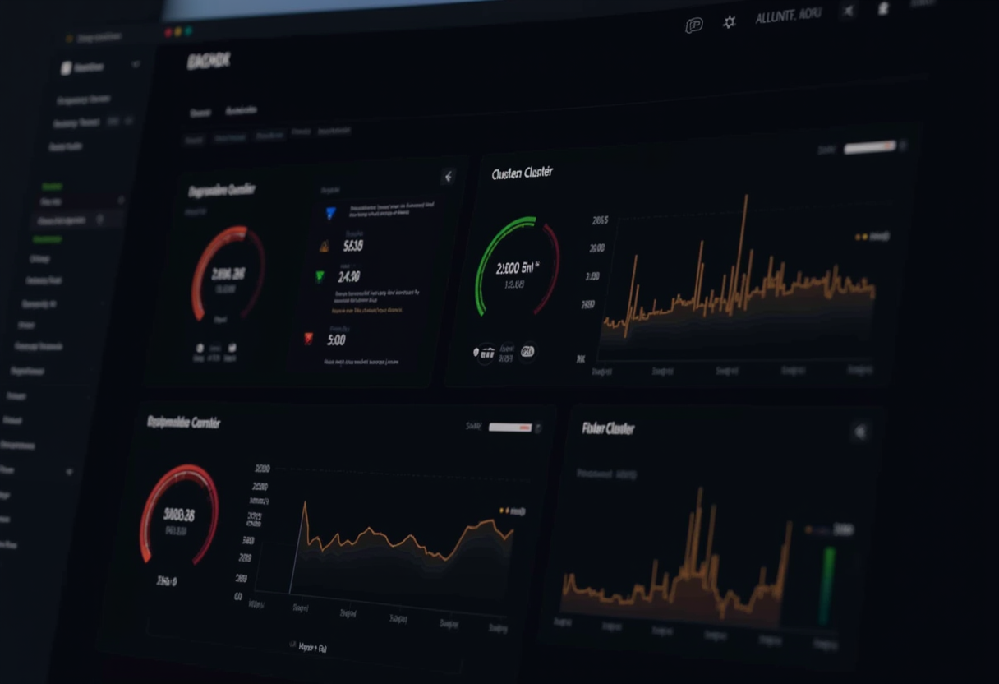

## The Goal

Add all 4 Proxmox VE cluster nodes (Proxmox-Node-1, Proxmox-Node-2, Proxmox-Node-4, Proxmox-Node-5) to the existing Prometheus/Grafana stack on a dedicated LXC. The monitoring stack already covered Graylog, Windows desktop, and PAN-OS firewall metrics -- Proxmox was the last major gap.

## Approach: pve-exporter vs node_exporter

I looked at two ways to collect the metrics:

1. **node_exporter on each Proxmox host.** It collects OS metrics for CPU, RAM, disk, and network. It misses guest status, storage pools, and cluster quorum.
2. **pve-exporter.** One container queries the Proxmox VE REST API and exposes cluster, node, storage, and guest metrics.

I chose **pve-exporter** for guest status, storage usage, and cluster health without an install on each node. I gave up some OS-level detail.

## Implementation

### PVE API Token

Created a dedicated API user and token on the Proxmox cluster:

```bash
# On any Proxmox node
pveum user add exporter-audit@pve
pveum aclmod / -user exporter-audit@pve -role PVEAuditor
pveum user token add exporter-audit@pve exporter --privsep 0
```

I first created the token with the default `--privsep 1`. The role looked right, but `/api2/json/cluster/status` returned 403 Forbidden. Recreating the token with `--privsep 0` let it inherit the user's permissions. The built-in `PVEAuditor` role gives it read-only access to cluster data.

### Docker Compose

Added pve-exporter to the existing stack:

```yaml
pve-exporter:
  image: prompve/prometheus-pve-exporter:3
  container_name: pve-exporter
  restart: unless-stopped
  environment:
    - TZ=America/Los_Angeles
    - PVE_USER=${PVE_USER}
    - PVE_TOKEN_NAME=${PVE_TOKEN_NAME}
    - PVE_TOKEN_VALUE=${PVE_TOKEN_VALUE}
    - PVE_VERIFY_SSL=${PVE_VERIFY_SSL}
  ports:
    - "9221:9221"
```

### Prometheus Scrape Jobs

Two scrape jobs using the same multi-target relay pattern as snmp-exporter:

- **`pve-cluster`**: Scrapes one node (192.0.2.20) with `cluster=1, node=0` for cluster-wide metrics
- **`pve-nodes`**: Scrapes all 4 nodes individually with `cluster=0, node=1` for per-node metrics

The per-node job uses relabel rules to assign friendly instance names (`Proxmox-Node-1`, `Proxmox-Node-2`, etc.) -- the same 4th-rule pattern established for the SNMP firewall job.

### Grafana Dashboard

The dashboard had 21 panels across five sections:

| Section | Panels | Purpose |
|---------|--------|---------|
| Cluster Overview | 5 stat panels | Nodes online, VMs/CTs running, stopped guests, PVE version |
| Node Status | 3 time series | Per-node CPU, memory %, memory absolute |
| Storage | 2 panels | Storage usage bar gauge + trend over time |
| Guest Overview | 2 bar gauges | Top 10 guests by CPU and memory |
| Guest Details | 4 time series | Per-guest CPU, memory, network I/O, disk I/O |

Template variables for `node` (multi-select) and `guest_type` (All/VMs/CTs) enable filtering.

### Alert Rules

Added 5 Proxmox-specific alerts:

| Alert | Condition | Severity |
|-------|-----------|----------|
| Proxmox Node Down | `pve_up < 1` | Critical |
| PVE Node CPU > 85% | Sustained CPU > 85% | Warning |
| PVE Node Memory > 90% | Sustained memory > 90% | Warning |
| PVE Storage > 85% | Any storage pool > 85% | Warning |
| Critical Guest Down | Guest with `onboot=1` is stopped | Critical |

The "Critical Guest Down" alert uses an `and on(id)` join between `pve_up` and `pve_onboot_status` to only fire for guests configured to auto-start.

## Challenges and Fixes

### PVE Token Authentication (privsep)
Assigning PVEAuditor to both the user and the token still gave me 403s with `--privsep 1`. The calls worked after I recreated the token with `--privsep 0`. I couldn't tell whether privilege separation was failing to propagate ACLs or I was hitting a PVE bug.

### Grafana Folder Caching
Grafana put the dashboard in "Graylog Monitoring" because the server still had a catch-all provider in `dashboards.yml`. Resetting the volume alone made no difference. I deployed the per-folder `dashboards.yml` and reset the data volume.

### Deployment File Sync
After I copied the provisioning directory with `scp -r`, the server's `rules.yml` was missing the Proxmox alert group and `Proxmox/` was missing the dashboard JSON. I copied those files individually and checked them on the server.

## Final Verification

I checked the running stack after deployment:




- **12/12 Prometheus targets UP** (including `pve-cluster` + 4 `pve-nodes`)
- **6/6 containers running** (prometheus, grafana, opensearch-exporter, snmp-exporter, node-exporter, pve-exporter)
- **Dashboard in Proxmox folder** with 21 panels rendering correctly
- **13 alert rules active** (4 Graylog + 4 mx-fw + 5 Proxmox)
- All 4 Proxmox nodes reporting metrics with friendly instance names

## Files Changed

| File | Change |
|------|--------|
| `prometheus/docker-compose.yml` | Added pve-exporter service |
| `prometheus/prometheus.yml` | Added pve-cluster and pve-nodes scrape jobs |
| `prometheus/.env` / `.env.example` | Added PVE_USER, PVE_TOKEN_NAME, PVE_TOKEN_VALUE, PVE_VERIFY_SSL |
| `prometheus/grafana/provisioning/dashboards/Proxmox/proxmox-cluster-overview.json` | New 21-panel dashboard |
| `prometheus/grafana/provisioning/dashboards/dashboards.yml` | Added Proxmox folder provider |
| `prometheus/grafana/provisioning/alerting/rules.yml` | Added proxmox-cluster alert group (5 rules) |
| `prometheus/CLAUDE.md` | Updated with pve-exporter, dashboard, alerts documentation |

## Key Takeaways

1. One pve-exporter container can collect metrics for the nodes, guests, and storage without installing an agent on each host.
2. My pve-exporter token worked with `--privsep 0`, using a read-only role. A setup that needs privilege separation needs its own check.
3. In this setup, Grafana cached folder assignments in SQLite. Deploying the right `dashboards.yml` and restarting was insufficient. I used `docker volume rm` to reset the volume.
4. Compare the files on the server after a bulk SCP copy, especially in subdirectories.
5. The SNMP exporter's multi-target relay pattern works here too. I reused three relabel rules and added a fourth for friendly instance names.
