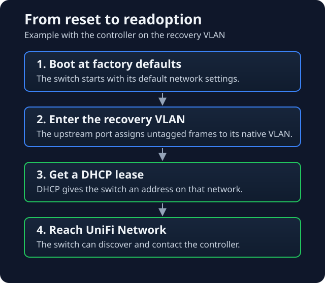

After a power cut, my UniFi Flex came back with a default name and the two access points behind it were offline. I could see the switch in ARP, but I couldn't manage it. I kept trying remote adoption anyway. The controller could have a record for the switch and still have no usable path to it.

## What got the switch back

I connected the switch to an upstream port whose native VLAN was the same network as the UniFi controller. With the uplink in place, I did a physical factory reset.

### What I verified

- **Controller events.** The switch and both access points disconnected together. The log showed the switch reconnecting and dropping again, then failed manual adoption attempts. After the reset, the controller recorded automatic readoption. The switch was still checking in later that day.
- **Switch forwarding.** The upstream port was up and forwarding, with the expected native VLAN. The MAC address tables still had no entries for either downstream access point.

The switch was back under management. Both access points were still offline at my last check, so their power and links needed a separate check.

## How the reset switch gets an address

A factory-reset switch boots as a DHCP client. On this recovery path, its first traffic is untagged. The upstream port puts those frames on its **native VLAN**, which is where the DHCP request needs to find a server or relay. If DHCP can't answer on that network, the switch has no usable lease from that segment. At that point, I'd check the cable, port profile, and DHCP path before retrying adoption.

The reset switch came up with an address on the recovery network. I didn't identify which DHCP server handed out the lease during the incident. [Ubiquiti's switch port VLAN guide](https://help.ui.com/hc/en-us/articles/26136855808919-Switch-Port-VLAN-Assignment-Trunk-Access-Ports) explains how the upstream port classifies untagged traffic.

## How it finds the controller

A DHCP lease gets the switch onto the network. It still needs to find and reach the controller. In my recovery setup they shared a VLAN, so the switch could use local discovery and communicate with UniFi Network. Auto-readoption was what I observed with my existing controller. On a fresh install, the device can show up as **Pending Adoption** instead. [Ubiquiti's device adoption guide](https://help.ui.com/hc/en-us/articles/360012622613-UniFi-Device-Adoption)

If the controller lives on a different subnet, plan for routed adoption. The switch needs a way to learn the controller's address and a working path to it. For example, UniFi supports DHCP Option 43 to supply the address and requires the device to reach the application over TCP 8080. [Ubiquiti's Layer 3 adoption guide](https://help.ui.com/hc/en-us/articles/204909754-Remote-Adoption-Layer-3)

## What I'd check next time

1. Plug a laptop into the intended recovery port and check that it gets a lease on the expected network.
2. From that network, check that the controller is reachable. After the switch starts, verify the switch itself gets a lease and shows up in UniFi.
3. Once it's online, check the downstream devices and their links separately.

I want those first two checks in the runbook before the next outage. The recovery port has to work with the settings the switch boots with after a reset. That's the only configuration I can count on at that point.
