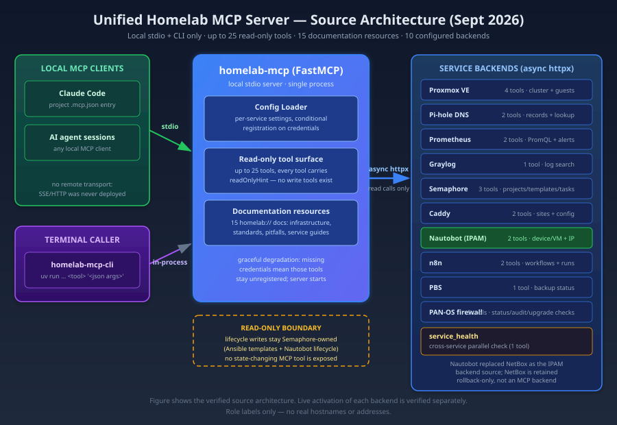

> **Correction, September 2026.** This post originally described the server as
> wrapping 9 services with 32 tools, including a confirmation-gated write
> surface and plans for an SSE transport. The maintained server is simpler and
> stricter than that: **local stdio plus a CLI, up to 25 read-only tools across
> 10 configured backends, and 15 documentation resources**. There are no write
> tools and no remote transport. Lifecycle changes (provisioning, DNS records,
> container updates) are owned by Semaphore automation, and the IPAM backend is
> now Nautobot — NetBox is retained rollback-only. The sections below have been
> rewritten to describe the current architecture; the original narrative is
> preserved where it explains the design decisions that still hold.

## The Problem: Six Interfaces for One Question

"Is anything broken in my homelab?"

Answering that question used to mean: SSH into Proxmox to check guest status. Curl the Pi-hole API for DNS health. Open Grafana to scan Prometheus alerts. Check Graylog for error spikes. Look at Semaphore for failed automation runs. Glance at Caddy logs for 502s.

Each interface had its own credentials and way of presenting the data. If I needed to change a guest after diagnosing it, I had to open another SSH session and risk mistyping a VMID.

I already ran separate MCP servers for Semaphore and PAN-OS. Adding one process and one `.mcp.json` entry per service would still leave me assembling health checks by hand.

## The Decision

I built a [FastMCP](https://github.com/jlowin/fastmcp) server with one config and read-only tools for the infrastructure I check every day.

I moved Semaphore into it and kept the PAN-OS MCP separate. That server is an upstream fork with a different scope.

### Why MCP?

Clients like Claude Code speak Model Context Protocol (MCP) directly. A REST API would need an adapter. With MCP, the assistant can call `list_guests(status="running")` with a structured argument and get structured data back.

## Architecture

The server follows a modular pattern: one Python module per service, each with its own async HTTP client, all registered conditionally at startup.



An MCP client launches the server locally over stdio. The `homelab-mcp-cli` entry point gives a terminal or agent host access to the same tools. I had planned SSE/HTTP support, but never deployed it, and the source has no remote entry point.

### Graceful Degradation

Each service loads its config in its own try/except. If Graylog credentials are missing, Graylog's tools stay out of the inventory. The server can start with only Proxmox configured.

```python
# Each service loads independently
try:
    config.proxmox = ProxmoxSettings()
except ValidationError:
    config.proxmox = None  # Tools won't register

try:
    config.graylog = GraylogSettings()
except ValidationError:
    config.graylog = None  # Graylog tools silently absent
```

I can add credentials one service at a time without blocking startup on the ones I haven't configured.

### Read-Only by Construction

The original design had a confirmation gate for writes. I removed write tools entirely. Each tool carries MCP's read-only annotation, and CI compares the registered inventory with an exact expected set.

Semaphore owns playbooks and lifecycle tasks, and Nautobot owns IPAM lifecycle state. Those paths have their own audit trails. The MCP server no longer needs a `confirm=true` flag because it exposes no writes.

## Service Backends

### Proxmox (the core)

The Proxmox service was ported from an existing infrastructure drift scanner. The key reuse was the IP extraction logic, which handles Proxmox's inconsistent IP reporting across LXC configs, cloud-init, and QEMU agent data:

```python
def _extract_ip_from_config(config: dict) -> str | None:
    # Try cloud-init first
    if ipconfig := config.get("ipconfig0", ""):
        if match := re.search(r"ip=(\d+\.\d+\.\d+\.\d+)", ipconfig):
            return match.group(1)
    # Fall back to net0 static IP
    if net0 := config.get("net0", ""):
        if match := re.search(r"ip=(\d+\.\d+\.\d+\.\d+)", net0):
            return match.group(1)
    return None
```

The original used synchronous `requests`. I switched to async `httpx` so a slow HTTP response wouldn't hold up concurrent calls.

**Tools**: `infra_overview`, `list_guests`, `get_guest`, `node_status`

### Pi-hole HA

The homelab runs Pi-hole in a high-availability pair with keepalived failover. The MCP service reads both instances, authenticating to each independently using Pi-hole v6's session-based auth (SID + CSRF tokens). DNS *changes* go through the Semaphore-managed deploy pipeline, not through the MCP.

**Tools**: `dns_list_records`, `dns_lookup`

### Prometheus

No auth needed (internal network), so this service always loads when the server starts. Exposes raw PromQL queries and a structured alerts endpoint:

**Tools**: `prom_query`, `prom_alerts`

### Graylog

Basic auth over the Graylog REST API. The search tool accepts a query string and timerange, returning structured log entries:

**Tools**: `search_logs`

### Semaphore (absorbed)

I moved the standalone Semaphore server (376 lines using the raw `Server` class) into the unified server. I kept async httpx and switched registration to FastMCP decorators. It lists projects, templates, and task status. I run tasks through the Semaphore UI and its approval flow.

**Tools**: `semaphore_list_projects`, `semaphore_list_templates`, `semaphore_task_status`

### Caddy

Read-only access to both HA instances' admin APIs: configured sites and the full config.

**Tools**: `caddy_list_sites`, `caddy_get_config`

### Nautobot (IPAM)

The IPAM backend is [Nautobot](https://docs.nautobot.com/), which replaced NetBox for ordinary IPAM and lifecycle operations. The adapter exposes two tools: a device/VM search and an IP address lookup.

`nautobot_search` looks up devices and VMs. It requests one page with `limit=50` and never follows `next` links. Nautobot has no global search endpoint. `nautobot_get_ip` validates the IP or CIDR in `address` before calling the API and returns matching records with their prefixes.

*On 2026-09-17, I verified authenticated device and VM search and IP lookup against production Nautobot.*

```bash
uv run homelab-mcp-cli nautobot_search '{"query": "nas"}'
uv run homelab-mcp-cli nautobot_get_ip '{"address": "192.0.2.10/24"}'
```

**Tools**: `nautobot_search`, `nautobot_get_ip`

### n8n and PBS

Read-only visibility into workflow automation and backups: n8n exposes workflow listings and execution history; PBS (Proxmox Backup Server) shows backup status.

**Tools**: `n8n_list_workflows`, `n8n_get_executions`, `pbs_backup_status`

### PAN-OS firewall

Five read-only firewall tools: system info and HA state, policy lookup (would this flow be allowed?), rule config audit, and upgrade readiness/checks.

**Tools**: `fw_status`, `fw_policy_lookup`, `fw_config_audit`, `fw_upgrade_check`, `fw_upgrade_status`

## The Tool Inventory

CI compares the inventory from MCP Inspector against the expected set and fails if they differ:

| Backend | Tools | Kind |
|---------|-------|------|
| Proxmox | 4 (overview, guests, guest detail, node status) | read-only |
| Pi-hole DNS | 2 (records, lookup) | read-only |
| Prometheus | 2 (query, alerts) | read-only |
| Graylog | 1 (log search) | read-only |
| Semaphore | 3 (projects, templates, task status) | read-only |
| Caddy | 2 (sites, config) | read-only |
| Nautobot | 2 (device/VM search, IP lookup) | read-only |
| n8n | 2 (workflows, executions) | read-only |
| PBS | 1 (backup status) | read-only |
| PAN-OS | 5 (status, policy, audit, upgrade checks) | read-only |
| **Cross-service** | **1 (service_health)** | **read-only** |
| **Total** | **up to 25** | **0 write** |

The total depends on configuration. Each backend registers tools only when it has the config it needs. With all optional credentials in place, the count is 25.

The `service_health` tool runs parallel health checks across all configured services using `asyncio.gather()`, returning a unified status in one call.

## Documentation Resources

I also serve 15 documentation resources over MCP (`homelab://` URIs). The client can read the infrastructure inventory, standards, known pitfalls, DNS records, and service guides without opening the repository. This was the original Phase 2.

## Configuration

The entire server is configured through environment variables, one prefix per service:

```bash
# Required (minimum viable server)
PROXMOX_API_URL=https://<PROXMOX_HOST>:8006
PROXMOX_TOKEN_ID=<USER>@pam!<TOKEN_NAME>
PROXMOX_TOKEN_SECRET=<SECRET>

# Optional (tools register only when present)
PIHOLE_DNS1_PASSWORD=<PASSWORD>
PIHOLE_DNS2_PASSWORD=<PASSWORD>
PROMETHEUS_URL=http://<PROMETHEUS_HOST>:9090
GRAYLOG_URL=http://<GRAYLOG_HOST>:9000
# Semaphore and Nautobot each take an API token env var
# (SEMAPHORE_API_TOKEN / NAUTOBOT_API_TOKEN — Nautobot powers IPAM lookups)
# ... etc
```

Claude Code connects via a single `.mcp.json` entry:

```json
{
  "mcpServers": {
    "homelab": {
      "command": "uv",
      "args": ["--directory", "homelab-mcp", "run", "homelab-mcp-stdio"]
    }
  }
}
```

## What It Looks Like in Practice

Here's how I can ask Claude Code to check the lab now:

> **Me**: "Is anything broken?"
>
> **Claude**: *calls `service_health`* "All configured services healthy. Proxmox cluster: 4 nodes. No Prometheus alerts firing. Graylog ingestion rate normal."

> **Me**: "What's sitting on this IP?"
>
> **Claude**: *calls `nautobot_get_ip` with the address* "That's the NAS primary host — matching interface, DNS name, and assigned status."

> **Me**: "Find every VM with 'nas' in the name"
>
> **Claude**: *calls `nautobot_search`* "Two matches: the NAS primary and its standby, with nodes and status."

I can ask those questions from one conversation. For a change, I use a Semaphore task with its own approval and log instead of a `confirm=true` flag in chat.

## Code Reuse

Most of the service logic was already in my scripts and existing servers:

| Source | Destination | What was ported |
|--------|------------|-----------------|
| Infrastructure drift scanner | Proxmox service | Guest dataclass, IP extraction, node iteration |
| PAN-OS MCP config | Config module | pydantic-settings pattern with env_prefix |
| PAN-OS MCP entry point | stdio entry point | Local stdio launcher pattern |
| Standalone Semaphore MCP | Semaphore service | API paths, project/template handling |
| Pi-hole DNS deploy script | Pi-hole service | v6 session auth |

The main transformation across all ports was `requests` (sync) to `httpx` (async). The business logic stayed the same.

## Lessons Learned

1. Load each backend separately. An expired API key should only take that backend out of service.

2. Put writes in automation with its own approval and audit trail. The MCP surface only needs tools for reading.

3. One server with conditional registration spared me nine separate processes and let me build cross-service health checks in one place.

4. I chose `httpx` and `async/await` so `service_health` could check services in parallel from the start.

5. I left write tools and SSE in the article after they were gone from the design. The inventory test now catches drift in the tools. I date corrections so readers can tell which account describes the running system.
