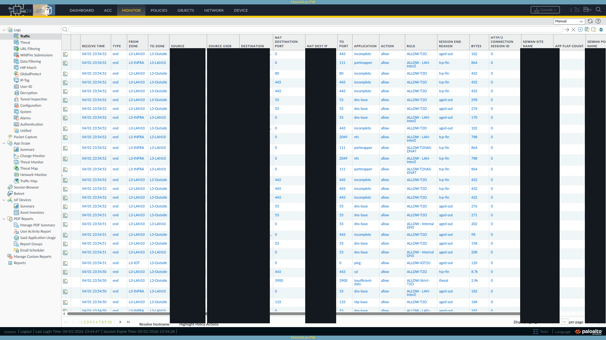
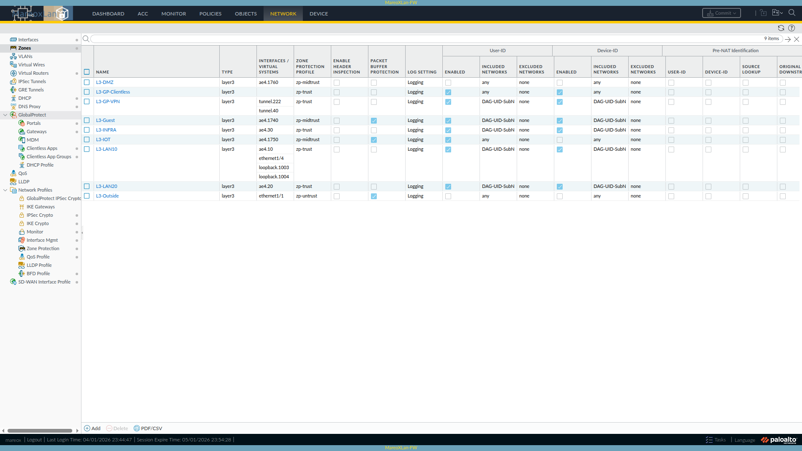
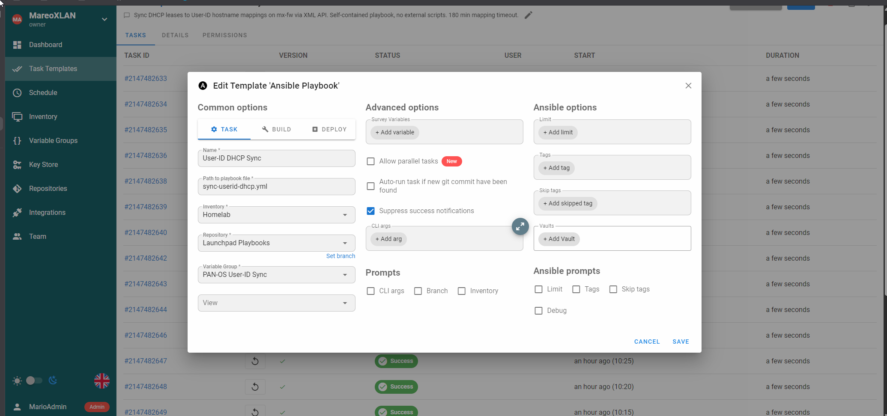
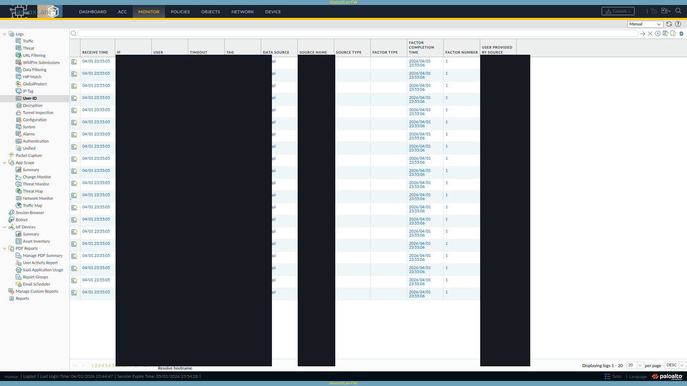

## TL;DR

My PA-440 logged IPs for devices I knew by name. I wrote a Python script that combines Pi-hole DNS, UniFi Controller data, and PAN-OS DHCP leases, then pushes the names through User-ID. It gave me 124 named devices without Active Directory.

**Before:**
```text
192.0.2.10  →  8.8.8.8       user: unknown
192.0.2.11  →  1.1.1.1       user: unknown
192.0.2.12    →  52.26.132.60  user: unknown
```

**After:**
```text
192.0.2.10  →  8.8.8.8       user: iphone
192.0.2.11  →  1.1.1.1       user: graylog
192.0.2.12    →  52.26.132.60  user: ring - front door
```

On my PA-440, the names now show up in the Source User column:



---

## Quick Start (5 minutes)

You'll need:

- A PAN-OS firewall that serves DHCP and supports the XML API
- An admin API key for the firewall
- Python 3.6+ on any machine that can reach the firewall over HTTPS

**Step 1:** Generate a PAN-OS API key (run this once):

```bash
curl -sk \
  "https://<FIREWALL_IP>/api/?type=keygen\
&user=<ADMIN_USER>&password=<PASSWORD>"
```

Copy the value from the `<key>` element. The [PAN-OS API key generation docs](https://docs.paloaltonetworks.com/pan-os/11-2/pan-os-panorama-api/get-started-with-the-pan-os-xml-api/get-your-api-key) walk through the response.

**Step 2:** Create the script and config file:

```bash
# Create a .env file with your credentials
cat > .env << 'EOF'
firewall-ip=<YOUR_FIREWALL_IP>
admin-api-key=<YOUR_API_KEY_FROM_STEP_1>
EOF
```

Then create `sync_userid_dhcp.py` with the full source at the [bottom of this post](#full-script).

**Step 3:** Run it:

```bash
# Preview what it would do (no changes made)
python3 sync_userid_dhcp.py --dry-run --verbose

# Push mappings to the firewall
python3 sync_userid_dhcp.py --verbose
```

With DHCP alone, logs show a name for devices that send a hostname in option 12. Add UniFi and static DNS below to pick up devices DHCP can't name.

---

## Prerequisites (Things You Must Configure First)

The API can accept a mapping before the firewall can use it. Enable User-ID on the zones where you want the names to appear in logs and policies.

### 1. Enable User-ID on Your Zones

In the PAN-OS web UI: **Device > User Identification > User Mapping**

Then for each internal zone (**Network > Zones > click zone name**):
- Check **Enable User Identification**

Or via CLI:

```text
set zone <ZONE_NAME> enable-user-identification yes
```

Enable it on the internal zones where you want device names in traffic logs. Leave it off on the WAN/untrust zone.




See the official [User-ID zone configuration guide](https://docs.paloaltonetworks.com/pan-os/11-2/pan-os-admin/user-id/enable-user-id) for full details on enabling User-ID per zone and configuring the User Mapping agent.


### 2. Verify the API Key Works

Use a test mapping to verify that the key can push User-ID entries:

```bash
curl -sk "https://<FIREWALL_IP>/api/?type=user-id\
&key=<API_KEY>\
&cmd=<uid-message>\
<version>2.0</version>\
<type>update</type>\
<payload><login>\
<entry name=\"test-device\" ip=\"192.0.2.13\" timeout=\"5\"/>\
</login></payload></uid-message>"
```

You should see `<response status="success">`. The test mapping expires in 5 minutes.

### 3. No Firewall Configuration Changes Needed

Once User-ID is enabled on your zones, the script only needs API access from another host. You can skip the syslog profile, parse profile, and server monitor that the loopback approach uses.

---

## How the Script Works

### The Core Idea

Each source sees a different part of the network:

- **DHCP** only sees dynamic clients (and some don't send hostnames)
- **DNS records** only cover devices you've manually documented
- **UniFi** only sees devices on its switches/APs (not VMs behind virtual bridges)

The script queries all three, merges them by IP with a priority order, and pushes the combined list to PAN-OS via the [User-ID XML API](https://docs.paloaltonetworks.com/pan-os/11-2/pan-os-panorama-api/pan-os-xml-api-request-types/dynamic-user-group-api).

### The Priority Merge (This Is the Key Concept)


flowchart TD
    A["Pi-hole A Records\n(static infrastructure)\n69 devices"] --> M
    B["UniFi Controller\n(device fingerprint)\n46 devices"] --> M
    C["PAN-OS DHCP\n(dynamic leases)\n54 leases"] --> M

    M{"Priority Merge\n(first source wins per IP)"}

    M --> D["User-ID XML API\nBatched push\n(50 entries/request)"]
    D --> E["124 Named Mappings\non PA-440 Firewall"]

    style A fill:#2563eb,stroke:#1d4ed8,color:#fff
    style B fill:#059669,stroke:#047857,color:#fff
    style C fill:#d97706,stroke:#b45309,color:#fff
    style M fill:#7c3aed,stroke:#6d28d9,color:#fff
    style D fill:#4b5563,stroke:#374151,color:#fff
    style E fill:#dc2626,stroke:#b91c1c,color:#fff


When two sources report the same IP, the first match in this order wins:

| Priority | Source | What It Covers | Example Names |
|:--------:|--------|----------------|---------------|
| 1 | Pi-hole A records | Static infrastructure (Proxmox, Caddy, NFS) | `graylog`, `pve5`, `caddy` |
| 2 | UniFi client names | User-assigned labels in the UniFi UI | `Ring - Front Door`, `NAS-Primary` |
| 3 | DHCP hostnames | What the device reports via DHCP option 12 | `iphone`, `mario-pc` |
| 4 | UniFi OUI vendor | Manufacturer from MAC address prefix | `Amazon-000001`, `Ring-000001` |

The script uses a Python dictionary to keep the first name it gets for each IP:

```python
all_mappings = {}  # ip -> {username, source}

# Priority 1: Static DNS (manually curated, cleanest names)
for record in static_dns_records:
    all_mappings[record["ip"]] = record

# Priority 2: UniFi client names (user-assigned labels)
for client in unifi_clients:
    if client["ip"] not in all_mappings:
        all_mappings[client["ip"]] = client

# Priority 3: DHCP hostnames (what the device reports)
for lease in dhcp_leases:
    if lease["ip"] not in all_mappings:
        all_mappings[lease["ip"]] = lease

# Priority 4: Replace ugly "mac-XXXX" with manufacturer names
for oui_entry in unifi_oui_fallbacks:
    ip = oui_entry["ip"]
    if ip in all_mappings and all_mappings[ip]["username"].startswith("mac-"):
        all_mappings[ip] = oui_entry
```

**Why this order?** Here is the same example with sample names and addresses. The Proxmox host at `192.0.2.14` appears in:
- Pi-hole A records as `pve5` (clean, short, I chose this name)
- UniFi as `PVE5` (from the controller's device fingerprint)
- DHCP: not at all (static IP, no lease)

The A record wins because it's manually curated and the shortest/cleanest.

### The API Push

I send entries in batches with the [User-ID XML API](https://docs.paloaltonetworks.com/pan-os/11-2/pan-os-panorama-api/pan-os-xml-api-request-types/dynamic-user-group-api):

```xml
<uid-message>
  <version>2.0</version>
  <type>update</type>
  <payload>
    <login>
      <entry name="iphone"
             ip="192.0.2.10"
             timeout="180"/>
      <entry name="graylog"
             ip="192.0.2.11"
             timeout="180"/>
      <entry name="ring - front door"
             ip="192.0.2.12"
             timeout="180"/>
    </login>
  </payload>
</uid-message>
```

The `name` field is what shows up in traffic logs. `timeout` is in minutes, so 180 gives the entry 3 hours. These are dynamic mappings and take effect without a commit.


**HTTP 414:** A request with 100+ entries can exceed the URI length limit once the XML is URL-encoded. The script sends 50 at a time.


---

## Adding UniFi Controller (Optional, Recommended)

The UniFi Controller sees clients on its switches and access points. It can fill in names and manufacturers for devices that sent no usable hostname over DHCP.

| Field | What It Is | Example |
|-------|-----------|---------|
| `name` | Label you set in the UniFi UI | `Ring - Front Door` |
| `hostname` | DHCP hostname the device reported | `LG_Smart_Fridge2_open` |
| `oui` | Manufacturer from MAC address lookup | `Amazon Technologies Inc.` |
| `mac` | Device MAC address | `02:00:00:00:00:01` |

**What UniFi reveals that DHCP alone misses:**

| Device | DHCP Hostname | UniFi Knows |
|--------|--------------|-------------|
| Fire TV Stick | `[Unavailable]` | name: `HO-FTV4kUltra` |
| Ring Doorbell | *(empty)* | name: `Ring - Front Door`, OUI: `Ring LLC` |
| TP-Link Smart Plug | *(empty)* | hostname: `KP115`, OUI: `TP-Link` |
| Smart Fridge | *(empty)* | hostname: `LG_Smart_Fridge2_open` |
| Amazon Fire Stick | *(empty)* | OUI: `Amazon Technologies Inc.` |

### UniFi Setup

Add UniFi credentials to your `.env` file:

```bash
# Append to your existing .env
cat >> .env << 'EOF'
UNIFI_CONTROLLER_URL=https://<UNIFI_IP>:8443
UNIFI_USERNAME=<YOUR_UNIFI_ADMIN>
UNIFI_PASSWORD=<YOUR_UNIFI_PASSWORD>
EOF
```

The script can read a UniFi `.env` at `../../unifi/.env`, relative to the script. It also accepts `UNIFI_URL`, `UNIFI_USER`, and `UNIFI_PASS` from the environment.

**UniFi API notes:**
- Uses session-based auth (login with username/password, get cookie, query, logout)
- The endpoint is `GET /api/s/default/stat/sta` (returns all connected clients)
- Works with UniFi Network Application 7.x+ and UniFi OS consoles
- Port 8443 is the default for self-hosted; CloudKey/UDM may differ
- The script handles SSL certificate warnings automatically (self-signed certs are common)


See the [UniFi API documentation](https://ubntwiki.com/products/software/unifi-controller/api) for the full list of available endpoints and client data fields.


### Tip: Name Your Devices in UniFi

In the UniFi web UI, open **Clients**, select a device, and give it a name. That label takes priority 2 in the merge. I used it to name my doorbells, NAS boxes, and KVMs in the firewall logs.

---

## Adding Static DNS Records (Optional, For Infrastructure)

Static addresses never show up as DHCP leases. For servers, switches, access points, and Proxmox hosts, I use Pi-hole A records or another file with names and IPs.

### Pi-hole A Records Format

The script parses this YAML format (used by Pi-hole's DNS management):

```yaml
groups:
  - name: "Reverse Proxy"
    records:
      - ip: "192.0.2.15"
        hostname: "caddy.mydomain.local"
      - ip: "192.0.2.16"
        hostname: "caddy2.mydomain.local"

  - name: "Monitoring"
    records:
      - ip: "192.0.2.11"
        hostname: "graylog.mydomain.local"
      - ip: "192.0.2.17"
        hostname: "prometheus.mydomain.local"
```

If you store names in CSV, JSON, or a hosts file, adapt `get_static_mappings()` to parse that format.

The script auto-discovers the A records file at `../../pihole/dns-records/a-records.yaml` relative to its location, or you can set the `ARECORDS_YAML_PATH` environment variable.

The script strips domain suffixes. `graylog.mydomain.local` appears as `graylog`. If an IP has several DNS names, the script keeps the shortest one.

---

## Gotchas I Hit (Save Yourself the Debugging)

### 1. The Syslog Loopback Works (I Misconfigured It)

**Correction (2026-07-12):** A reader who runs this setup without a proxy at home and has used it at roughly the last 18 Black Hat events challenged my result. I retested on my PA-440 with PAN-OS 11.2.12. My original claim that PAN-OS can't deliver syslog to its own interface was wrong.

The [approach I followed](https://jamesholland.me.uk/user-id-from-dhcp/) sends the firewall's DHCP lease logs back to its syslog listener. I set up the syslog profile, log match filter, parse profile, and server monitor. I saw 0 messages and drew the wrong conclusion.

I tested direct syslog from an external host. I pointed it at the PA-440's dataplane listener and added a matching Server Monitor entry. The firewall created a live User-ID mapping with no proxy or relay. That's the supported syslog integration. It's probably the reader's setup too, with a separate DHCP server or NAC gear sending the logs.

I verified the configuration requirements for self-loopback during the retest. I ran the live test only with an external sender. For self-loopback, send syslog to the IP used as the source in the syslog service route, and put that same IP in the Server Monitor Network Address. PAN-OS discards messages from unlisted senders without logging an error.

In my first test, I sent loopback syslog to the out-of-band management address while the service route sourced it from a dataplane interface. The packet couldn't reach that isolated management network. The Server Monitor also needed an entry matching the source. Mine was effectively empty, so even a correctly routed packet would have been dropped.

Two details I would check on another setup:

- The User-ID listener accepts UDP 514 or SSL 6514. Plain TCP won't work.
- The Server Monitor parse-profile reference needs a nested `event-type` of login or logout. Without it, the commit can report `status=FIN` and `result=FAIL`. Read the result field to see whether it succeeded.


Use a syslog relay if the senders can't route directly to the firewall or you need to rewrite their log format. For this single firewall, I kept the XML API approach so I didn't have to maintain a service route or match syslog senders.


### 2. DHCP Reservations Were Being Skipped

My first version skipped all `state=reserved` entries because most of my reservations only had MAC addresses. That also hid my workstation, which had a reservation and a hostname. The script now skips a reservation only when the hostname is missing.

### 3. HTTP 414 URI Too Long

The web server rejected a single URL-encoded request with all 124 entries. I split the list into batches of 50.

### 4. UniFi API Requires Session Auth, Not API Keys

With `X-API-KEY`, I got 0 clients from `/stat/sta`. POST to `/api/login` with the username and password, then use the session cookie for the client query.

### 5. PAN-OS XML Schema Differs From CLI Syntax

For User-ID configuration, I query `action=complete` to see what XML the API accepts. The CLI `set` syntax doesn't tell you how to nest the elements.

```text
GET /api/?type=config&action=complete
    &xpath=.../server-monitor/entry/syslog
```

This returns all valid child elements at any xpath. I discovered that `syslog-parse-profile` uses `<entry name="...">` reference format (not text content), and `event-type` nests inside the profile entry. See the [PAN-OS XML API config reference](https://docs.paloaltonetworks.com/pan-os/11-2/pan-os-panorama-api/pan-os-xml-api-request-types/pan-os-xml-api-request-types-and-actions/configuration-actions) for more on the `action=complete` endpoint.

---

## Automating It (Cron)

I run the script every 5 minutes. The mappings expire after 180 minutes (3 hours), so the next 36 runs can be missed before the old mappings go stale.

### Option A: Simple Cron

```bash
# Edit crontab
crontab -e

# Add this line (adjust path to your script location)
*/5 * * * * cd /path/to/script \
  && python3 sync_userid_dhcp.py \
  >> /var/log/userid-sync.log 2>&1
```

### Option B: Ansible + Semaphore (What I Use)

I run it from a [Semaphore](https://semaphoreui.com/) CI/CD template. Semaphore lets me see the runs, get failure alerts, and keep credentials in one place.



The playbook uses `ansible.builtin.copy` to write the Python script to `/tmp`. It runs the script and removes the temporary file afterward. Credentials come from Semaphore's encrypted environment variables.

<details>
<summary>Click to expand sync-userid-dhcp.yml (Ansible playbook)</summary>

```yaml
---
# Sync device identities to User-ID mappings on Firewall-Main
# Multi-source: Pi-hole A records + UniFi Controller + PAN-OS DHCP leases
#
# Schedule: every 5 minutes via Semaphore cron
# Timeout: mappings expire after 180 min, so missing a few runs is safe
#
# Semaphore environment must provide:
#   PANOS_API_KEY: Firewall-Main admin API key
#   UNIFI_USER: UniFi controller username
#   UNIFI_PASS: UniFi controller password
#   PANOS_HOST: <FIREWALL_IP> (set this to your firewall address)
#   UNIFI_URL: https://<UNIFI_IP>:8443 (optional)

- name: Sync User-ID from DHCP + UniFi + static DNS
  hosts: localhost
  connection: local
  gather_facts: false

  tasks:
    - name: Verify API key is set
      ansible.builtin.fail:
        msg: "PANOS_API_KEY not set in Semaphore environment"
      when: lookup('env', 'PANOS_API_KEY') == ''

    - name: Write sync script
      ansible.builtin.copy:
        dest: /tmp/sync_userid_combined.py
        mode: "0755"
        content: |
          #!/usr/bin/env python3
          # Full Python script written inline here
          # (see the standalone script above for the complete source)
          # This version combines all 3 sources: static DNS,
          # UniFi Controller, and DHCP leases
          ...

    - name: Run sync script
      ansible.builtin.command:
        cmd: python3 /tmp/sync_userid_combined.py
      environment:
        PANOS_API_KEY: "{{ lookup('env', 'PANOS_API_KEY') }}"
        PANOS_HOST: "{{ lookup('env', 'PANOS_HOST') | default('<FIREWALL_IP>', true) }}"
        UNIFI_URL: "{{ lookup('env', 'UNIFI_URL') | default('https://<UNIFI_IP>:8443', true) }}"
        UNIFI_USER: "{{ lookup('env', 'UNIFI_USER') | default('', true) }}"
        UNIFI_PASS: "{{ lookup('env', 'UNIFI_PASS') | default('', true) }}"
      register: sync_result
      changed_when: "'Pushed' in sync_result.stdout"

    - name: Show result
      ansible.builtin.debug:
        msg: "{{ sync_result.stdout_lines }}"

    - name: Cleanup temp script
      ansible.builtin.file:
        path: /tmp/sync_userid_combined.py
        state: absent
```

</details>

I write the script at runtime so Semaphore doesn't need an SSH key to clone it. `changed_when: "'Pushed' in sync_result.stdout"` marks the task as changed when the script actually pushes mappings. Credentials pass through environment variables and stay out of the temporary file. With `connection: local`, the playbook runs on `localhost`; it only needs HTTPS to the firewall and UniFi controller.

### Verifying It Works

After running the script, check the firewall:

```bash
# Via API (replace <FW> and <KEY>)
curl -sk "https://<FW>/api/?type=op&key=<KEY>\
&cmd=<show><user><ip-user-mapping>\
<all></all></ip-user-mapping></user></show>"
```

Or via CLI (SSH to firewall):

```text
> show user ip-user-mapping all

IP              Vsys   User              Type     Timeout
192.0.2.10  vsys1  iphone            XMLAPI   180
192.0.2.11  vsys1  graylog           XMLAPI   180
192.0.2.12    vsys1  ring - front door XMLAPI   180
```

Check traffic logs (**Monitor > Traffic**): the "Source User" and "Destination User" columns now show device names.



---

## What I Evaluated and Rejected

I looked at these options before writing the script:

| Tool | Why I Skipped It |
|------|-----------------|
| **[PacketFence](https://www.packetfence.org/)** | Enterprise NAC. Requires 16GB RAM, MariaDB, FreeRADIUS. Wants to be your DHCP server. No native PAN-OS User-ID integration. Massive overkill for device naming. |
| **[p0f](https://lcamtuf.coredump.cx/p0f3/)** | Passive OS fingerprinting. Signature database last updated ~2012. Cannot identify modern iOS, Android, or Windows 11. Unmaintained. |
| **[Fingerbank](https://fingerbank.org/)** | Cloud API for device fingerprinting (by the PacketFence team). Interesting, but UniFi already does 80% of this for free. Free tier is 300 req/hour. |
| **mDNS/Bonjour sniffing** | Requires a listener daemon on each VLAN. UniFi already catches most mDNS devices through its normal operation. |
| **[PAN-OS Device-ID](https://docs.paloaltonetworks.com/iot/iot-security-admin/get-started-with-iot-security/device-id-overview)** | Maps device *type* (e.g., "IP Camera"), not hostname. Requires a paid IoT Security subscription for full coverage. 0 entries without the license. |
| **NetBIOS scanning** | Windows-only, active scanning, UDP 137. Marginal benefit when UniFi already has the data. |

---

## Extending the Script

Each new source can use this pattern:

```python
def get_my_new_source():
    """Return a list of dicts with ip, username, source keys."""
    mappings = []
    # ... query your source here ...
    mappings.append({
        "ip": "192.0.2.18",
        "username": "my-device",
        "source": "my-source",
    })
    return mappings
```

Put the source at the right priority in `main()`. The first source to claim an IP supplies its name.

Ideas for additional sources: Wazuh agent list, Proxmox API (VM/LXC names to IPs), SNMP discovery (device sysName), or ARP table + reverse DNS.

---

## Results

I ended up with 124 named devices across 6 VLANs and no pip dependencies.

| Source | Devices | Examples |
|--------|:-------:|---------|
| Pi-hole A records (static DNS) | 69 | `graylog`, `sema`, `atlas`, `pve5`, `caddy` |
| UniFi hostnames | 34 | `LG_Smart_Fridge2_open`, `KP115`, `HS200` |
| UniFi user-assigned names | 5 | `Ring - Front Door`, `NAS-Primary-Eth1` |
| UniFi OUI vendor fallback | 10 | `Amazon-000001`, `Tuya-000001`, `Ring-000001` |
| PAN-OS DHCP leases | 6 | `tesla`, `Mario-s-S23-Ultra` |
| **Total** | **124** | |

The script is about 300 lines and uses only the Python standard library (`urllib`, `ssl`, `json`, `re`, `xml.etree`). It runs on any host that can reach the firewall over HTTPS.

---

## Full Script

This is the DHCP-only script. Use the UniFi and static DNS sections above to add those sources.

<details>
<summary>Click to expand sync_userid_dhcp.py (~150 lines)</summary>

```python
#!/usr/bin/env python3
"""
Sync DHCP leases to User-ID mappings on a PAN-OS firewall.

Usage:
    python3 sync_userid_dhcp.py              # Push DHCP mappings
    python3 sync_userid_dhcp.py --dry-run    # Preview without pushing
    python3 sync_userid_dhcp.py --verbose    # Show all mapping details

Requires: .env file with firewall-ip and admin-api-key,
          or PANOS_API_KEY and PANOS_HOST environment variables.
"""

import urllib.request
import urllib.parse
import ssl
import xml.etree.ElementTree as ET
import sys
import os


def load_env(path=".env"):
    """Parse a key=value .env file (supports hyphenated keys)."""
    env = {}
    if not os.path.exists(path):
        return env
    with open(path) as f:
        for line in f:
            line = line.strip()
            if "=" in line and not line.startswith("#"):
                k, v = line.split("=", 1)
                env[k] = v
    return env


def api_call(base_url, params, ctx):
    """Make a PAN-OS XML API call and return parsed XML root."""
    query = urllib.parse.urlencode(params)
    url = f"{base_url}?{query}"
    req = urllib.request.Request(url)
    resp = urllib.request.urlopen(req, context=ctx)
    return ET.fromstring(resp.read().decode())


def get_dhcp_leases(base_url, api_key, ctx):
    """Retrieve active DHCP leases from all firewall interfaces."""
    root = api_call(base_url, {
        "type": "op",
        "cmd": (
            "<show><dhcp><server><lease>"
            "<interface>all</interface>"
            "</lease></server></dhcp></show>"
        ),
        "key": api_key,
    }, ctx)

    leases = []
    for entry in root.findall(".//entry"):
        ip = entry.find("ip")
        hostname = entry.find("hostname")
        mac = entry.find("mac")
        state = entry.find("state")

        if ip is None:
            continue

        host_text = hostname.text if hostname is not None else None
        mac_text = mac.text if mac is not None else None
        state_text = state.text if state is not None else ""

        # Use hostname if available
        if host_text and host_text not in (
            "[Unavailable]", "", "none"
        ):
            username = host_text
        # Skip reserved entries without hostnames
        elif state_text == "reserved":
            continue
        # Fall back to MAC address
        elif mac_text:
            username = f"mac-{mac_text.replace(':', '')}"
        else:
            continue

        leases.append({"ip": ip.text, "username": username})
    return leases


def push_mappings(base_url, api_key, ctx, mappings,
                  timeout_min=180, batch_size=50):
    """Push User-ID mappings in batches to avoid HTTP 414."""
    for i in range(0, len(mappings), batch_size):
        batch = mappings[i:i + batch_size]
        entries = []
        for m in batch:
            # XML-escape special characters in usernames
            u = (
                m["username"]
                .replace("&", "&amp;")
                .replace("<", "&lt;")
                .replace(">", "&gt;")
                .replace('"', "&quot;")
            )
            entries.append(
                f'<entry name="{u}" ip="{m["ip"]}" '
                f'timeout="{timeout_min}"/>'
            )

        cmd = (
            "<uid-message>"
            "<version>2.0</version>"
            "<type>update</type>"
            "<payload><login>"
            + "".join(entries)
            + "</login></payload>"
            "</uid-message>"
        )

        root = api_call(base_url, {
            "type": "user-id",
            "cmd": cmd,
            "key": api_key,
        }, ctx)

        if root.get("status") != "success":
            print(
                f"ERROR: Batch {i // batch_size + 1} failed"
            )
            sys.exit(1)


def main():
    # Credentials: env vars (for cron/CI) or .env file (local)
    api_key = os.environ.get("PANOS_API_KEY")
    fw_ip = os.environ.get("PANOS_HOST", "<FIREWALL_IP>")

    if not api_key:
        env = load_env(os.path.join(
            os.path.dirname(os.path.abspath(__file__)),
            ".env",
        ))
        api_key = env["admin-api-key"]
        fw_ip = env.get("firewall-ip", "<FIREWALL_IP>")

    base_url = f"https://{fw_ip}/api/"
    ctx = ssl.create_default_context()
    ctx.check_hostname = False
    ctx.verify_mode = ssl.CERT_NONE

    dry_run = "--dry-run" in sys.argv
    verbose = "--verbose" in sys.argv

    print("Fetching DHCP leases...")
    leases = get_dhcp_leases(base_url, api_key, ctx)
    print(f"  Found: {len(leases)} mappable leases")

    if verbose:
        for m in sorted(leases, key=lambda x: x["ip"]):
            print(f"    {m['ip']:20s} -> {m['username']}")

    if not leases:
        print("No mappings to push.")
        return

    if dry_run:
        print(f"[DRY RUN] Would push {len(leases)} mappings")
    else:
        print(f"Pushing {len(leases)} mappings...")
        push_mappings(base_url, api_key, ctx, leases)
        print("  Success")


if __name__ == "__main__":
    main()
```

</details>

To add another source, query it, put the names in `all_mappings` in priority order, and push the combined entries.

---

## Official Documentation References

- [PAN-OS XML API: Get Your API Key](https://docs.paloaltonetworks.com/pan-os/11-2/pan-os-panorama-api/get-started-with-the-pan-os-xml-api/get-your-api-key)
- [PAN-OS XML API: User-ID Request Types](https://docs.paloaltonetworks.com/pan-os/11-2/pan-os-panorama-api/pan-os-xml-api-request-types/dynamic-user-group-api)
- [PAN-OS Admin: Enable User-ID](https://docs.paloaltonetworks.com/pan-os/11-2/pan-os-admin/user-id/enable-user-id)
- [PAN-OS Admin: Configure User Mapping](https://docs.paloaltonetworks.com/pan-os/11-2/pan-os-admin/user-id/map-ip-addresses-to-users)
- [PAN-OS XML API: Configuration Actions (action=complete)](https://docs.paloaltonetworks.com/pan-os/11-2/pan-os-panorama-api/pan-os-xml-api-request-types/pan-os-xml-api-request-types-and-actions/configuration-actions)
- [PAN-OS Admin: Device-ID Overview (IoT Security)](https://docs.paloaltonetworks.com/iot/iot-security-admin/get-started-with-iot-security/device-id-overview)
- [UniFi Controller API Reference](https://ubntwiki.com/products/software/unifi-controller/api)
- [Original inspiration: User-ID from DHCP (James Holland)](https://jamesholland.me.uk/user-id-from-dhcp/)

---

*Built on a PA-440 running PAN-OS 11.2.10-h2. Automated via [Semaphore](https://semaphoreui.com/) (every 5 min). Compatible with any PAN-OS firewall that has the XML API enabled.*
