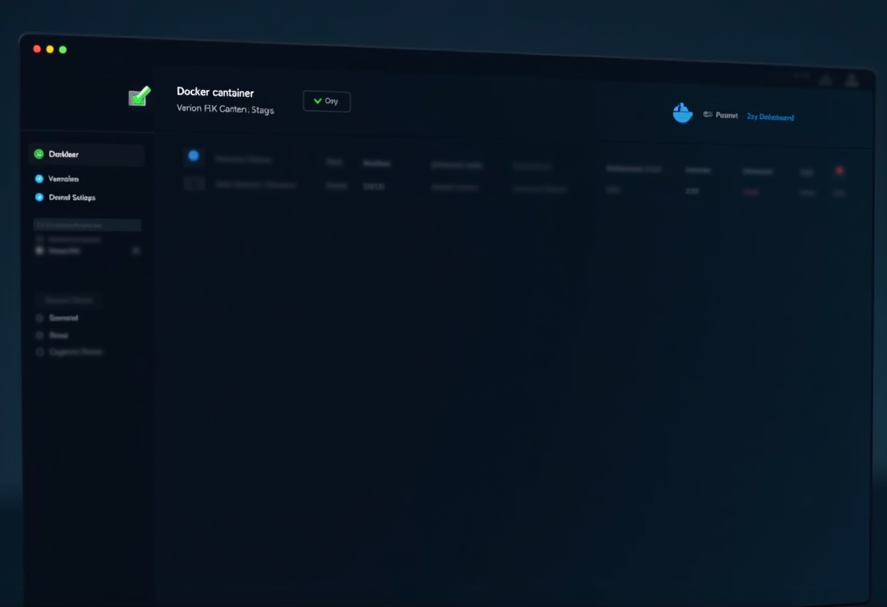

> **Update, September 2026.** Neither Watchtower nor WUD is the current
> update controller. Both were fully decommissioned in March 2026 after
> update-related outages; container updates are now Semaphore-managed
> (`safe-update.sh`, health-gated with soak and auto-rollback). This post is
> preserved as the historical migration account — including its NetBox
> dashboard walk-through, which reflects the IPAM tool of that era, not a
> current deployment.

## The Problem

I used Watchtower to update more than eight Docker services. The updates usually worked. I had trouble seeing them coming and choosing when they ran.

1. Watchtower watched every container by default. I had to add `com.centurylinklabs.watchtower.enable=false` to each one I wanted to exclude. A missed label meant a surprise update.

2. Updates ran silently at 4 a.m. There was no dashboard for pending updates. Sometimes the first sign of a new version was a broken service.

3. For the reverse proxy and secrets manager, I wanted to review new versions before applying them.

## What I Tried

I looked at four alternatives:
- **Diun** could notify me, but had no web UI.
- **Renovate** targeted CI/CD pipelines. I wanted something smaller for the lab.
- **Ouroboros** had been abandoned.
- **WUD (What's Up Docker)** let me opt containers in and see pending updates in a dashboard. It notified by default.

## The Solution

I migrated all 8 Docker stacks to WUD:




```yaml
# WUD Golden Template
wud:
  image: fmartinou/whats-up-docker:latest
  container_name: wud-<service>
  restart: unless-stopped
  ports:
    - "3000:3000"  # Web dashboard
  volumes:
    - /var/run/docker.sock:/var/run/docker.sock:ro
    - wud-data:/store
  environment:
    - TZ=America/Los_Angeles
    - WUD_WATCHER_LOCAL_WATCHBYDEFAULT=false  # CRITICAL: opt-in only
    - WUD_TRIGGER_DISCORD_1_URL=${DISCORD_WEBHOOK_URL:-}
    - WUD_TRIGGER_DISCORD_1_BOTUSERNAME=WUD-ServiceName
    - WUD_TRIGGER_DISCORD_1_SIMPLETITLE=Container Update Available
    - "WUD_TRIGGER_DISCORD_1_SIMPLEBODY=$${name} can be updated from $${local} to $${remote}"
  labels:
    - "wud.watch=true"
```

Key changes from Watchtower:
- Containers need `wud.watch=true` label to be monitored (opt-in)
- Web dashboard shows all monitored containers and pending updates
- WUD sent notifications. I chose when to pull an update.
- Tag filtering with `wud.tag.include` regex for semver-only updates

## Root Cause

The problem was the timing. I wanted to see updates while the old image was still running and pick a window to apply them.

## Key Takeaways

1. Opt containers in. I'd rather miss a notification than update a production service I meant to exclude.

2. Set `WUD_WATCHER_LOCAL_WATCHBYDEFAULT=false` for opt-in monitoring. Otherwise WUD watches everything by default.

3. WUD uses port 3000. I used 3001 on hosts where 3000 was occupied.

4. Check each host for the old Watchtower container after switching. I removed it with `docker rm -f watchtower`.

5. Update both HA nodes in the same change window. I had already seen what happens when their configurations drift.

## Services Migrated

| Service | WUD Dashboard |
|---------|---------------|
| Caddy HA (2 nodes) | `:3001` |
| Excalidraw | `:3001` |
| Neko | `:3000` |
| NetBox | `:3000` |
| Pulse | `:3000` |
| Semaphore | `:3001` |
| Wazuh | `:3000` |
| Infisical | `:3001` |

After the migration, the eight WUD dashboards showed what could be updated. I could choose when to apply it.
