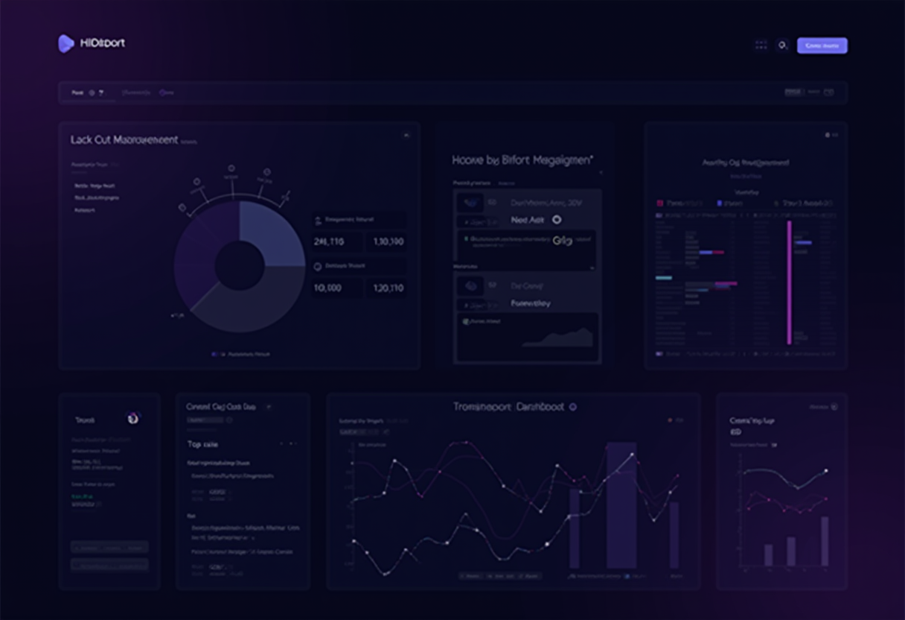

## The Challenge

I wanted endpoint detection and response without moving my existing logs out of Graylog. The new system had to use my Hermes threat feeds and leave me a way to grow beyond one node.

## The Solution

### Wazuh Single-Node Stack

I started with three Wazuh containers on one host:
- **Wazuh Manager**: Core HIDS/XDR engine
- **Wazuh Indexer**: OpenSearch-based storage
- **Wazuh Dashboard**: Kibana-based UI

### Graylog Integration via Rsyslog

I used rsyslog to send Wazuh alerts into the Graylog pipeline I already ran:

```bash
# /etc/rsyslog.d/wazuh-graylog.conf
# Forward Wazuh alerts to Graylog via syslog
module(load="imfile")

input(type="imfile"
      File="/var/ossec/logs/alerts/alerts.json"
      Tag="wazuh-alerts"
      Severity="info"
      Facility="local0")

local0.* @@<GRAYLOG_SERVER>:1514;RSYSLOG_SyslogProtocol23Format
```

### Pipeline Creation Scripts

I wrote two Python scripts for the Graylog setup:

**Pipeline creator.** Sets up extractors and processing rules for Wazuh JSON:
```python
# Key fields extracted:
# - rule.level (severity 0-15)
# - rule.description (alert message)
# - agent.name (source host)
# - data.* (event-specific data)
```

**Dashboard creator.** Builds these widgets:
- Alert severity distribution (pie chart)
- Top 10 triggered rules (bar chart)
- Agent activity timeline (histogram)
- Critical alerts table (>= level 10)



## What I Learned

### 1. JSON Log Shipping is Tricky

Wazuh writes one JSON object per line. The rsyslog `imfile` module can send each line as its own message for Graylog to extract. Check two things:
- File permissions allow rsyslog to read the alerts file
- Log rotation doesn't break the file watcher

### 2. Hermes Integration Adds Value

I use the Hermes feeds in `hermes_rules.xml` to check IP addresses, domains, and hashes:
- Known malicious IP detection
- Suspicious domain lookups
- File hash matching against threat intel

### 3. Single-Node is Fine for Homelab

The manager, indexer, and dashboard ran comfortably on this host:
- 4 vCPUs
- 8GB RAM
- 50GB storage

That was enough for my lab with fewer than 20 agents.

## Architecture

```text
┌─────────────────────────────────────────────────────────────┐
│                    Security Monitoring                       │
├─────────────────────────────────────────────────────────────┤
│                                                             │
│  ┌─────────┐    ┌─────────┐    ┌─────────┐                 │
│  │ Agents  │───▶│ Wazuh   │───▶│ Wazuh   │                 │
│  │ (hosts) │    │ Manager │    │ Indexer │                 │
│  └─────────┘    └────┬────┘    └─────────┘                 │
│                      │                                      │
│                      │ alerts.json                          │
│                      ▼                                      │
│               ┌──────────────┐                              │
│               │   rsyslog    │                              │
│               └──────┬───────┘                              │
│                      │ syslog/tcp:1514                      │
│                      ▼                                      │
│               ┌──────────────┐                              │
│               │   Graylog    │◀── Unified Log View          │
│               └──────────────┘                              │
│                                                             │
└─────────────────────────────────────────────────────────────┘
```

## Files Created

| File | Purpose |
|------|---------|
| `docker-compose.yml` | Wazuh single-node stack |
| `rsyslog-graylog-wazuh.conf` | Syslog forwarding config |
| `hermes_rules.xml` | Custom threat intel rules |
| `create-wazuh-graylog-pipeline.py` | Graylog pipeline automation |
| `create-wazuh-dashboard.py` | Dashboard generation |

## Next Steps

1. Deploy Wazuh agents to all LXC containers
2. Create alerting rules in Graylog for critical Wazuh events
3. Integrate with Discord notifications for real-time alerts
4. Explore Wazuh's vulnerability detection module

---

I can investigate endpoint alerts in Wazuh and correlate them with the rest of my logs in Graylog. The rsyslog bridge lets me do that with the logging setup I already had.
