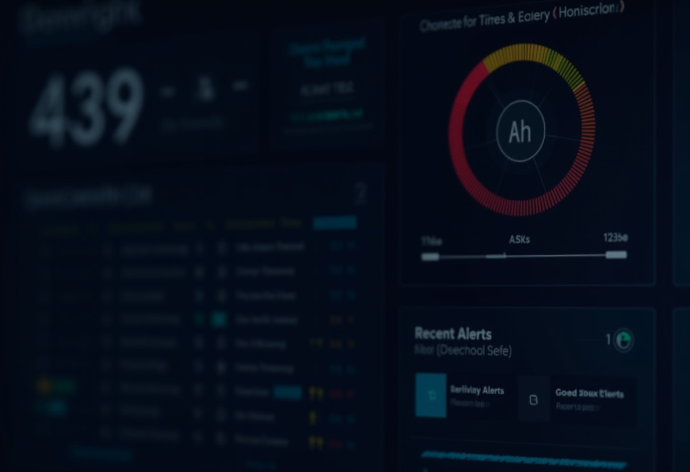

## Why an XDR in a Homelab?

I had VLANs, a firewall doing deep packet inspection, and patched systems. Then I gave Hermes, a local AI agent framework, shell and network access. It could chain commands across the lab on its own. The firewall could show me a connection, but I still needed to know what started it.

I already worried about compromised containers, lateral movement, and untrusted Docker images. An agent adds another path: someone can try to make it run a command through an instruction it reads. ClawHavoc gave me a concrete case to watch for.

I kept Graylog for central logging and added Wazuh for endpoint detection, file integrity monitoring, and threat correlation. It's open source and fits the stack I already run.

## The Architecture

I looked at several XDR options and picked Wazuh's single-node Docker deployment. It runs three containers.




The Wazuh Manager talks to endpoint agents, runs the detection rules, and exposes a REST API for configuration. It correlates events with threat intelligence and turns matches into alerts.

The OpenSearch-based Indexer stores those events and alerts. It handles the dashboard's historical queries, compliance reports, and forensic searches. It's also the component I had to watch for memory use.

The Kibana-based Dashboard is where I investigate alerts, inspect file changes and compliance status, and manage agents.

I gave the LXC 4 vCPUs, 8GB of RAM, and 50GB of storage. For a deployment with fewer than 20 agents, I didn't see enough benefit from clustering to justify the extra nodes, load balancers, and coordination.

```text
┌─────────────────────────────────────────────────────────────┐
│                    Security Monitoring                       │
├─────────────────────────────────────────────────────────────┤
│                                                             │
│  ┌─────────┐    ┌─────────┐    ┌─────────┐                 │
│  │ Agents  │───▶│ Wazuh   │───▶│ Wazuh   │                 │
│  │ (hosts) │    │ Manager │    │ Indexer  │                 │
│  └─────────┘    └────┬────┘    └─────────┘                 │
│                      │                                      │
│                      │ alerts.json                          │
│                      ▼                                      │
│               ┌──────────────┐                              │
│               │   rsyslog    │                              │
│               └──────┬───────┘                              │
│                      │ syslog/udp:1514                      │
│                      ▼                                      │
│               ┌──────────────┐                              │
│               │   Graylog    │◀── Unified Log View          │
│               └──────────────┘                              │
│                                                             │
└─────────────────────────────────────────────────────────────┘
```

Agents send events to the Manager over port 1514. The Manager writes alerts to a JSON file and stores structured data in the Indexer. On the LXC host, rsyslog watches the alerts file and forwards it to Graylog so I can search it alongside my other logs.

## Deployment: The Docker Way

I cloned the official wazuh-docker repository and opened the single-node directory, which already had a docker-compose.yml.

The Indexer wouldn't start until `vm.max_map_count` was at least 262144. I spent about 30 minutes setting it in the wrong place. An LXC shares the Proxmox host kernel, so set this on the host:

```bash
# On the Proxmox host
sysctl vm.max_map_count=262144
echo "vm.max_map_count=262144" >> /etc/sysctl.conf
```

The compose file defines three services with persistent volumes. Generate their TLS certificates before you start them:

```bash
# Generate certificates for the cluster
docker compose -f generate-indexer-certs.yml run --rm generator
```

The command writes the certificates and keys to `certs`. Then start the stack:

```bash
docker compose up -d
```

Give the stack about 60 to 90 seconds. The Indexer starts first, the Manager connects to it, and the Dashboard comes up last. Watch with `docker compose logs -f`.

The Dashboard listens on port 443 with a self-signed certificate. After the first login, I opened the agent enrollment page and changed the default credentials.

The supplied Compose stack includes health checks, restart policies, and persistent volumes.

## Custom Security Rules: Watching the AI

Wazuh already watches SSH authentication, file integrity, rootkits, and known vulnerabilities. On the agent host I also wanted to see which files and network destinations the agent touched. Shell, network, filesystem, and API access are normal for the work I give it, so a rule needs enough context to distinguish routine use from something worth investigating.

I added six rules to a custom XML file that Wazuh loads at startup. Each maps to MITRE ATT&CK techniques.

I started with known ClawHavoc command-and-control destinations. The rule fires on connections to the documented C2 IPs:

```xml
<rule id="100100" level="15">
  <if_sid>100001</if_sid>
  <match>ClawHavoc C2</match>
  <description>Hermes agent attempting connection to ClawHavoc C2 infrastructure</description>
  <mitre>
    <id>T1071</id>
    <id>T1041</id>
  </mitre>
</rule>
```

A connection to one of those destinations gets an immediate level 15 alert. I mapped the rule to T1071 (Application Layer Protocol) and T1041 (Exfiltration Over C2 Channel).

Agents need credentials for some work. Changes to SSH keys, token files, or password files can also signal credential harvesting or privilege escalation:

```xml
<rule id="100103" level="10">
  <if_sid>550</if_sid>
  <match>.ssh/authorized_keys|.ssh/id_|.env|credentials</match>
  <description>Modification to credential or authentication file</description>
  <mitre>
    <id>T1552</id>
  </mitre>
</rule>
```

I used Wazuh's file integrity rule 550 as the base. The custom rule looks for SSH keys, environment files containing credentials, and filenames containing "credentials". It maps to T1552 (Unsecured Credentials).

The next rule looks for connections on ports often used by reverse shells:

```xml
<rule id="100104" level="10">
  <if_sid>100002</if_sid>
  <match>:4444|:5555|:6666|:7777|:8888|:9999</match>
  <description>Network connection to common reverse shell port</description>
  <mitre>
    <id>T1571</id>
  </mitre>
</rule>
```

I set this to level 10 because those ports have legitimate uses. An alert gives me something to investigate. It maps to T1571 (Non-Standard Port).

I also watch for uploads to pastebin, file.io, or transfer.sh, where stolen data could end up:

```xml
<rule id="100108" level="13">
  <if_sid>100002</if_sid>
  <match>pastebin.com|file.io|transfer.sh|0x0.st</match>
  <description>Potential data exfiltration to external service</description>
  <mitre>
    <id>T1567</id>
  </mitre>
</rule>
```

I set this to level 13 and mapped it to T1567 (Exfiltration Over Web Service).

I want an alert if the agent runs Metasploit, an aggressive Nmap scan, or a password cracker:

```xml
<rule id="100109" level="11">
  <if_sid>100003</if_sid>
  <match>msfvenom|msfconsole|nmap -A|nmap -sV|hashcat|john</match>
  <description>Execution of known attack or reconnaissance tool</description>
  <mitre>
    <id>T1059</id>
  </mitre>
</rule>
```

I set this to level 11 because those tools also have legitimate testing uses. I expect that use to be deliberate and documented. The rule maps to T1059 (Command and Scripting Interpreter).

The last rule catches SSH brute-force attempts against the host:

```xml
<rule id="100110" level="10">
  <if_sid>5551</if_sid>
  <description>Multiple SSH authentication failures - possible brute force</description>
  <mitre>
    <id>T1110</id>
  </mitre>
</rule>
```

This builds on Wazuh's authentication rules and maps to T1110 (Brute Force).


## The Graylog Bridge

Graylog already had my firewall syslog, rsyslog from servers, GELF from Docker, and application logs. I wanted Wazuh alerts there so I could line them up with those events.

Wazuh's built-in syslog sender uses UDP from inside Docker. That works when the collector is on the same Docker network or the container can route to it. My Graylog instance was on a separate LXC, and the packets weren't reaching it reliably across the Docker bridge. I lost time troubleshooting Wazuh before I found the routing problem.

I moved the forwarding to rsyslog on the LXC host. The Manager writes one JSON object per line to `/var/lib/docker/volumes/single-node_wazuh_logs/_data/alerts/alerts.json`. Your path can vary with the Docker volume configuration. Here's the rsyslog configuration:

```bash
# /etc/rsyslog.d/wazuh-graylog.conf
# Load the file monitoring module
module(load="imfile")

# Monitor the Wazuh alerts file
input(type="imfile"
      File="/var/lib/docker/volumes/single-node_wazuh_logs/_data/alerts/alerts.json"
      Tag="wazuh-alerts"
      Severity="info"
      Facility="local0"
      reopenOnTruncate="on")

# Forward to Graylog via syslog UDP
local0.* @<GRAYLOG_SERVER>:1514
```

I set `reopenOnTruncate="on"` so rsyslog can keep reading after a truncation. Without it, rotation can cost you alerts.

Within seconds of restarting rsyslog, Graylog received messages tagged "wazuh-alerts" with the full JSON in the message field. Now I can take an exfiltration alert and look back a few minutes for the host's DNS queries, network connections, and firewall decisions.

## Automating the Graylog Pipeline

I wrote two Python scripts so I could rebuild the Graylog setup without repeating the configuration in the web UI.

The first creates the processing pipeline. It pulls out severity from `rule.level` (0 to 15), plus `rule.id`, `rule.description`, `agent.name`, and fields from `data` that depend on the alert.

I spent 20 minutes chasing an off-by-one bug in the extractor. In Graylog 7, `regex()` puts the first capture group in `m["0"]`. Java's `Matcher.group()` uses that slot for the full match, and I didn't find the difference in the Graylog docs.

Here's a simplified version of the pipeline rule:

```python
rule "Extract Wazuh Alert Fields"
when
  has_field("application_name") AND
  to_string($message.application_name) == "wazuh-alerts"
then
  let parsed = parse_json(to_string($message.message));
  set_field("wazuh_rule_level", parsed.rule.level);
  set_field("wazuh_rule_id", parsed.rule.id);
  set_field("wazuh_rule_description", parsed.rule.description);
  set_field("wazuh_agent_name", parsed.agent.name);
end
```

The second script creates a dashboard with seven widgets:

1. A count widget showing total alerts in the time range
2. A count widget showing unique agents that generated alerts
3. A count widget showing unique rules that triggered
4. A pie chart breaking down alerts by severity level
5. A bar chart showing which agents generated the most alerts
6. A bar chart showing the top triggered rules
7. A timeline showing alert volume over time

The dashboard script uses an API token for Graylog's REST API. I had to move widgets around a few times to get them to fit the grid.

I also got "No series handler registered for: null" from a dashboard that used the widget form `{"function": "count()"}` for its search series. The search type expects `{"type": "count", "id": "count()", "field": null}`. I put that conversion in the shared library.

I can rerun both scripts after a rebuild or migration. One restores the parsing and the other restores the dashboard.

## The Supporting Security Stack

Here's what was already running around Wazuh.

The firewall inspects traffic by application and applies rules by user, zone, and application. Traffic between VLANs needs an explicit allow rule. A pair of Pi-hole resolvers use keepalived for failover. They block malicious domains and send DNS queries to Graylog.

Cloudflare Tunnel gives me external access to services through an outbound connection to Cloudflare's edge. I didn't have to open inbound firewall ports. I keep passwords in Vaultwarden and infrastructure secrets such as API keys and certificates in Infisical, where they stay out of checked-in config and logs.

On the agent host, LuLu logs connection requests by process before allowing or denying them. Those logs go to Graylog. The host also sits on its own VLAN with firewall rules limiting what it can reach.

Pi.Alert checks for new devices every five minutes. Uptime Kuma checks more than 50 services. An unexpected outage gives me something to investigate, whether it's an attack, a bad config, or a broken service.

## What I Learned

- Set `vm.max_map_count` on the Proxmox host for OpenSearch or Elasticsearch in LXC. Setting it inside the container left my Indexer crashing with out-of-memory errors.
- If the Manager container can't reliably reach the remote syslog receiver, try forwarding with rsyslog from the LXC host. You can filter alerts, change their format, or send them to several destinations there.
- In Graylog 7, `m["0"]` is the first capture group. Check that index before rewriting an extractor that looks off by one.
- A single node can handle 20+ agents and thousands of events a day on 4 vCPUs and 8GB of RAM. I started with fewer agents than that. I'd add nodes when I have a concrete scale or availability need.
- With an agent that can run shell commands, check what it actually did. If Wazuh flags a file change or connection, Graylog gives me the events around it and the firewall tells me what got through.

## Next Steps

When I wrote this, Wazuh covered a handful of hosts, including the agent. I wanted to enroll the remaining LXC containers, especially Docker hosts, database servers, and public-facing services. I also planned to send level 12 and higher alerts from Graylog through the Discord webhooks I already use for infrastructure events.

After that, I wanted to try package vulnerability scans and test active response. Wazuh can block an address, kill a process, or disable an account when a rule fires. I'd test those actions carefully before letting a rule run them on its own.

## Files Created

I checked these five files into version control so I could rebuild the setup:

| File | Purpose |
|------|---------|
| `docker-compose.yml` | Wazuh single-node stack definition with Manager, Indexer, and Dashboard services |
| `rsyslog-graylog-wazuh.conf` | rsyslog configuration for tailing Wazuh alerts and forwarding to Graylog via syslog UDP |
| `hermes_rules.xml` | Custom Wazuh rules for monitoring AI agent behavior with MITRE ATT&CK mappings |
| `create-wazuh-graylog-pipeline.py` | Python script to automate Graylog stream, pipeline, and extraction rule creation via REST API |
| `create-wazuh-dashboard.py` | Python script to generate Graylog dashboard with seven security-focused widgets |


## Closing Thoughts

At work, security monitoring comes with teams, budgets, and compliance requirements. In the lab, it's one person looking after dozens of services. I needed enough visibility to answer what changed, which process made a connection, and whether it got through.

That became more important when I gave an AI agent shell access. An agent can misunderstand an instruction or act on one it should have ignored. Wazuh gives me rules for the events I care about and MITRE ATT&CK names for what they might represent. Graylog is still where I look at the surrounding logs.
