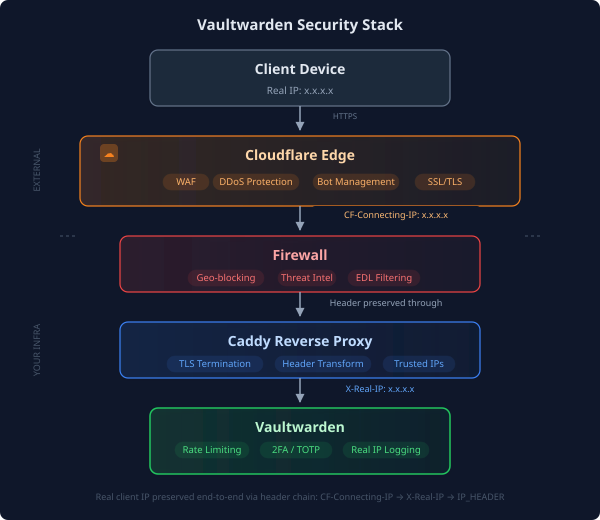

## Overview

I wanted Cloudflare's WAF, DDoS protection, and bot management in front of Vaultwarden. I also needed Vaultwarden to keep logging the client's IP so I could tell where a login came from. Here's how I set up the proxy and kept those logs useful.

**What you'll achieve:**

```text
        Client (real IP)
               ↓
Cloudflare Edge (WAF, DDoS, Bot protection)
               ↓ CF-Connecting-IP header
 Your Firewall (geo-blocking, threat intel)
               ↓
 Caddy (extracts real IP, TLS termination)
               ↓ X-Real-IP header
Vaultwarden (rate limiting, 2FA, logs real IP)
```

## Prerequisites

- Vaultwarden already running behind Caddy reverse proxy
- Domain managed by Cloudflare (DNS)
- Caddy with valid TLS certificates (Let's Encrypt/ACME)
- Basic understanding of reverse proxies

## The Problem

With Cloudflare Proxy enabled (orange cloud), traffic goes through Cloudflare's edge before it reaches your server. Check the TLS mode and the client IP header once you switch it on.

1. **SSL handshake fails** if Cloudflare tries HTTP to your origin
2. **Logs show Cloudflare's IP** unless you pass through the client IP

## Step 1: Enable Cloudflare Proxy

In your Cloudflare dashboard:

1. Go to **DNS** → Find your Vaultwarden subdomain
2. Toggle the cloud icon from **gray** (DNS only) to **orange** (Proxied)

If you see `ERR_SSL_PROTOCOL_ERROR` after toggling the proxy, check the TLS mode in Step 2.

## Step 2: Set SSL/TLS Mode to Full

In "Flexible" mode, Cloudflare tries to reach your origin over HTTP on port 80. Caddy redirects that request to HTTPS, which leaves the two sides using different protocols.

1. Go to **SSL/TLS** → **Overview**
2. Change encryption mode to **Full** or **Full (strict)**

| Mode | Behavior | Use When |
|------|----------|----------|
| Flexible | CF → Origin via HTTP | ❌ Breaks with HTTPS origins |
| Full | CF → Origin via HTTPS (any cert) | ✅ Self-signed certs |
| Full (strict) | CF → Origin via HTTPS (valid cert) | ✅ Best with Let's Encrypt |

Caddy already gets valid certificates from Let's Encrypt, so use **Full (strict)** to verify the origin certificate.

## Step 3: Configure Caddy to Trust Cloudflare IPs

Add Cloudflare's IP ranges to your Caddyfile global config so Caddy knows to look for real client IPs in headers:

```caddyfile
{
    servers {
        trusted_proxies static 173.245.48.0/20 103.21.244.0/22 103.22.200.0/22 103.31.4.0/22 141.101.64.0/18 108.162.192.0/18 190.93.240.0/20 188.114.96.0/20 197.234.240.0/22 198.41.128.0/17 162.158.0.0/15 104.16.0.0/13 104.24.0.0/14 172.64.0.0/13 131.0.72.0/22 2400:cb00::/32 2606:4700::/32 2803:f800::/32 2405:b500::/32 2405:8100::/32 2a06:98c0::/29 2c0f:f248::/32
    }
}
```

Cloudflare publishes its current IP ranges at https://www.cloudflare.com/ips/

## Step 4: Forward Real Client IP to Vaultwarden

A typical Caddy configuration uses `{remote_host}` for the client IP.

```caddyfile
# WRONG for Cloudflare-proxied traffic
reverse_proxy <YOUR_BACKEND>:80 {
    header_up X-Real-IP {remote_host}  # Shows Cloudflare's IP!
}
```

When Cloudflare proxies the request, the peer Caddy sees in `{remote_host}` is a Cloudflare edge server (for example, `162.158.x.x`).

Use Cloudflare's header to pass the client IP to Vaultwarden.

```caddyfile
# CORRECT for Cloudflare-proxied traffic
reverse_proxy <YOUR_BACKEND>:80 {
    header_up X-Real-IP {header.CF-Connecting-IP}
}
```

Cloudflare includes the client IP in `CF-Connecting-IP` on proxied requests.

## Step 5: Configure Vaultwarden to Read the Header

Add this environment variable to your Vaultwarden configuration:

```yaml
environment:
  - IP_HEADER=X-Real-IP
```

Now Vaultwarden will log the real client IP from the header Caddy forwarded.

## Step 6: Enable Vaultwarden Security Settings

Apply these Vaultwarden security settings too.

```yaml
environment:
  # Disable public registration
  - SIGNUPS_ALLOWED=false
  - INVITATIONS_ALLOWED=true

  # Rate limiting (brute force protection)
  - LOGIN_RATELIMIT_MAX_BURST=5
  - LOGIN_RATELIMIT_SECONDS=60

  # Admin panel (leave empty to disable)
  - ADMIN_TOKEN=

  # IP header for logging
  - IP_HEADER=X-Real-IP
```

## Verification

### Test 1: Access Works

```bash
curl -I https://vault.<YOUR_DOMAIN>
# Should return HTTP/2 200
```

### Test 2: Real IP Logging

1. Access Vaultwarden from your phone on cellular (not WiFi)
2. Check Vaultwarden logs:
   ```bash
   podman logs vaultwarden | grep -i login
   ```
3. The logged IP should be your phone's cellular IP, **not** a Cloudflare IP (104.x.x.x, 162.158.x.x, 172.64.x.x)

## Troubleshooting

| Symptom | Cause | Fix |
|---------|-------|-----|
| `ERR_SSL_PROTOCOL_ERROR` | SSL mode is Flexible | Change to Full or Full (strict) |
| Logs show `162.158.x.x` | Using `{remote_host}` | Change to `{header.CF-Connecting-IP}` |
| 520/521/522 errors | Origin unreachable | Check firewall allows Cloudflare IPs |
| 525 SSL handshake failed | Cert issue at origin | Verify Caddy has valid certs |

## What I Learned

### Gotcha 1: SSL Mode Matters

"Flexible" mode is for origins that only speak HTTP. If your reverse proxy provisions HTTPS certificates, use Full or Full (strict).

### Gotcha 2: Caddy Placeholders Are Tricky

The name `remote_host` sounds like the original client, but `{remote_host}` gives you the address that connected to Caddy. On the proxied path that's Cloudflare. `{header.CF-Connecting-IP}` carries the original client IP.

### Gotcha 3: Mixed Proxy Configurations

If some domains use Cloudflare Proxy (orange cloud) and others don't (gray cloud), you need different header configurations:

- **Orange cloud domains:** `{header.CF-Connecting-IP}`
- **Gray cloud / internal domains:** `{remote_host}`

## Architecture Diagram



## Final Security Stack

| Layer | Protection | Status |
|-------|-----------|--------|
| Cloudflare | WAF, DDoS, Bot management | ✅ |
| Firewall | Geo-blocking, threat intel EDLs | ✅ |
| Vaultwarden | 2FA (TOTP/WebAuthn) | ✅ |
| Vaultwarden | Login rate limiting | ✅ |
| Vaultwarden | Public signups disabled | ✅ |
| Vaultwarden | Real IP logging | ✅ |

## Why Not Cloudflare Zero Trust?

My Bitwarden/Vaultwarden mobile apps need to sync in the background. Cloudflare Access requires an interactive browser login, which breaks that sync. I keep it for browser-only services.
