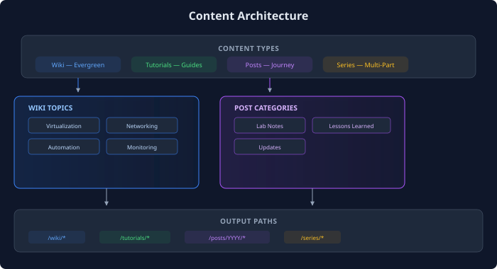
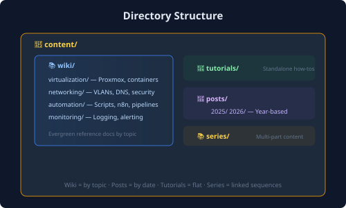
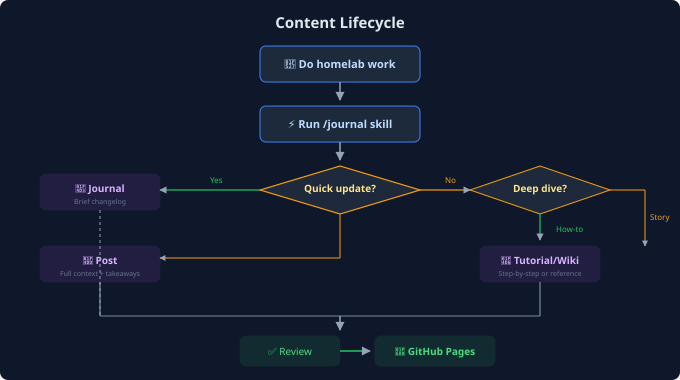

## Overview

I want to be able to find a DNS setting months after I wrote it down. I also want to follow a project in the order it happened.

- **Wiki sections** for evergreen reference content (organized by topic)
- **Blog posts** for work logs and lessons learned (organized by date)
- **Tutorials** for step-by-step guides (standalone, searchable)
- **Series** for multi-part deep dives (linked learning paths)

## Content Architecture

## Directory Structure

## Why This Structure?

### Problem: Wiki vs Blog Dilemma

A blog makes it easy to follow a project as it happens. A dated post gets harder to find when I only remember the setting I need. A wiki makes that lookup easier, but it's harder to follow the decisions and mistakes that got me there.

### Solution: Hybrid Approach

| Content Type | Organization | Purpose | Example |
|-------------|--------------|---------|---------|
| Wiki | By topic | Quick reference, "how does X work?" | "Keepalived VRRP basics" |
| Tutorial | Standalone | "How do I set up X?" | "HA Pi-hole with Keepalived" |
| Post | By date | "What happened? What did I learn?" | "The day DNS failed" |
| Series | Linked sequence | Deep dives that build on each other | "Building a Proxmox Cluster" |

## Content Lifecycle

## Design Decisions

### 1. Topic-First for Wiki

Wiki pages sit with related topics, so I can find them without remembering when I wrote them.

- All DNS stuff → `/wiki/networking/`
- All container stuff → `/wiki/infrastructure/`

### 2. Year-Based for Posts

I group posts by year so the URLs stay predictable, readers can browse a period, and I don't need deeper folders.

### 3. Flat Tutorials

Tutorials live in a single `/tutorials/` directory. Search and tags help readers find them, and I can publish a new guide without picking a subdirectory first.

### 4. Tags + Topics Taxonomy

I use tags for the kind of content and topics for the technology.

- **Tags**: Content type (`tutorial`, `lesson-learned`, `lab-note`)
- **Topics**: Technology (`proxmox`, `docker`, `networking`, `dns`)

This allows queries like "all lessons learned about DNS" or "all tutorials about Proxmox."

## Trade-offs

| Decision | Gain | Cost |
|----------|------|------|
| Hybrid structure | Topic lookup and chronological browsing | More complex to maintain |
| Flat tutorials | Easy publishing | Less topic grouping |
| Year-based posts | Stable URLs | Manual year folders |
| Dual taxonomy | Flexible queries | More tags to manage |

## What's Next

- Add more wiki reference content
- Create first tutorial (HA Pi-hole)
- Build out series for cluster setup
- Integrate with homelab automation for auto-posting
