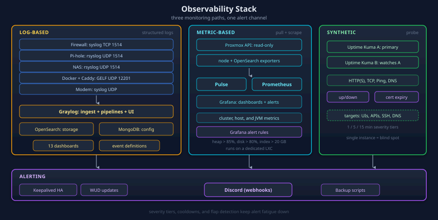
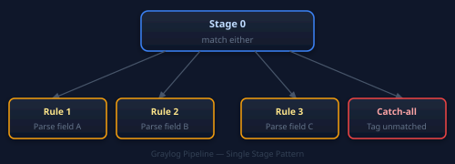
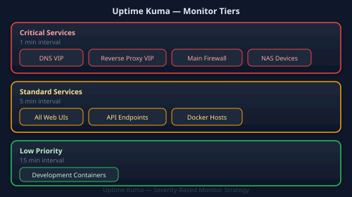
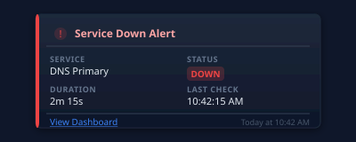

I monitor 50+ services. I send their logs to one place, use dashboards to investigate problems, and set alerts for issues I need to act on.

## Monitoring Stack



## Graylog Centralized Logging

I use [Graylog](https://graylog.org) to collect and process logs from the lab and chart what comes in.

### Architecture

| Component | Purpose | Resources |
|-----------|---------|-----------|
| **Graylog** | Web UI + log ingestion | 1 GB JVM heap |
| **OpenSearch** | Log storage + full-text search | 1 GB JVM heap |
| **MongoDB** | Configuration metadata | ~200 MB |

**Storage**: Dedicated 240 GB disk for OpenSearch indices.

OpenSearch queries run much faster when I leave ~2 GB free for the OS filesystem cache.

### Log Shipping Methods

| Transport | Port | Use Case | Example |
|-----------|------|----------|---------|
| **Syslog TCP** | 1514 | Appliance native syslog | Firewall traffic logs |
| **Syslog UDP** | 1514 | rsyslog forwarding | Pi-hole DNS, NAS |
| **GELF UDP** | 12201 | Docker container logs | Caddy, other stacks |

### GELF Docker Pattern

Docker services ship logs directly to Graylog:

```yaml
services:
  myservice:
    logging:
      driver: gelf
      options:
        gelf-address: "udp://<GRAYLOG_IP>:12201"
        tag: "service-name"
```

**Benefits:**
- Structured log fields (container name, image, etc.)
- No log rotation management
- `docker logs` still works (Docker dual logging)

To apply a new logging driver, recreate the containers with `docker compose down && up -d`. A restart keeps the old driver.

### rsyslog Forwarding Pattern


For services without native Graylog support, rsyslog forwards logs:


**Example**: Pi-hole DNS logs → rsyslog → Graylog → Dashboard.

### Active Pipelines

Each log source has a processing pipeline that extracts structured fields:

| Stream | Source | Field Prefix | Dashboards |
|--------|--------|--------------|------------|
| Pi-hole DNS | DNS servers | `dns_` | Query analysis, blocked domains |
| PAN-OS Firewall | Main firewall | `fw_` | Traffic, threats, blocked activity |
| Synology NAS | NAS devices | `syn_` | Storage, access logs |
| Caddy Proxy | Reverse proxy | `caddy_` | Request analysis |
| Internet Modem | Upstream modem | `modem_` | Connection logs |

### Pipeline Design Pattern

All pipelines use a **single-stage pattern**:



If no rule matches under `match either` in stage 0, Graylog never runs stage 1. I keep these pipelines in a single stage and use content-based exclusions.

### Index Retention

All index sets use standardized retention:

| Setting | Value |
|---------|-------|
| Min Lifetime | 30 days |
| Max Lifetime | 90 days |
| Strategy | Time-based with size optimization |
| Deletion | Automatic after max lifetime |

I can troubleshoot most incidents with 30-90 days of logs. If I need older data, the PBS backups hold the original sources.

## Dashboards

### Graylog Dashboards

13 dashboards organized by function:

| Category | Dashboards | Purpose |
|----------|------------|---------|
| **DNS** | Pi-hole Overview, DNS Security, DNS Operations | Query analysis, blocked domains |
| **Firewall** | Traffic, Threats, Blocked, URLs, Network Activity | Security visibility |
| **Infrastructure** | Homelab Security Overview | Cross-service summary |
| **Proxy** | Caddy Overview | Request analysis |

Python scripts build the dashboards through the Graylog REST API. I keep those scripts in version control so I can reproduce the dashboards when I deploy them again.

### Pulse (Proxmox Monitoring)

[Pulse](https://github.com/relliky/proxmox-pulse) provides Proxmox-specific metrics:

| Metric | Visualization |
|--------|---------------|
| CPU usage (per node) | Time series graph |
| RAM usage (per node) | Time series graph |
| Disk usage | Bar charts |
| Network I/O | Time series graph |
| VM/LXC status | Status cards |

**Integration**: Read-only Proxmox API user (`pulse@pve` with PVEAuditor role).

## Uptime Monitoring

### Uptime Kuma

Two Uptime Kuma instances for redundant availability monitoring:

| Instance | Purpose |
|----------|---------|
| UTK-A | Primary monitoring |
| UTK-B | Secondary (monitors UTK-A too) |

If UTK-A goes down, UTK-B can still send an alert. With one instance, I'd lose the monitor and its alerts at the same time.

### Monitor Types

| Type | Use Case | Example |
|------|----------|---------|
| **HTTP(S)** | Web services | Graylog UI, Proxmox API |
| **TCP Port** | Raw connectivity | SSH, database ports |
| **Ping** | Basic availability | Network devices |
| **DNS** | Resolution check | Pi-hole health |

### Monitor Strategy



## Alerting

### Discord Integration

All monitoring sends alerts to Discord:



### Alert Sources

| Source | Alert Types |
|--------|-------------|
| **Uptime Kuma** | Service down/up, certificate expiry |
| **Graylog** | Log-based alerts (high error rate, security events) |
| **Keepalived** | HA failover notifications |
| **WUD** | Container update availability |
| **Backup scripts** | Backup success/failure |

### Alert Fatigue Prevention

**Strategies to avoid noise:**

1. **Severity tiers**: Only critical alerts wake me up
2. **Cooldown periods**: 30-minute minimum between repeat alerts
3. **Flap detection**: Ignore rapid up/down cycles (usually transient)
4. **Maintenance windows**: Suppress alerts during planned work

## Network Discovery

### Pi.Alert

Scans subnets every 5 minutes for device discovery:

| Feature | Purpose |
|---------|---------|
| New device detection | Alert on unknown devices |
| MAC tracking | Identify device moves |
| Port scanning | Discover services |
| Vendor lookup | Identify device types |

**Monitored subnets**: Management VLAN, Server VLAN.

## Observability Patterns

### Log-Based Monitoring

```text
Application → Graylog → Stream → Alert Condition → Discord
```

**Example**: "More than 10 DNS query failures in 5 minutes" → Alert.

### Metric-Based Monitoring

```text
Service → Prometheus/API → Pulse/Dashboard → Threshold → Alert
```

**Example**: "Proxmox node CPU > 90% for 5 minutes" → Alert.

### Synthetic Monitoring

```text
Uptime Kuma → Scheduled Request → Service → Response Check → Alert
```

**Example**: "Graylog /api/system/lbstatus doesn't return ALIVE" → Alert.

## Lessons Learned

### 1. JVM Heap Pinning

Graylog and OpenSearch both run on JVMs. Without explicit heap limits, they compete for RAM and starve the OS filesystem cache. **Always pin JVM heap:**

```yaml
GRAYLOG_SERVER_JAVA_OPTS: "-Xms1g -Xmx1g"
OPENSEARCH_JAVA_OPTS: "-Xms1g -Xmx1g"
```

### 2. Graylog 7 API Gotchas

Graylog 7 changed its REST API significantly:

| Issue | Solution |
|-------|----------|
| `entity cannot be null` | Wrap body in `{"entity": <payload>}` |
| Regex capture groups | 0-indexed: `m["0"]` = first group |
| Stream creation | Requires explicit `index_set_id` |
| Dashboard series format | Use search_type format, not widget format |

### 3. Log Retention Balance

With short retention, I lose the logs I need to investigate older incidents. Keeping them too long fills the disk and slows queries. In my lab, 30-90 days works.

### 4. Redundant Monitoring

UTK-B checks UTK-A so I still get an alert if UTK-A stops responding.

### 5. Pipeline Rules Only Apply at Ingestion

Graylog pipeline rules process messages **at ingestion time only**. Changing a rule doesn't reprocess existing logs. For historical data, you must re-send the logs or query raw fields.

## Quick Reference

### Graylog API

```bash
# Health check
curl http://<GRAYLOG_IP>:9000/api/system/lbstatus

# List streams
curl -u admin:<PASSWORD> http://<GRAYLOG_IP>:9000/api/streams

# Search logs
curl -u admin:<PASSWORD> "http://<GRAYLOG_IP>:9000/api/views/search/messages?query=source:firewall"
```

### Log Shipping Test

```bash
# Test syslog UDP
echo "<14>Test message from $(hostname)" | nc -u <GRAYLOG_IP> 1514

# Test GELF
echo '{"short_message":"Test","host":"test"}' | nc -u <GRAYLOG_IP> 12201
```

## Related Pages

- [Networking](../networking/) - Log sources (firewall, DNS)
- [Infrastructure](../infrastructure/) - Where monitoring runs
- [Automation](../automation/) - Alert automation
