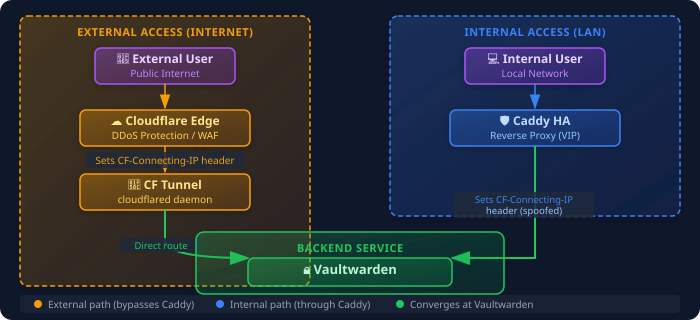
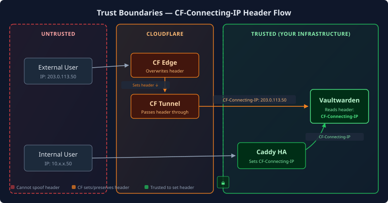

## Overview

I check the IP in Vaultwarden's "New Device Login" email to see where someone accessed my vault. That only works if the alert shows the client IP. Cloudflare Tunnel and my internal reverse proxy used different headers to pass it along, so I configured both paths to use the same header.

## The Problem

After migrating Vaultwarden's external access from Cloudflare Proxy (orange cloud DNS) to Cloudflare Tunnel with direct backend routing, my "New Device Login" alerts started showing the tunnel container's IP instead of the real client IP.

**Before (broken):**
```text
New device logged in:
  IP: <TUNNEL_IP>  ← Wrong! This is my tunnel container
  Device: Chrome on Windows
```

**After (fixed):**
```text
New device logged in:
  IP: 203.0.113.50  ← Correct! Real public IP
  Device: Chrome on Windows
```

## Architecture

External and internal requests take separate routes.



### Why Direct Tunnel Routing?

I route Cloudflare Tunnel traffic directly to Vaultwarden. If Caddy breaks because of an NFS mount failure or configuration drift, I can still reach my password manager from outside the lab. Skipping Caddy also removes a network hop and a possible point of failure. The part I had to configure separately was how each path passes the client IP.

## The IP Header Strategy

### The Challenge

| Traffic Path | Header Source | Original Header |
|--------------|---------------|-----------------|
| External (CF Tunnel) | Cloudflare Edge | `CF-Connecting-IP` |
| Internal (Caddy) | Caddy | `X-Real-IP` |

Vaultwarden reads the header named in `IP_HEADER`. If the two paths send different headers, only one path logs the client IP consistently.

### The Solution

I use `CF-Connecting-IP` on both paths.

External traffic already has this header set by Cloudflare. For internal traffic, configure Caddy to set the same header:

```caddy
vault.loc.<YOUR_DOMAIN> {
    reverse_proxy http://<VAULTWARDEN_IP>:80 {
        header_up CF-Connecting-IP {remote_host}
    }
}
```

Then configure Vaultwarden to read it:

```bash
IP_HEADER=CF-Connecting-IP
```

## Security Considerations

### Trust Boundaries




Only trusted components should set the `CF-Connecting-IP` header:

- **Cloudflare Edge**: Overwrites any incoming `CF-Connecting-IP` header (prevents spoofing)
- **Your reverse proxy**: Only receives traffic from trusted sources

External requests **cannot** spoof this header because:
1. Cloudflare overwrites it at the edge
2. Direct access to Vaultwarden is blocked at the firewall
3. The tunnel only accepts authenticated Cloudflare traffic

### Why This Matters for Password Managers

Accurate IP logging enables:
- **Login alerts**: Know where access attempts originate
- **Audit trails**: Security investigations need real IPs
- **Rate limiting**: Per-client-IP rate limits actually work
- **Future geo-blocking**: Block entire regions if needed

## Failover Behavior

Each path fails over independently.

| Failure | External Impact | Internal Impact |
|---------|-----------------|-----------------|
| CF Tunnel down | Fails over to replica (<10s) | None |
| Caddy down | None | Fails over via VRRP (~2s) |
| Both Caddy nodes down | None | Internal access down |

## Rollback Plan

If issues arise, the previous configuration is documented inline:

```bash
# Vaultwarden .env
# Previous: IP_HEADER=X-Real-IP
IP_HEADER=CF-Connecting-IP

# Caddy config
# Previous: header_up X-Real-IP {remote_host}
header_up CF-Connecting-IP {remote_host}
```

Uncomment the previous lines and restart services to revert.

## Key Takeaways

1. **Direct routing for critical services**: Don't chain your password manager through unnecessary proxies
2. **Unified headers**: Pick one header name and configure all traffic paths to use it
3. **Trust boundaries matter**: Only let trusted components set client IP headers
4. **Document rollback**: Keep previous config commented for emergency reversion
5. **Test from external**: Always verify IP logging works from outside your network

## What I'd Do Differently

I'd add the shared header to my service onboarding checklist. I'd also consider writing down the Cloudflare Tunnel routing earlier. I only realized it was routing directly to Vaultwarden when I started debugging.
